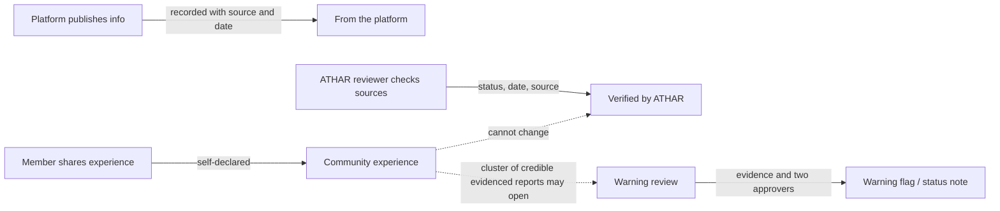
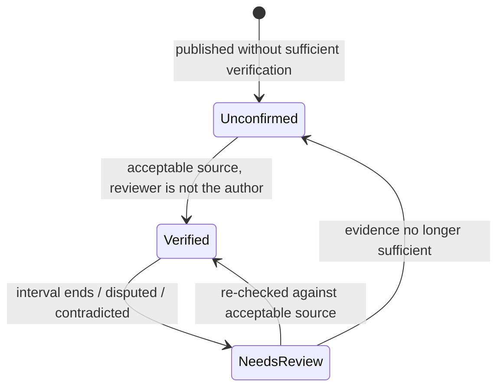

# ATHAR — Product Requirements Document (PRD)

> Suggested location: `docs/01-product/PRD.md`

---

## 1. Document Information

| Field | Value |
| --- | --- |
| **Document title** | ATHAR Product Requirements Document (PRD) |
| **Version** | 1.0 (draft) |
| **Status** | Draft for product-owner review. The source baseline is approved; this PRD is a derivative and is not itself approved until the product owner signs it off. |
| **Date** | 12 November 2026 |
| **Purpose** | Translate the approved product and UX decisions into testable, implementation-ready functional and non-functional requirements for V1. |
| **Source of truth** | *ATHAR Product & UX Decisions v1.2 — Approved Baseline* (referred to as "the baseline"). |
| **Intended audience** | Product owner, designers, developers, AI coding agents, QA, moderation and verification leads, legal counsel (for [L] items). |
| **Related documents** | The baseline only. Other documents in the ATHAR documentation set are not available at the time of writing and are not referenced. |

### 1.1 Change history

| Version | Date | Author | Summary |
| --- | --- | --- | --- |
| 1.0 | 2026-11-12 | Product documentation | First PRD derived from baseline v1.2. Records source conflicts (§15.1) and open decisions (§15.2). |

### 1.2 Reading conventions

| Convention | Meaning |
| --- | --- |
| **Source tags** | `CD-###` confirmed decision; `RD-##` approved working default (approved as the V1 baseline by CD-209); `CH-##` correction; `OQ-##` baseline open question; `FR-##`/`§` baseline requirement or section. |
| **[L]** | Legal matter for qualified Egyptian counsel. A product assumption only, not legal advice. |
| **[F]** | Pilot assumption. Numbers marked [F] are initial operational settings to calibrate during the pilot, not fixed commitments (baseline §0, CD-209). |
| **Approved** | Traceable to a CD or RD entry in the baseline. |
| **PRD-REC** | A recommendation by this PRD that is *not* in the baseline. It is never a requirement until approved. |
| **OPEN DECISION (OD-##)** | An unresolved, ambiguous or contradictory point. See §15. |
| **Conflict (SC-##)** | A contradiction inside the baseline. See §15.1. |
| **Requirement IDs** | `FR-<MODULE>-###` (functional), `BR-###` (business rule), `NFR-<AREA>-###` (non-functional), `US-##` (user story). These are new and independent of the baseline's `FR-##` numbers; the mapping is in §17. |

### 1.3 Source precedence applied by this PRD

The baseline contains stale text that contradicts later founder decisions. This PRD applies the following order and records every instance in §15.1 rather than resolving anything silently:

1. Founder decisions CD-201 to CD-210 (§2.3) take precedence over earlier wording, as CD-209 states ("except where CD-201 to CD-208 or the corrections in §10.5 change them").
2. Corrections CH-01 to CH-09 (§10.5), except CH-06, which CD-205 reverses.
3. All other baseline text.

Where precedence does not settle a conflict, the item is an OPEN DECISION and the affected requirement says so.

---

## 2. Product Overview

### 2.1 What ATHAR is

ATHAR (أثر) is an Arabic-first, Egypt-first platform that helps people discover digital work platforms, evaluate them through trustworthy information and real experiences, track their own journey, and contribute knowledge that helps others (baseline §1.2). Its primary motivation is social impact and leaving a positive legacy, not monetization.

Identity (approved, reproduced exactly):

- **Name:** ATHAR – أثر
- **Slogan:** من أثرٍ جئنا، وإلى أثرٍ نمضي.
- **Supporting message:** ابدأ بخطوات اللي سبقوك، وسيب خطوات يستفيد منها اللي بعدك.

### 2.2 Problem solved and why it matters

The baseline does not contain a separate problem statement or user research. The following is derived only from the approved vision, principles and risk-driven rules, and makes no claims about market size or user behavior:

- People interested in digital work in Egypt need to find platforms, understand whether those platforms are available to Egyptians, how registration, tests, and payment work, and whether other people had real experiences with them.
- The baseline's design (per-fact verification, Warning procedure, scam and link controls, evidence-before-labeling rule) implies that unreliable or stale information and scam risk are the harms ATHAR is built to reduce.
- A person's own progress (platforms followed, applications, earnings) is otherwise scattered; ATHAR provides a private tracking space.
- Experience gained by earlier participants is lost unless it is captured; ATHAR captures it as verified facts and reviews, not feeds (§1.6).

### 2.3 Target users

People interested in digital work in Egypt: trainees of initiatives such as DEPI and Digital Egypt Pioneers, beginners and professionals in freelancing, remote work and AI-model training, and anyone seeking trustworthy digital platforms and opportunities (CD-002, §1.4). **No partnership, endorsement or official relationship with any initiative is claimed or implied** (§1.4, RD-J5).

### 2.4 Main user needs

| # | Need | Satisfied by (PRD module) |
| --- | --- | --- |
| 1 | Find platforms relevant to me | FR-DIR, FR-SRCH, FR-FILT |
| 2 | Know whether a platform is available to Egyptians and how it works | FR-PLAT, FR-VER, FR-STAT |
| 3 | Know how fresh and well-sourced each fact is | FR-SRC, FR-VER |
| 4 | Learn from people who actually used the platform | FR-XP, FR-REV, FR-RAT |
| 5 | Ask, share and learn in a safe group space | FR-COM, FR-MEM, FR-CHAT |
| 6 | Track my own platforms, applications and earnings privately | FR-MYA, FR-MYP, FR-APP, FR-ERN |
| 7 | Keep a personal list of platforms to revisit | FR-FAV |
| 8 | Contribute corrections and new platforms | FR-SUG, FR-COR |
| 9 | Stay safe from scams and abuse | FR-RPT, FR-MOD, FR-APL |
| 10 | Control my data | FR-PRIV, FR-DEXP, FR-DEL |

### 2.5 Core product value

Core loop (descriptive, baseline §1.5): discover a platform → evaluate through verified facts and real experiences → act and track progress → contribute reviews and corrections → leave a trace for the next person.

### 2.6 Positioning

ATHAR is a trust and verification system plus a community knowledge resource for digital work in Egypt. The core experience is free. There is no paid ranking, paid placement or sale of user data (CD-021, §1.6).

### 2.7 What ATHAR is not (CD-001, §1.3)

| ATHAR is | ATHAR is not |
| --- | --- |
| A platform discovery and information resource | A job marketplace |
| A trust and verification system | A hiring or recruitment platform |
| A personal journey-tracking tool | A traditional social network |
| A community knowledge-sharing environment (group chat) | A feed, a follower graph, a messaging app, a course marketplace, or a directory with paid promotion |

---

## 3. Product Vision and Principles

### 3.1 Vision and mission

- **Vision:** as in §2.1. Social impact and legacy over monetization (§1.2).
- **Mission:** the About page carries "mission and vision" (CD-018). The baseline does not provide a separate mission sentence. **PRD-REC:** use the vision text as the working mission statement until the About copy is drafted (see OD-12).

### 3.2 Core values and principles

| # | Principle | Source | Practical consequence |
| --- | --- | --- | --- |
| P1 | The core experience is free | CD-021, §1.6 | No paywall on any V1 feature. |
| P2 | No paid ranking, paid placement, or selling of user data | CD-021, §1.6, RD-A9 | Featured and sort order are rule-driven; no sponsored slots. |
| P3 | Trust, transparency and knowledge sharing come first | §1.6 | Every fact shows source, date, status. |
| P4 | Evidence over opinion | CD-112, §1.6 | A platform is never labeled fraudulent on a negative review alone. |
| P5 | Arabic-first, full RTL | CD-020 | See NFR-LOC, NFR-RTL. |
| P6 | No unnecessary social-network mechanics | §1.6, CD-110 | No feeds, followers, DMs, posts, comments. |
| P7 | Privacy by default | CD-014, §1.6 | Profiles private; earnings, applications and detailed progress always private. |
| P8 | Knowledge persists in verified facts and reviews, not feeds | §1.6 | Community value is retained via platform pages and chat history for members. |

### 3.3 Trust and transparency principles

- Per-fact source, verification date, status and reviewer (CD-010, RD-B1).
- Three labeled information layers (RD-B3, CD-210).
- Stale facts remain visible as *Needs Review* with their last verified date; nothing is silently removed (RD-B5, §7.1).
- Moderation notices state the reason and appeal path (RD-D9, §7.8).
- The system never generates the words "fraud" or "scam"; any such wording needs second-person approval and legal review [L] (RD-B8).

### 3.4 Privacy principles

Private-by-default profiles, optional per-field visibility, admins cannot view any individual member's earnings, applications, notes or tracking (RD-F10), user data is never sold, no third-party advertising trackers (§8.1), aggregate small-group-suppressed analytics (§8.6).

### 3.5 Arabic-first and RTL principles

Interface Arabic-first and fully RTL; Latin platform and brand names must render correctly inside RTL text; English is limited to such names; no English localization in V1 (FR-95 baseline, CD-022). Tone: warm Egyptian colloquial for invitations, encouragement and empty states; plain Modern Standard Arabic for legal text, security messages, verification statuses, moderation notices and precise errors (RD-I6).

### 3.6 Community participation principles

Communities are members-only group chats, not social networks (CD-110). Open membership: any registered member joins any open community immediately, with no approval (CD-206). An account is required to send messages so contributions are attributable. Guests see public community information only (CD-105).

### 3.7 Free-access principles

See P1 and P2. Funding model is an external question (OQ-16) and is not blocking V1; any future funding must respect no paid ranking, no paid placement, no data selling.

### 3.8 Product boundaries

V1 boundaries are the exclusions in §11. ATHAR gives no legal, tax or financial advice (OQ-06, RD-E6).

---

## 4. Target Audience and User Personas

The baseline defines the audience in one sentence (§1.4) and contains no research. The personas below are **illustrative archetypes derived only from that sentence and from approved features**. They contain no demographics, statistics or behavioral claims and must not be quoted as research findings.

### 4.1 Persona P-A — The initiative trainee

| Aspect | Description |
| --- | --- |
| Background | Participant in a digital skills initiative of the kind named in §1.4 (e.g., DEPI). *No affiliation is implied.* |
| Goals | Find platforms where newly learned skills can be applied; understand how to start. |
| Main problems | Unclear which platforms accept Egyptians; unclear registration and test requirements; uncertainty about trustworthiness. |
| Expected usage | Browse directory, compare platforms, read verified facts, join the platform's community, track progress after starting. |
| Important needs | Clear Arabic information; availability in Egypt; safe community; low-friction start. |
| Relevant features | FR-DIR, FR-FILT, FR-CMP, FR-PLAT, FR-COM, FR-MYP |

### 4.2 Persona P-B — The curious beginner

| Aspect | Description |
| --- | --- |
| Background | Person with little or no digital-work experience, exploring fields. |
| Goals | Discover fields and platforms they did not know about (approved Fields copy). |
| Main problems | Does not know where to start or which platforms suit them. |
| Expected usage | Homepage categories, search, filters by experience level ("Beginner-friendly"), Help Center. |
| Important needs | Plain-language guidance, no account needed to browse, a first-time starting-points screen. |
| Relevant features | FR-HOME, FR-SRCH, FR-FILT, FR-HELP, FR-MYA (first-time state) |

### 4.3 Persona P-C — The working digital worker

| Aspect | Description |
| --- | --- |
| Background | Freelancer, remote worker or AI-model trainer already working on or applying to platforms. |
| Goals | Track applications and earnings; check platform changes; share experience. |
| Main problems | Scattered records; platform terms and payment conditions change; multiple currencies. |
| Expected usage | My Platforms, My Applications, My Earnings with exports, reviews, notifications on platform changes. |
| Important needs | Privacy of earnings; honest currency conversion; timely notice of important platform updates. |
| Relevant features | FR-MYP, FR-APP, FR-ERN, FR-REV, FR-NOT, FR-COR |

### 4.4 Persona P-D — The contributor

| Aspect | Description |
| --- | --- |
| Background | Member motivated by leaving a trace for others. |
| Goals | Write reviews, suggest corrections and new platforms, help in communities. |
| Main problems | Wants contributions to be recognized and acted on without being exposed. |
| Expected usage | Reviews, edit suggestions, new-platform suggestions, My Contributions, optional public profile. |
| Important needs | Clear suggestion outcomes with reasons; control over identity (display name, "Former member"). |
| Relevant features | FR-REV, FR-SUG, FR-COR, FR-PROF, FR-NOT |

### 4.5 Persona P-E — The cautious evaluator (guest)

| Aspect | Description |
| --- | --- |
| Background | Visitor deciding whether a platform is safe, without creating an account. |
| Goals | Understand verified facts, freshness, Warning flags and community experience before acting. |
| Main problems | Fear of scams; cannot tell facts from opinion. |
| Expected usage | Platform Details, comparison, reviews (read-only), community information pages. |
| Important needs | Clear separation of the three information layers; visible Warning banners; reports visible as neutral wording. |
| Relevant features | FR-PLAT, FR-SRC, FR-VER, FR-STAT, FR-XP, FR-CMP |

Staff personas (Content Admin, Community Moderator, Super Admin) are defined as roles in §5.

---

## 5. User Roles and Permissions

### 5.1 Role catalog

The baseline defines these roles (§6.1). No additional roles are defined, and none are added here.

| Role | Type | Responsibilities | Source |
| --- | --- | --- | --- |
| **Guest** | Public | Browse, search, filter, compare, read public information. | CD-013 |
| **Member — email unverified** | Registered | Personal tools (tracking, applications, earnings, favorites) and account management. | §6.2 |
| **Member — email verified** | Registered | Everything above, plus community access, reviews, suggestions and reports (subject to SC-02, SC-05). | §6.2 |
| **Community Moderator** | Staff | Chat conduct, reports on messages and accounts, pins, locks, domain blocklist, temporary sanctions. Global scope in V1. | CD-019, RD-D3 |
| **Content Admin** | Staff | Platform content, vocabularies, verification, edit suggestions, review moderation, Help Center, support inbox. | CD-019 |
| **Super Admin** | Staff | Everything, including roles, bans, suspension, appeals (final), data requests, settings, platform-wide notices, archive of communities. | CD-019 |

Staff accounts require mandatory two-factor authentication (RD-F8). Staff are attributed to members by role ("ATHAR Moderation"), not by name (RD-H6); staff posting in chat show a visible role badge.

**Account states (not roles):** *Restricted* (muted, temporarily restricted, suspended or banned — RD-D9; suspended users can sign in to a restricted view to appeal, RD-D10) and *Deletion pending* (14-day grace period, RD-F4).

### 5.2 Guest and member capabilities (baseline §6.2)

| Capability | Guest | Member, unverified | Member, verified |
| --- | --- | --- | --- |
| Browse directory, platform details, comparison, About, Help | Yes | Yes | Yes |
| See community public information | Yes | Yes | Yes |
| Save/favorite, track platforms, record applications and earnings | No | Yes | Yes |
| Optional public profile, data export, account deletion | No | Yes | Yes |
| Join a community, read and post in chat | No | **No — conflict SC-02** | Yes |
| Write a review | No | No | Yes |
| Suggest an edit or a new platform | No | No | Yes |
| Report a message, review, platform or account | No | No | Yes — conflict SC-05 |

> **Conflict notice.** CD-206, RD-D2 and RD-D4 state that joining and chatting require no email verification, which contradicts the "No" in the unverified column above and RD-F8. Until the product owner resolves OD-02, this PRD documents CD-206 (the later, explicit founder decision) in FR-MEM and FR-CHAT and flags the dependency. Verified-email requirements for reviews, suggestions and reports are retained (RD-C3 explicitly keeps the review email rule separate from community access), except where OD-04 applies.

### 5.3 Staff permission matrix (baseline §6.3, working rule RD-H1)

| Area | Super Admin | Content Admin | Community Moderator |
| --- | --- | --- | --- |
| Admin Overview | Everything | Content queues | Moderation queues |
| Create, edit, publish platforms | Yes | Yes | No |
| Set or lift Warning flag; move to Suspended or closed | Yes, as approver | Yes, with a second approver (RD-B9) | No |
| Featured selections | Yes | Yes | No |
| Categories and the four other vocabularies | Yes | Yes | No |
| Verify fact items | Yes | Yes, not their own entries | No |
| Edit suggestions and new-platform submissions | Yes | Yes | No |
| Review moderation (hide, remove, restore) | Yes | Yes | Hold only, pending Content Admin decision (see SC-06) |
| Community description, rules summary, pins, locks | Yes | View only | Yes |
| Archive a community | Yes | No | No |
| Chat moderation (remove, mute, slow mode) | Yes | No | Yes |
| Domain blocklist | Yes | No | Yes |
| Report queues | All | Reviews and platform information | Messages and accounts |
| Temporary sanctions (mute; restriction up to 30 days) | Yes | No | Yes |
| Suspension and permanent ban | Yes | No | Recommend only |
| Appeals | Final decision | Content decisions, never their own | Conduct decisions, never their own |
| User and role management | Yes | No | No |
| View a member's email and personal data | Yes, minimum necessary | No | No |
| View an individual member's earnings, applications or tracking | **No one** | **No one** | **No one** |
| Process data export and deletion requests | Yes | No | No |
| Analytics | Full aggregates | Content analytics | Moderation analytics |
| Settings: thresholds, legal pages | Yes | No | No |
| Help Center content | Yes | Yes | No |
| Support and contact inbox | Yes | Yes | No |
| Platform-wide notices | Yes | No | No |
| Audit Log | Read all | Own actions | Own actions |

### 5.4 Governance rules attached to roles

Least privilege; authors of a fact do not verify it; two-person rule for Warning set/lift, move to Suspended or closed, and Egypt-availability changes on a Featured platform (RD-B9); no one grants their own role; only Super Admins issue permanent bans and grant roles; appeals reviewed by a different person than the decider; re-authentication for role changes, bans, bulk deletions, settings changes and data requests; no "sign in as user"; no bulk export of member data by staff; quarterly role review; conflict-of-interest declarations (staff may not verify, feature or moderate reviews for platforms they are affiliated with); at least two Super Admins before launch (RD-H3 to RD-H5). Email addresses are visible only to Super Admins (RD-F10).

### 5.5 Permissions that are unclear in the baseline

| Item | Status |
| --- | --- |
| Who may unpublish a platform (baseline lists create, edit, publish only; merge is Super Admin only, §7.3) | OPEN — OD-09 |
| Who may restore a Content Admin-removed review after appeal | Partially covered by appeals row; no explicit restore rule beyond "hide, remove, restore" — covered by OD-06 |
| Whether Community Moderator "remove" in RD-C3 means Content Admin only | OPEN — SC-06 / OD-06 |
| Two-factor method for staff (app, SMS, etc.) | OPEN — OD-14 |

---

## 6. Functional Requirements

### 6.0 How to read this catalog

- Every feature below is **V1** and supported by the cited baseline decisions. Nothing from the deferred list (§11) is included.
- The baseline defines no priority tiers inside V1. **V1 priority** is therefore stated as "V1 — required" for every feature; finer prioritization is OPEN (OD-11).
- Acceptance criteria are written as numbered, testable statements (`AC-n`). Numeric limits are the baseline's initial settings and carry [F] where the baseline marks them so.
- "Permission" columns use the roles in §5. Where a conflict affects a feature, the row says so.
- Standard states (loading, empty, error, success) apply to every list and form (baseline FR-98, §10.4). They are specified per feature only where the baseline gives specifics.

**Module index**

| Module | Prefix | Section |
| --- | --- | --- |
| Homepage | FR-HOME | 6.1 |
| Platform Directory | FR-DIR | 6.1 |
| Platform Search | FR-SRCH | 6.1 |
| Search Filters | FR-FILT | 6.1 |
| Platform Comparison | FR-CMP | 6.1 |
| Platform Details | FR-PLAT | 6.2 |
| Platform Information Sources | FR-SRC | 6.2 |
| Verification Information | FR-VER | 6.2 |
| Platform Status | FR-STAT | 6.2 |
| Community Experiences | FR-XP | 6.3 |
| User Reviews | FR-REV | 6.3 |
| Rating Calculations | FR-RAT | 6.3 |
| Communities | FR-COM | 6.4 |
| Community Membership | FR-MEM | 6.4 |
| Community Chat | FR-CHAT | 6.4 |
| Chat History Search | FR-CHS | 6.4 |
| Message Editing and Deletion | FR-MSG | 6.4 |
| Reporting and Safety | FR-RPT | 6.5 |
| Moderation | FR-MOD | 6.5 |
| Appeals | FR-APL | 6.5 |
| My ATHAR | FR-MYA | 6.6 |
| My Platforms | FR-MYP | 6.6 |
| Favorites | FR-FAV | 6.6 |
| Applications | FR-APP | 6.6 |
| Earnings | FR-ERN | 6.6 |
| Contributions | FR-CON | 6.6 |
| Notifications | FR-NOT | 6.6 |
| Platform Suggestions | FR-SUG | 6.7 |
| Platform Information Corrections | FR-COR | 6.7 |
| Help Center and Supporting Pages | FR-HELP | 6.7 |
| User Profiles | FR-PROF | 6.8 |
| Account Management | FR-ACC | 6.8 |
| Privacy Settings | FR-PRIV | 6.8 |
| Data Export | FR-DEXP | 6.8 |
| Account and Data Deletion | FR-DEL | 6.8 |
| Administration | FR-ADM | 6.9 |

---

### 6.1 Discovery

#### FR-HOME-001 — Homepage

| Field | Specification |
| --- | --- |
| Description | Public landing page with the sections in the approved order (CD-004, §10.1, CH-01). |
| User goal | Understand ATHAR quickly and start discovering. |
| Preconditions | None. Works for guests and signed-in members. |
| Main behavior | Sections in order: (1) sticky navbar that shrinks slightly on scroll; (2) hero with slogan, supporting message and main search using the approved prompt "بتدور على بداية جديدة؟"; (3) Digital Work Categories with the approved Fields copy; (4) Featured Platforms with the approved Platforms copy (rules in FR-DIR-002); (5) **Active Communities** (3–6 cards: General first, then communities with most weekly activity, with at least 5 active members that week [F], then communities of featured platforms; one slot may be pinned by a Super Admin or Moderator; each card shows name, short description, member count, coarse activity indicator, Join or Open); (6) User Journey (static marketing explainer, no personal data, same for everyone); (7) short About with the approved Philosophy copy and link to About; (8) footer. |
| Alternative flows | Signed-in: navbar shows bell and profile menu; User Journey is replaced by a compact "Continue your journey" card linking to My ATHAR, or a starting-points card for members with no activity; joined communities show "Open". Pools empty at launch: show fewer cards, never unqualified ones (RD-A9). |
| Validation rules | Active Communities **never** shows message text, authors, individual-message timestamps or previews. The optional aggregate line shows only above a minimum threshold of 20 [F]. No personalized feed. |
| Success conditions | All sections render with approved copy; no discussion content appears. |
| Failure conditions | A section's data fails to load → that section shows an error with retry; the rest of the page remains usable. |
| Permissions | Everyone. |
| Dependencies | FR-DIR, FR-COM, FR-MYA, FR-HELP. |
| V1 priority | V1 — required. |
| Acceptance criteria | AC-1: Sections appear in the order above. AC-2: No Active Communities card contains message text, author or message timestamp. AC-3: Hero prompt and approved copy match the baseline exactly. AC-4: A signed-in member sees the compact journey card instead of the User Journey section. AC-5: The public homepage remains reachable when signed in; default post-sign-in destination is My ATHAR (RD-I3). |

#### FR-DIR-001 — Platform Directory (listing)

| Field | Specification |
| --- | --- |
| Description | Browsable, sortable list of published platforms (CD-007, RD-A4, RD-A5). |
| User goal | See and scan available platforms. |
| Preconditions | None. |
| Main behavior | Grid and list views; result count; pagination; sort by rating, newest additions, last verification, popularity. Default sort is Relevance when a search term exists, otherwise Popularity. Ties break by fresher verification, then Arabic alphabetical order. Platforms in *Suspended or closed* are excluded from default listings and top rating-sort positions unless the user selects that state, but stay reachable by direct link and name search. Each card shows name, categories, availability state, Warning badge when present, headline rating or "Not enough reviews yet", last verification date, and a Favorite action (label and behavior per CD-205; see OD-01). |
| Alternative flows | Zero results → approved copy "لسه ملقيناش اللي بتدور عليه، جرّب مجال تاني." with a clear-filters action. Loading → placeholder cards. Error → retry. |
| Validation rules | *Newest additions* sorts by publication date. *Last verification* uses the platform-level date = oldest verification date among core facts (RD-B2). *Popularity* = distinct registered users who started tracking the platform or joined its community in the last 90 days [F], each user once, page views excluded (RD-A7; see OD-16). |
| Success conditions | Correct ordering and counts for any filter/sort combination. |
| Failure conditions | Backend failure → error state with retry; no partial misleading list. |
| Permissions | Everyone; Favorite action requires an account. |
| Dependencies | FR-FILT, FR-SRCH, FR-RAT, FR-VER, FR-STAT, FR-FAV. |
| V1 priority | V1 — required. |
| Acceptance criteria | AC-1: Each of the four sorts orders results as defined. AC-2: A Suspended-or-closed platform is absent from default listings and present when its state is selected. AC-3: A card with fewer than 3 qualifying reviews shows "Not enough reviews yet", not a star average. AC-4: Zero-result search shows the approved copy exactly. AC-5: Pagination preserves active filters and sort. |

#### FR-DIR-002 — Featured Platforms rules

| Field | Specification |
| --- | --- |
| Description | Homepage featured mix of admin picks, highly rated, and recently added (CD-004, RD-A9). |
| User goal | See trustworthy, current platforms first. |
| Preconditions | Eligible platforms exist. |
| Main behavior | About 6 slots (adjustable in design): 2 admin-selected, 2 highly rated, 2 recently added; refreshed daily; rotated within eligible pools. Eligibility: published; availability *Available* or *Available with restrictions*; no Warning flag; Class 1 facts within their review interval. Highly rated pool: top evidence-weighted score with at least 5 qualifying reviews. Recently added pool: published within 30 days and verified. Admin picks last at most 30 days before re-confirmation and are logged. |
| Alternative flows | Empty pool → fewer cards. |
| Validation rules | No sponsorship, payment or undisclosed placement. Overdue Class 1 timing is conflicted (SC-07 / OD-05). |
| Success / failure | Only eligible platforms appear. A platform that becomes ineligible is removed at next refresh at latest; see OD-05 for immediacy. |
| Permissions | Selection: Content Admin, Super Admin. |
| Dependencies | FR-VER, FR-STAT, FR-RAT, FR-ADM. |
| V1 priority | V1 — required. |
| Acceptance criteria | AC-1: No platform with a Warning flag appears. AC-2: Admin picks older than 30 days without re-confirmation drop out. AC-3: Every admin pick is recorded in the audit log. AC-4: With no eligible "highly rated" platforms, those slots are not filled by lower-qualified ones. |

#### FR-SRCH-001 — Platform Search

| Field | Specification |
| --- | --- |
| Description | Hero and directory search over platforms only (CD-005, RD-A8). |
| User goal | Find a platform or work type by typing. |
| Preconditions | None. |
| Main behavior | Searches by platform name, category, work type and payment method. Before typing: popular work types and categories. While typing: grouped suggestions (platforms, work types, payment methods, categories). Choosing a platform opens it; choosing a term opens the directory with that term applied. Communities are searched only in Browse Communities. |
| Alternative flows | Zero results → approved empty-state copy. Suggestion service fails → typed search still submits. |
| Validation rules | Search never returns communities, members or messages. |
| Success conditions | Relevant platforms returned; default sort Relevance. |
| Failure conditions | Error with retry. |
| Permissions | Everyone. |
| Dependencies | FR-DIR, FR-FILT, controlled vocabularies (FR-ADM-002). |
| V1 priority | V1 — required. |
| Acceptance criteria | AC-1: Suggestions are grouped by the four types. AC-2: Selecting a work-type suggestion applies it as a filter in the directory. AC-3: Typing a community name returns no community results. AC-4: Popular terms appear before typing. |

#### FR-FILT-001 — Search Filters

| Field | Specification |
| --- | --- |
| Description | Multi-select filters on the directory (CD-006, RD-A1, RD-A3). |
| User goal | Narrow platforms to what suits me. |
| Preconditions | None. |
| Main behavior | Filters: category, availability in Egypt, opportunity type, payment method, experience level. Desktop sidebar; mobile drawer or bottom sheet. Multi-select. Options inside one filter combine with OR; different filters with AND. Active filters appear as individually removable chips; Clear All available. Selections persist when returning from a platform page. |
| Alternative flows | A filter combination with no results → empty state with clear-filters action. |
| Validation rules | The availability filter uses the availability layer (RD-A2), not the Warning flag. Experience level describes the platform, not the user (RD-A1). Vocabulary values come from the five controlled lists managed by Content Admins. |
| Success / failure | Result count updates with each change; failure shows retry. |
| Permissions | Everyone. |
| Dependencies | FR-DIR, FR-ADM-002. |
| V1 priority | V1 — required. |
| Acceptance criteria | AC-1: Selecting two categories returns platforms in either (OR). AC-2: Selecting a category and a payment method returns only platforms matching both (AND). AC-3: Removing one chip removes only that selection. AC-4: Returning from a platform page restores the filters. |

#### FR-CMP-001 — Platform Comparison

| Field | Specification |
| --- | --- |
| Description | Side-by-side comparison of up to three platforms (CD-008). |
| User goal | Decide between platforms. |
| Preconditions | None; available to guests. |
| Main behavior | Select up to three platforms from the directory or details page. Compare availability, work types, payment methods, requirements, experience level, advantages and challenges. Each fact shows its status and date. |
| Alternative flows | Attempting a fourth → blocked with an explanatory message. Fewer than two selected → prompt to add another. |
| Validation rules | Information layers must remain labeled in the comparison (RD-B3). The source of "advantages and challenges" in a comparison is undefined (OD-15). |
| Success / failure | Matching facts align on rows; missing facts show "not yet documented" (§10.4). |
| Permissions | Everyone. |
| Dependencies | FR-PLAT, FR-VER. |
| V1 priority | V1 — required. |
| Acceptance criteria | AC-1: Maximum three platforms enforced. AC-2: Every compared fact shows status and verification date. AC-3: Guests can compare without signing in. AC-4: A platform with a Warning flag shows its banner in the comparison. |

---

### 6.2 Platform information and trust

#### FR-PLAT-001 — Platform Details

| Field | Specification |
| --- | --- |
| Description | The platform page (CD-009, FR-10/11/12 baseline). |
| User goal | Understand a platform and its evidence before acting. |
| Preconditions | Platform is published. Suspended-or-closed platforms remain reachable. |
| Main behavior | Ten sections (list not enumerated in the baseline — OD-07); sidebar navigation on desktop, compact dropdown on mobile. Sections 1–8 and 10 belong to the layers *From the platform* and *Verified by ATHAR*; section 9 is the *Community experience* layer (RD-B3). Shows "Reviewed by the ATHAR Content Team" with the date. Shows a public update history (what changed and when, never contributor identity) and a dated public status history. Actions: Favorite, Compare, Suggest edit, Report, Write review, Open community. A Warning flag shows a visible banner with neutral wording (e.g., "Reports under review"). |
| Alternative flows | A section without data states it is not yet documented. Platform in Suspended or closed shows its state clearly; its community remains Open with a banner. |
| Validation rules | Platform information is visibly separated from user reviews. The bare word "official" is never used in the interface (RD-B3). Never display "fraud" or "scam" as system-generated text (RD-B8). Private screenshots are never published (RD-B6). |
| Success / failure | Page loads with all facts, statuses and dates; section failure shows retry for that section. |
| Permissions | View: everyone. Actions per §5. |
| Dependencies | FR-SRC, FR-VER, FR-STAT, FR-XP, FR-REV, FR-COM, FR-RPT, FR-SUG. |
| V1 priority | V1 — required. |
| Acceptance criteria | AC-1: Each verifiable fact shows source, verification date, status and reviewer label. AC-2: Section 9 contains only community content; no section 1–8 or 10 contains review text. AC-3: The word "official" does not appear. AC-4: A Warning banner appears whenever the Warning flag is set, regardless of availability state. AC-5: Update history lists changes without naming suggesters. |

#### FR-SRC-001 — Platform Information Sources and Layers

| Field | Specification |
| --- | --- |
| Description | Source attribution and the three labeled information layers (CD-010, RD-B3, RD-B6). |
| User goal | Know where each fact comes from and who vouches for it. |
| Preconditions | A fact item exists. |
| Main behavior | Each fact is labeled with its layer. Sources show title, link and access date. Source weighting (highest first): the platform's own documents; a direct ATHAR test by a reviewer account (recorded as such, with date and scope); reputable third-party reporting; aggregated user reports as support only. |
| Alternative flows | A fact with no acceptable source publishes as *Unconfirmed* or stays unpublished; never *Verified*. |
| Validation rules | User reports alone can trigger a review or an Unconfirmed item but cannot make a claim Verified. Reviews never change a fact's verification status (CD-012, RD-C6). |
| Success / failure | Every published fact has at least a source entry or an Unconfirmed status. |
| Permissions | Edit sources: Content Admin, Super Admin. |
| Dependencies | FR-VER. |
| V1 priority | V1 — required. |
| Acceptance criteria | AC-1: Source records show title, link and access date. AC-2: A fact whose only evidence is user reports cannot be set to Verified. AC-3: A reviewer-test source records date and scope. |

#### FR-VER-001 — Verification Information

| Field | Specification |
| --- | --- |
| Description | Per-fact verification, statuses, intervals and escalation (CD-010, RD-B1 to RD-B7, §7.1). |
| User goal | Trust that facts are checked and current. |
| Preconditions | Fact items entered by a Content Admin or accepted from a suggestion. |
| Main behavior | Each important fact (Egypt availability, registration requirements, registration/application steps, tests and acceptance requirements, payment methods, withdrawal conditions, work types, experience level, eligibility, official links) carries sources, verification date, status, reviewer and next-review due date. Statuses: **Verified**, **Needs Review**, **Unconfirmed**. Review intervals [F]: Class 1 every 60 days (Egypt availability, tests and acceptance, payment methods, withdrawal conditions); Class 2 every 120 days (registration requirements and steps, eligibility, experience level); Class 3 every 180 days (identity and overview, work types, official links); items under a Warning every 14 days. Early review triggers: an evidenced substantive suggestion, a credible report, or a cluster of reviews describing a change. At interval end a Verified item becomes Needs Review automatically; 14 days later it moves to the top of the Content Admin queue; 30 days after a missed Class 1 date the platform loses Featured eligibility and shows a freshness notice (§7.1; compare SC-07). Nothing is silently removed. |
| Alternative flows | Unverifiable item: publish as Unconfirmed or keep unpublished. |
| Validation rules | The reviewer of a fact is never its author. Public pages show "Reviewed by the ATHAR Content Team"; the individual reviewer is visible to admins only (RD-B7). Platform-level last verification = oldest date among core facts (Egypt availability, registration requirements, tests and acceptance, payment and withdrawal). |
| Success / failure | Freshness metrics (M-04) computable from item dates. |
| Permissions | Verify: Content Admin (not own entries), Super Admin. |
| Dependencies | FR-SRC, FR-ADM-003, FR-NOT. |
| V1 priority | V1 — required. |
| Acceptance criteria | AC-1: A Verified item past its due date displays Needs Review and its last verified date. AC-2: An author cannot set the verification status of their own entry. AC-3: Platform-level last verification equals the oldest core-fact date. AC-4: Intervals and due dates are configurable settings (Super Admin), since they are [F] starting values. |

#### FR-STAT-001 — Platform Status

| Field | Specification |
| --- | --- |
| Description | Two-layer state model, status history, Warning procedure (CD-111, CD-112, CD-201, RD-A2, RD-B8, RD-B9, §7.3, §7.4). |
| User goal | See at a glance whether a platform is usable by Egyptians and whether credible concerns exist. |
| Preconditions | Platform exists. |
| Main behavior | **Availability state for Egyptians:** Available; Available with restrictions (restriction note mandatory); Unavailable; Suspended or closed; Not yet confirmed (used only when availability cannot yet be established). **Warning / under review** is an independent flag that can coexist with any availability state and shows as a banner. State changes are dated in a public status history that summarizes the change and the source. Platforms are never deleted for a status change; merging is for duplicates only, by a Super Admin, preserving history and community. |
| Alternative flows | **Warning procedure [L]:** intake on at least three independent reports about the same issue within 30 days [F], or one report with documentary evidence, or an official notice → Content Admin triage within 3 days [F] → decision to open a Warning with neutral banner and dated note (second approver required; members tracking the platform are notified) → re-review every 14 days → resolution within 60 days [F] by lifting, replacing with a sourced factual note, or moving to Suspended or closed → every step logged; outcome in public status history. Target decision within 14 days (RD-B8) [F]. |
| Validation rules | Never label a platform fraudulent on negative reviews or ratings alone. "Fraud" or "scam" wording requires second-person approval and legal review. Restriction note mandatory for Available with restrictions. Two-person rule on: set/lift Warning, move to Suspended or closed, change Egypt availability on a Featured platform. |
| Success / failure | Both layers displayed; changes dated and logged. |
| Permissions | Content Admin with second approver; Super Admin as approver (§5.3). |
| Dependencies | FR-VER, FR-NOT, FR-ADM, FR-RPT. |
| V1 priority | V1 — required. |
| Acceptance criteria | AC-1: A platform can be *Available* and carry a Warning flag at the same time. AC-2: Setting a Warning is impossible without a recorded second approver. AC-3: The system never generates the words "fraud" or "scam". AC-4: A Warning not resolved within the configured limit appears as overdue in the admin overview. AC-5: Changing a status never deletes the platform, reviews or community. |

### 6.3 Community experience, reviews and ratings

#### FR-XP-001 — Community Experiences (display layer)

| Field | Specification |
| --- | --- |
| Description | Platform Details section 9: the *Community experience* layer made of reviews and ratings (RD-B3, CD-012, CD-103). |
| User goal | See what real people experienced, without confusing it with verified facts. |
| Preconditions | Platform published. |
| Main behavior | Shows headline rating (rules in FR-RAT-001), a transparent breakdown by experience type, and the list of reviews. Reviews can be filtered by experience type. Every review is labeled "Experience reported by the user", never "verified". Each review shows display name, experience type, star rating, written text, advantages and challenges, date, and an "edited" marker when changed. A profile link appears only when the author's profile is public. |
| Alternative flows | No reviews → invitation to share an experience (members) / sign-in prompt (guests). Authors who deleted their account and chose to keep reviews appear as "Former member" with no name or profile link. |
| Validation rules | Ratings reflect experience, not factual verification. Reviews never alter fact status. |
| Success / failure | Breakdown counts equal the number of reviews per type. |
| Permissions | View: everyone. |
| Dependencies | FR-REV, FR-RAT. |
| V1 priority | V1 — required. |
| Acceptance criteria | AC-1: All four experience types are visible and counted separately. AC-2: No review is labeled "verified". AC-3: Private profiles are never linked. AC-4: Filtering by "Applied but failed the acceptance test or was rejected" shows only those reviews. |

#### FR-REV-001 — User Reviews

| Field | Specification |
| --- | --- |
| Description | Create, edit, delete and moderate reviews (CD-101 to CD-104, RD-C1, RD-C3 to RD-C6). |
| User goal | Share my experience for the next person. |
| Preconditions | Signed-in member with verified email (RD-C3, §6.2). |
| Main behavior | One review per user per platform at a time. Required: star rating 1–5 and experience type. Optional: advantages, challenges, comments. The author confirms no affiliation with the platform and no compensation. Experience types: *Worked on the platform*; *Accepted but did not start work*; *Registered or explored only*; *Applied but failed the acceptance test or was rejected*. Reviews publish immediately after automated checks (blocked contact details, referral links, phone patterns, profanity) and are moderated afterwards through reports. Limit: at most 5 new reviews per account per day [F]. Authors can edit or delete at any time; edits show "edited" and every version is kept internally (visible only to moderation roles). Author deletion removes the review from public view and aggregates immediately; the internal copy is kept 180 days or until any open report closes, then purged [L][F]. |
| Alternative flows | Automated check blocks → author sees which rule triggered and may edit. Moderator holds, removes, or asks the author to edit, always with a reason code; they cannot rewrite the text (authority split: SC-06). Removal is appealable (FR-APL-001). Alerts to Content Admins when a platform receives 10 or more reviews in 24 hours or most from accounts under 7 days old [F]. |
| Validation rules | Content rules (RD-C6): no referral or affiliate links, no contact details, no confidential task or test content, no accusations of crime stated as fact without evidence, no personal data of others, no harassment, no reviews by affiliates. A second review on the same platform is rejected; the member is directed to edit the existing one. Whether the experience type can be changed on edit is undefined (OD-18). |
| Success / failure | Review visible, counted, and appears in My Contributions. Failure retains drafted text. |
| Permissions | Write: verified member. Hold: Community Moderator. Remove/restore: Content Admin, Super Admin. |
| Dependencies | FR-RAT, FR-XP, FR-RPT, FR-MOD, FR-DEL (RD-C5), FR-NOT (N-03). |
| V1 priority | V1 — required. |
| Acceptance criteria | AC-1: A member cannot hold two active reviews for one platform. AC-2: Submitting without a rating or an experience type is blocked with field errors. AC-3: Deleting a review removes it from the public page and aggregate immediately. AC-4: A moderator action always records a reason code and notifies the author. AC-5: Prior versions are visible to moderation roles only. |

#### FR-RAT-001 — Rating Calculations

| Field | Specification |
| --- | --- |
| Description | Headline rating, evidence-weighted rating sort, qualifying reviews (CD-202, RD-A6, RD-C2). |
| User goal | See a fair rating and a fair ranking. |
| Preconditions | Reviews exist. |
| Main behavior | **Qualifying review** = type *Worked on the platform*. The headline rating and rating sort use qualifying reviews only; other types stay visible and counted separately. The headline average appears only with at least 3 qualifying reviews [F]; otherwise the page shows "Not enough reviews yet" plus the count of all reviews. Displayed stars always show the real average and review count. **Rating sort** ranking uses an evidence-weighted score that pulls platforms with few reviews toward the directory-wide average, starting with a weight equal to 10 reviews [F]. Platforms with fewer than 3 qualifying reviews rank after those with 3 or more; zero-review platforms rank last. Ties break by review count, then fresher verification. |
| Alternative flows | Deleted reviews leave aggregates immediately. Reviews kept anonymously after account deletion still count. |
| Validation rules | The exact weighted formula is not specified (OD-10). The Highly-rated Featured pool requires at least 5 qualifying reviews [F]. |
| Success / failure | One 5-star qualifying review cannot outrank 40 reviews averaging 4.3 in the rating sort. |
| Permissions | System. |
| Dependencies | FR-REV, FR-DIR, FR-DIR-002. |
| V1 priority | V1 — required. |
| Acceptance criteria | AC-1: With two qualifying reviews the card shows "Not enough reviews yet" and the total review count. AC-2: Non-"worked" reviews never change the headline average. AC-3: In rating sort, a platform with fewer than 3 qualifying reviews appears after all with 3 or more. AC-4: Thresholds (3, 10 weight) are configurable settings. AC-5: A "How ratings work" help entry exists (RD-A6). |

---

### 6.4 Communities and chat

#### FR-COM-001 — Communities

| Field | Specification |
| --- | --- |
| Description | General community plus one auto-created community per published platform; discovery and information pages (CD-011, CD-106, CD-118, RD-D1, RD-D11, RD-D13). |
| User goal | Find the right community to learn from others. |
| Preconditions | None to view. |
| Main behavior | The General community exists at launch. A platform community is created automatically when the platform is published (not when merely suggested). Users cannot create communities in V1. States: *Open* (default), *Read-only* (temporary lock by a Moderator or Super Admin), *Archived* (Super Admin only, e.g., duplicate merges; history preserved). A Suspended-or-closed platform keeps its community Open with a banner unless locked. Communities are never auto-deleted or auto-archived for low activity. **Browse Communities** supports search by community name or platform and sort by activity (default), newest, member count. Cards show name, description, member count and activity indicator. The community information page shows name, platform link, description, rules summary, member count, activity indicator and Join — never messages. Honest "New community" label; no bots or fake messages. Every platform community starts with one system-generated pinned "Start here" item linking to the platform page and its reviews. |
| Alternative flows | Empty community → invitation to write first with the pinned item (§10.4). No results → "no communities match". |
| Validation rules | Public rules summary is a separate field from the members-only pinned messages. The approved Community copy introduces the Browse Communities header; see EF-01: no screen may show or imply a public Q&A list. |
| Success / failure | Community exists for every published platform. |
| Permissions | View info: everyone. Description, rules summary, pins, locks: Moderator, Super Admin. Archive: Super Admin. |
| Dependencies | FR-ADM-002, FR-MEM, FR-CHAT. |
| V1 priority | V1 — required. |
| Acceptance criteria | AC-1: Publishing a platform creates its community with the "Start here" pin. AC-2: A guest sees no message text on any community page. AC-3: Default sort in Browse Communities is activity. AC-4: Archiving preserves history. |

#### FR-MEM-001 — Community Membership

| Field | Specification |
| --- | --- |
| Description | Open, one-click join and leave (CD-206, RD-D2, RD-D4, RD-D13). |
| User goal | Join a community immediately and leave when I want. |
| Preconditions | Registered account. **Email verification requirement is in conflict (SC-02 / OD-02).** This PRD documents CD-206: none required. |
| Main behavior | One-click join into any Open community, no approval, no identity screening. Members can leave at any time; removal only through a moderation sanction. No member list in V1; messages show display names only. The join screen states that chat history is visible to new members. Opt-in offers: once when a member favorites or starts tracking a platform, offer to join its community; General community offered during onboarding. My Communities lists joined communities and allows leaving. |
| Alternative flows | Guest taps Join → sign-in/sign-up prompt. Locked or Read-only community → join allowed, posting disabled. Restricted (muted/suspended) member → per sanction. |
| Validation rules | Joining does not require moderator approval, manual verification or screening. Rate limits and anti-spam remain. |
| Success / failure | Member sees full retained history and the composer. |
| Permissions | Registered member. |
| Dependencies | FR-ACC, FR-CHAT. |
| V1 priority | V1 — required. |
| Acceptance criteria | AC-1: A registered member joins with one action and no approval step. AC-2: After leaving, history, search and composer are inaccessible. AC-3: The join screen discloses history visibility. AC-4: No member-list UI exists. AC-5: Email-verification behavior is gated on resolution of OD-02. |

#### FR-CHAT-001 — Community Chat

| Field | Specification |
| --- | --- |
| Description | Real-time, flat, text-and-links group chat (CD-011, CD-110, CD-203, RD-D5 to RD-D7, RD-D11, FR-42). |
| User goal | Ask, answer and share within a safe group. |
| Preconditions | Joined member (CD-105). |
| Main behavior | Real-time delivery of text and links. Maximum 2,000 characters per message [F]. Rate limit 10 messages per minute, stricter during the first 24 hours [F]; duplicate-message blocking; Moderators can enable slow mode or lock the chat. **Flat chat:** no replies, reactions, mentions, threads, read receipts or typing indicators. Links display as plain text with a visible domain, no rich previews; external links open a leaving-ATHAR notice. Links are blocked for the first 24 hours after joining a given community [F]; URL shorteners, group-invite links to other messaging apps and blocklisted domains are blocked; phone numbers and messaging handles are held automatically; referral and affiliate links are prohibited. A permanent safety notice shows in every chat (never share passwords or codes; never pay to be accepted). Pinned bar (collapsible) at the top: at most 5 pins labeled Rules, Resource or Announcement, set only by Moderators and Super Admins. Staff post under a visible role badge. Visible connection-status banner. Messages retained 24 months, rolling; pinned messages exempt until unpinned [L][F]. |
| Alternative flows | Connection lost → banner and automatic retry; failed send → retry action. Held message → author informed it is under review; Moderators can review it. Locked community → composer disabled with explanation. |
| Validation rules | No images or file attachments (CD-121). Chat content policy (§7.6) applies: no spam or promotion, referral links, requests for money, passwords or codes, off-app migration, harassment, hate or threats, impersonation, confidential test content, others' personal data, illegal or sexual content. |
| Success / failure | Message appears for all members in real time with display name; failures never silently drop messages. |
| Permissions | Joined members (SC-02 for verification). Pins: Moderator, Super Admin. |
| Dependencies | FR-MEM, FR-MSG, FR-CHS, FR-MOD, FR-RPT. |
| V1 priority | V1 — required. |
| Acceptance criteria | AC-1: The UI contains no reply, reaction, mention or thread controls. AC-2: A 2,001-character message is rejected with a clear error. AC-3: A link posted within 24 hours of joining is blocked with explanation. AC-4: A message containing a phone number is held. AC-5: External links show the leaving notice. AC-6: The safety notice is always visible. AC-7: No notification is generated per chat message (CD-016). |

#### FR-CHS-001 — Chat History Search

| Field | Specification |
| --- | --- |
| Description | Members-only search inside one community (CD-109, RD-D12). |
| User goal | Find earlier answers. |
| Preconditions | Joined member. |
| Main behavior | Searches retained, non-deleted messages in the current community only. Results show author display name and date and open the message in context. |
| Alternative flows | No results → empty state. After leaving, search is unavailable. |
| Validation rules | No guest search; no cross-community search. |
| Success / failure | Results never include deleted or removed content. |
| Permissions | Joined members. |
| Dependencies | FR-CHAT, FR-MSG. |
| V1 priority | V1 — required. |
| Acceptance criteria | AC-1: A guest cannot access search. AC-2: Search does not return messages from other communities. AC-3: Deleted messages never appear in results. |

#### FR-MSG-001 — Message Editing and Deletion

| Field | Specification |
| --- | --- |
| Description | Authors edit or delete own messages; moderator removal (CD-109, RD-D5). |
| User goal | Correct or retract what I wrote. |
| Preconditions | Message author, or Moderator for removal. |
| Main behavior | Edited messages show "edited"; prior text kept internally 30 days [F] for moderation. Author deletion removes content immediately and leaves a "message deleted" placeholder; purged within 30 days unless a report exists (§8.7). Moderator removal shows "removed by moderator"; content kept as evidence 180 days after the case closes [F]. Pinned messages are exempt from retention until unpinned. |
| Alternative flows | Deleting an already reported message → content retained as evidence. |
| Validation rules | Edited text passes the same automated checks as new messages. |
| Success / failure | Placeholders replace content for all viewers. |
| Permissions | Author; Moderator, Super Admin for removal. |
| Dependencies | FR-CHAT, FR-MOD. |
| V1 priority | V1 — required. |
| Acceptance criteria | AC-1: Edited messages carry the "edited" marker. AC-2: Deleted message text is not retrievable by search or UI. AC-3: Moderator removals display the exact label "removed by moderator" (in Arabic per design). |

---

### 6.5 Reporting, moderation and appeals

#### FR-RPT-001 — Reporting and Safety

| Field | Specification |
| --- | --- |
| Description | Report messages, reviews, platform pages and accounts (CD-108, RD-D8). |
| User goal | Flag harmful or wrong content. |
| Preconditions | Signed-in member (verified-email gating is conflicted: SC-05 / OD-04). |
| Main behavior | Reasons: spam or promotion, suspected scam, harassment or abuse, confidential content, personal information, inaccurate information, other (optional note). Routing: messages and accounts → Moderator queue; reviews and platform information → Content Admin queue; each queue sorts by severity then age. First-response targets: 24 hours for scam, personal-information and harassment reports; 72 hours for others [F]. The reporter receives an in-app notice that the report was reviewed, without detail (N-04). |
| Alternative flows | Repeated false reports → warning to the reporter (RD-D9). |
| Validation rules | Guests cannot report. Rate limit on reports per account (RD-F9). |
| Success / failure | Report appears in the correct queue. |
| Permissions | Members; queues per §5.3. |
| Dependencies | FR-MOD, FR-NOT, FR-ADM. |
| V1 priority | V1 — required. |
| Acceptance criteria | AC-1: A report on a review lands in the Content Admin queue, not the Moderator queue. AC-2: A scam report is ordered above a lower-severity report. AC-3: The reporter's notice includes no action details. |

#### FR-MOD-001 — Moderation

| Field | Specification |
| --- | --- |
| Description | Moderation action ladder, sanctions and transparency (CD-108, RD-D9, §7.5 to §7.8). |
| User goal | (Staff) Keep communities and content safe and fair. |
| Preconditions | Staff role with 2FA. |
| Main behavior | Actions: dismiss; warn; hold or remove content; temporary mute in one community (1 hour to 7 days); temporary chat or review restriction up to 30 days (Moderator); suspension or permanent ban (Super Admin only). Every action has a reason code and internal note; the user is told the reason and how to appeal. Moderators may also set slow mode, lock chats, pin, and maintain the domain blocklist. Actions toward users are attributed to "ATHAR Moderation"; individuals are recorded in the audit log. Sanction guide: Low (off-topic spam, first minor break) → remove content, warn; Medium (repeated spam, referral links, harassment) → temporary mute or restriction; High (scam attempts, doxxing, threats, ban evasion) → immediate restriction pending review, suspension or ban by a Super Admin. |
| Alternative flows | A Moderator can only recommend suspension or ban. |
| Validation rules | No hidden sanctions: the user is always told. Review-removal authority is conflicted (SC-06). |
| Success / failure | Every action has a log entry and, where applicable, an N-03 or N-05 notice. |
| Permissions | §5.3. |
| Dependencies | FR-RPT, FR-APL, FR-NOT, FR-ADM-004. |
| V1 priority | V1 — required. |
| Acceptance criteria | AC-1: An action without a reason code cannot be saved. AC-2: A Moderator cannot suspend or ban an account. AC-3: A sanctioned user receives an in-app notice that cannot be switched off; suspension and ban also trigger an account-status email (CD-204, RD-G3). AC-4: Staff identities are not shown to the sanctioned user. |

#### FR-APL-001 — Appeals

| Field | Specification |
| --- | --- |
| Description | Users affected by moderation can appeal (CD-108, RD-D10). |
| User goal | Contest a decision I think is wrong. |
| Preconditions | A moderation action against the user. |
| Main behavior | In-app appeal form within 14 days [F]; suspended users can sign in to a restricted view to appeal; one appeal per action; reviewed by someone other than the original decider; Super Admin decides finally, 7-day target [F]. Outcomes: upheld, reduced or reversed, with an in-app notice; appeal outcome also sent by email (CD-204). |
| Alternative flows | Appeal window expired → form unavailable with explanation. |
| Validation rules | Content Admin decides content appeals, Moderator decides conduct appeals, never their own (§5.3). |
| Success / failure | Outcome notice delivered. |
| Permissions | Affected user; reviewers per §5.3. |
| Dependencies | FR-MOD, FR-NOT, FR-ACC. |
| V1 priority | V1 — required. |
| Acceptance criteria | AC-1: A second appeal on the same action is blocked. AC-2: The appeal reviewer differs from the original decider. AC-3: A suspended user reaches the appeal form but no other member features. |

### 6.6 Personal journey

#### FR-MYA-001 — My ATHAR

| Field | Specification |
| --- | --- |
| Description | The member's personal journey home (CD-015, RD-E5, RD-I3). |
| User goal | Continue my own path. |
| Preconditions | Signed-in member. Default landing after sign-in (or the page that triggered sign-in). |
| Main behavior | Welcome with display name; "Continue your journey" card (most recently updated platform and its next step); platforms being followed (up to 6, with status chips); recent activity (the user's own updates and important updates on saved or tracked platforms); up to 3 rule-based suggested next steps using only data the user entered; a gentle, dismissible prompt to share an experience when a platform is *Currently Working* or *Stopped Working* and no review exists. **No KPIs, charts or earnings figures.** Sections: My Platforms, My Applications, My Earnings, My Contributions, My Communities, Settings. |
| Alternative flows | First-time user sees three starting points: explore fields, see featured platforms, join the General community (opt-in). |
| Validation rules | Suggestions must be rule-based on the user's own entries; no personalized feed. |
| Success / failure | Loading placeholder; save error and success confirmations per §10.4. |
| Permissions | Own data only. |
| Dependencies | FR-MYP, FR-APP, FR-ERN, FR-CON, FR-NOT, FR-COM. |
| V1 priority | V1 — required. |
| Acceptance criteria | AC-1: Earnings figures never appear on the first screen. AC-2: A member with no data sees the three starting points. AC-3: The review prompt appears only for platforms in Currently Working or Stopped Working with no existing review and can be dismissed. AC-4: Sign-in returns the user to the page that required sign-in, otherwise to My ATHAR. |

#### FR-MYP-001 — My Platforms

| Field | Specification |
| --- | --- |
| Description | Private journey tracking per platform (CD-015, CD-205, RD-E1). |
| User goal | Record how far I am with each platform. |
| Preconditions | Signed-in member. |
| Main behavior | One entry per platform. Six statuses: **Interested, Account Created, Test Passed, Started Receiving Tasks, Currently Working, Stopped Working**. Dated status history; private notes; links to the platform's community and the member's own review. Statuses are entered manually. To stop tracking, the member removes the entry. |
| Alternative flows | An application reaching *Test passed* or *Started work* offers a one-tap platform-status update (FR-APP-001); never automatic. |
| Validation rules | Failures are recorded only on applications, not as a platform status (RD-E4). Under CD-205, tracking is independent of Favorites: adding a platform to My Platforms is a separate act, and removing a Favorite never alters a tracking record. |
| Success / failure | Status change is timestamped. |
| Permissions | Own data only; admins can never view (RD-F10). |
| Dependencies | FR-FAV, FR-APP, FR-NOT, FR-COM. |
| V1 priority | V1 — required. |
| Acceptance criteria | AC-1: A member has at most one My Platforms entry per platform. AC-2: Only the six approved statuses exist. AC-3: Each status change stores a date. AC-4: No staff screen exposes tracking details. AC-5: Favoriting a platform does not create an entry (CD-205). |

#### FR-FAV-001 — Favorites

| Field | Specification |
| --- | --- |
| Description | Personal saved list for bookmarking platforms to return to later (CD-205). |
| User goal | Bookmark a platform without committing to track it. |
| Preconditions | Signed-in member (verified email not required per §6.2). |
| Main behavior | A Favorite action on platform cards and platform pages adds the platform to the member's Favorites; unfavoriting removes it. Favoriting never adds the platform to My Platforms; removing a Favorite never deletes or alters a tracking record. Once per favorite (and per tracking start), ATHAR offers to join the platform's community (RD-D13). |
| Alternative flows | Guest tapping Favorite → sign-in prompt. |
| Validation rules | **The location, naming and navigation of the Favorites list are not defined:** the baseline's earlier model (no separate Favorites page, RD-E2) was rejected by CD-205 and no replacement was specified (SC-01 / OD-01). |
| Success / failure | Favorite state shows consistently on cards and pages. |
| Permissions | Own data only. |
| Dependencies | FR-DIR, FR-PLAT. |
| V1 priority | V1 — required (UI form pending OD-01). |
| Acceptance criteria | AC-1: Favoriting a platform leaves My Platforms unchanged. AC-2: Unfavoriting a platform leaves any tracking record and its statuses unchanged. AC-3: Favorites are private. AC-4: Entry point and list UI follow the resolution of OD-01. |

#### FR-APP-001 — Applications

| Field | Specification |
| --- | --- |
| Description | Individual attempts to join or qualify for a platform (CD-015, RD-E1, RD-E3, RD-E4, RD-E8). |
| User goal | Track each application and its outcome. |
| Preconditions | Signed-in member. |
| Main behavior | A platform may have several applications, each with its own outcome. States: Planned, Submitted, Assessment pending, Test passed, Test failed, Waitlisted, Accepted, Rejected, Started work, Withdrawn. **Guided, not enforced:** ATHAR suggests the usual next step (Planned → Submitted → Assessment pending → Test passed or failed → Accepted, Rejected or Waitlisted → Started work; Waitlisted can become Accepted, Rejected or Withdrawn; any state can become Withdrawn) but lets users set any state, since data is self-entered. Every change is timestamped. *Reapply* creates a new application linked to the earlier one. CSV and Excel export of own applications after a recent sign-in confirmation. |
| Alternative flows | At *Test passed* or *Started work*, offer a one-tap update of the platform status to *Test Passed* or *Started Receiving Tasks*; nothing updates automatically. |
| Validation rules | Entries are manual; there is no integration with any platform (CD-022). |
| Success / failure | Timestamped history; export opens Arabic text correctly. |
| Permissions | Own data only. |
| Dependencies | FR-MYP, FR-DEXP. |
| V1 priority | V1 — required. |
| Acceptance criteria | AC-1: Any state can be set directly. AC-2: Reapply creates a linked new record, leaving the earlier one unchanged. AC-3: Platform status never changes without the user's tap. AC-4: Exports contain only the member's own applications. |

#### FR-ERN-001 — Earnings

| Field | Specification |
| --- | --- |
| Description | Manual earnings ledger with multi-currency support (CD-015, CD-117, RD-E6 to RD-E8). |
| User goal | Keep an honest private record of income. |
| Preconditions | Signed-in member. |
| Main behavior | Entry fields: amount, currency, date, payment status (Pending, Available in platform balance, Withdrawal requested, Received, Failed or disputed), optional platform, optional note. Totals grouped by original currency and payment status. The member chooses a display currency for summaries only; original amounts and currencies are never overwritten. Every converted figure shows rate, rate date and source and is marked approximate. A rate is locked to the entry when first used and changes only by the member choosing *Recalculate*. Members may enter their own rate or the amount actually received. If no disclosed rate exists for a date, the amount is not converted and appears as a separate subtotal. CSV and Excel export (original amount and currency, display amount, rate, rate date, rate source), own data only, after a recent sign-in confirmation. A notice states ATHAR gives no tax or financial advice. |
| Alternative flows | Rate source unavailable → unconverted subtotal. |
| Validation rules | The disclosed exchange-rate source is undecided (OQ-11 / OD-17); conversion is blocked on it. |
| Success / failure | Originals preserved; locked rates stable across reloads. |
| Permissions | Own data only; no one on staff can view individual earnings (RD-F10). |
| Dependencies | FR-DEXP, FR-PRIV. |
| V1 priority | V1 — required (conversion depends on OD-17). |
| Acceptance criteria | AC-1: Editing display currency changes no stored original amount. AC-2: A converted figure displays rate, date, source and "approximate". AC-3: A previously converted entry keeps its rate until Recalculate. AC-4: With no available rate the amount appears in its own currency subtotal. AC-5: The no-tax-or-financial-advice notice is visible. |

#### FR-CON-001 — Contributions

| Field | Specification |
| --- | --- |
| Description | The member's record of reviews, edit suggestions and new-platform suggestions (CD-015, §4.2). |
| User goal | See what I contributed and what happened to it. |
| Preconditions | Signed-in member. |
| Main behavior | Lists reviews, edit suggestions and new-platform suggestions with statuses (Pending, Accepted, Rejected with reason, or published/declined for new platforms). Accepted contributions can appear as a count on a public profile if the member chooses. |
| Alternative flows | Pending suggestion can be withdrawn (FR-COR-001). |
| Validation rules | Public edit history never shows the suggester (§7.2). |
| Success / failure | Statuses update with N-01/N-02 notices. |
| Permissions | Own data only. |
| Dependencies | FR-REV, FR-COR, FR-SUG, FR-PROF. |
| V1 priority | V1 — required. |
| Acceptance criteria | AC-1: Rejections always display a reason. AC-2: Withdrawn suggestions leave the Pending state. |

#### FR-NOT-001 — Notifications

| Field | Specification |
| --- | --- |
| Description | In-app notifications only (CD-016, CD-119, RD-G1, RD-G2, §9). |
| User goal | Be told about outcomes and important changes without noise. |
| Preconditions | Signed-in member. |
| Main behavior | Navbar bell with unread count (capped at 9+); newest first; similar items grouped; read/unread; mark one or all as read; click opens the related content or explains it was removed; kept 90 days [F]. Triggers: **N-01** edit suggestion accepted/rejected; **N-02** new-platform suggestion published/declined; **N-03** moderation action on the user's content (review held/removed/restored, message removed, message pinned); **N-04** a report the user filed was reviewed; **N-05** warning, sanction or appeal outcome (cannot be switched off); **N-06** important update to a platform the member saved or tracks (availability, Warning flag, or verified Class 1 fact; at most one per platform per 24 hours, grouped; can be switched off); **N-07** important admin notice (Super Admin only, rare); **N-08** data export ready, deletion scheduled or cancelled. |
| Alternative flows | Content removed → clear explanation instead of a dead link. |
| Validation rules | **Never notified:** chat messages, other members joining, new platforms, other members' reviews, suggestions received. No push notifications and no ordinary activity emails (CD-121). The recipient set of N-06 ("saved or tracked") under independent Favorites is undefined (OD-16). |
| Success / failure | Bell count matches unread items. |
| Permissions | Own notifications. |
| Dependencies | FR-STAT, FR-VER, FR-MOD, FR-COR, FR-DEXP. |
| V1 priority | V1 — required. |
| Acceptance criteria | AC-1: Posting a chat message creates no notification for anyone. AC-2: Two Class 1 changes within 24 hours produce one grouped N-06. AC-3: N-05 cannot be disabled in Settings. AC-4: The badge shows "9+" above nine unread. AC-5: A notification for removed content opens an explanation. |

---

### 6.7 Suggestions and support content

#### FR-SUG-001 — Platform Suggestions

| Field | Specification |
| --- | --- |
| Description | Members suggest new platforms (CD-107, FR-32 baseline, §7.2). |
| User goal | Add a platform I know that is missing. |
| Preconditions | Signed-in member with verified email (§6.2). |
| Main behavior | Submit name or website plus basic information; no official source required. Duplicate check on submission. An admin independently verifies identity (working website, accessible terms), payment and withdrawal information, Egypt availability and any warnings before publication. Publication creates the platform community. |
| Alternative flows | Identity confirmed but availability not → may publish with availability *Not yet confirmed* and Unconfirmed items. Identity cannot be confirmed → stays unpublished and the member is told why. |
| Validation rules | Never auto-published. Spam and duplicate detection (RD-F9). |
| Success / failure | Author notified (N-02). |
| Permissions | Submit: verified member. Review: Content Admin, Super Admin. |
| Dependencies | FR-ADM-003, FR-COM, FR-NOT. |
| V1 priority | V1 — required. |
| Acceptance criteria | AC-1: A duplicate submission is flagged to the member. AC-2: No suggestion appears publicly before admin verification. AC-3: Publishing creates the community automatically. AC-4: Declines state a reason. |

#### FR-COR-001 — Platform Information Corrections (edit suggestions)

| Field | Specification |
| --- | --- |
| Description | Members suggest edits to platform information (CD-017, CD-113, FR-30/31 baseline, §7.2). |
| User goal | Correct or update a fact. |
| Preconditions | Signed-in member with verified email. |
| Main behavior | The member picks the fact item and proposes a value. Evidence (link or description) is **required for substantive changes** — any change to availability state or to a Class 1 or Class 2 fact — and optional for minor observations. Statuses Pending, Accepted, Rejected; a "more information requested" note may sit inside Pending; members can withdraw a pending suggestion. Rejections always show a reason (e.g., insufficient evidence, duplicate, inaccurate). Acceptance updates the fact, creates an edit-history entry and notifies the author; status becomes Verified only if the evidence meets RD-B6, otherwise Unconfirmed. Decisions target a median of 7 days [F]. |
| Alternative flows | An evidenced substantive suggestion triggers an early review of that fact (RD-B4). |
| Validation rules | Never auto-published. File attachments are out of V1; links and text only. |
| Success / failure | Edit history shows what changed and when, not who. |
| Permissions | Submit: verified member. Decide: Content Admin, Super Admin. |
| Dependencies | FR-VER, FR-NOT, FR-CON. |
| V1 priority | V1 — required. |
| Acceptance criteria | AC-1: A substantive change without evidence cannot be submitted. AC-2: An accepted suggestion with insufficient evidence yields Unconfirmed, not Verified. AC-3: A rejection without a reason is not savable. AC-4: Withdrawn suggestions cannot be decided. |

#### FR-HELP-001 — Help Center, Contact and Supporting Pages

| Field | Specification |
| --- | --- |
| Description | Help Center & FAQ, About, Contact, Privacy Policy, Terms of Use, Community & Content Guidelines, How Verification Works (CD-114, CD-018, RD-I4, §4.1). |
| User goal | Get answers, understand rules, contact ATHAR. |
| Preconditions | None. |
| Main behavior | Searchable Help Center managed by Content Admins. About: story, mission and vision, how ATHAR helps, principles, contact, links to Privacy Policy and Terms. Contact handles support, legal and takedown notices and reporting issues, with a stated response target of 2 business days [F] (§13.2). Footer links: About, Help Center, Contact, Privacy Policy, Terms of Use, Community & Content Guidelines. At least 20 FAQ entries at launch (signup, statuses, ratings, privacy, reporting, deletion, export). |
| Alternative flows | Search with no match → empty state with contact link. |
| Validation rules | Legal text is drafted with counsel [L] and is not final in this PRD. |
| Success / failure | Pages reachable from the footer. |
| Permissions | View: everyone. Edit: Content Admin, Super Admin (legal pages: Super Admin). |
| Dependencies | FR-ADM-004. |
| V1 priority | V1 — required. |
| Acceptance criteria | AC-1: All footer links resolve. AC-2: Help Center search returns matching entries. AC-3: Contact accepts takedown requests and routes them to Content Admin handling [L]. |

---

### 6.8 Accounts, profiles and privacy

#### FR-ACC-001 — Account Management: signup, sign-in, recovery

| Field | Specification |
| --- | --- |
| Description | Registration and authentication (CD-013, RD-F3, RD-F8, RD-F9, FR-60 baseline). |
| User goal | Create and use an account with minimal friction. |
| Preconditions | None. |
| Main behavior | Signup by email and password or Google; email verification; password recovery; no mandatory phone number. Display name required (3–30 characters, not derived from the email, no staff impersonation or reserved words such as ATHAR, Admin, Moderator); signup states that a real name is not required. Acceptance of Terms and Privacy Policy is recorded. Passwords at least 10 characters, checked against known-breached passwords, no arbitrary composition rules. Google sign-in links to the same verified email. Signup challenge, disposable-email blocking, sign-in rate limiting with temporary lockout. Optional profile fields (governorate, interests, experience level) are never required at registration (CD-116). |
| Alternative flows | Recovery: request, sent, reset, success, link expired states. Verification: pending, verified, link expired states. |
| Validation rules | **Minimum-age confirmation is in conflict (SC-03 / OD-03):** CD-207 adopts no age threshold, while RD-F1 and baseline FR-60 require self-declared age 18. The signup form's age field is therefore undefined. |
| Success / failure | Verified account reaches My ATHAR. |
| Permissions | Guests. |
| Dependencies | FR-PRIV, FR-NOT, system emails (§9 baseline). |
| V1 priority | V1 — required. |
| Acceptance criteria | AC-1: Signup succeeds without a phone number. AC-2: A reserved display name is rejected. AC-3: A known-breached password is rejected. AC-4: Repeated failed sign-ins trigger a temporary lockout. AC-5: The age rule is implemented only after OD-03 is resolved. |

#### FR-ACC-002 — Account security and sessions

| Field | Specification |
| --- | --- |
| Description | Session management, email change, security emails (RD-F8, RD-G3, RD-G4, CD-119, CD-204). |
| User goal | Keep my account safe. |
| Preconditions | Signed-in member. |
| Main behavior | View and end active sessions; a password change ends other sessions; email change confirmed at both old and new addresses; display name changeable once per 30 days [F] (changes apply to existing reviews and messages; history kept internally). **Emails sent:** verification, password reset, password-change confirmation, account-deletion confirmation (transactional); new-device sign-in, email change, deletion request, suspicious activity (security); suspension/ban notice and appeal outcome (account status). Emails are plain Modern Standard Arabic, state why they were sent and carry no promotional content. No marketing, digests, newsletters or activity emails. |
| Alternative flows | Suspended user: restricted view with appeal path. |
| Validation rules | Staff must use two-factor authentication; member two-factor is Later. |
| Success / failure | Security emails delivered. |
| Permissions | Own account. |
| Dependencies | FR-APL, FR-DEL. |
| V1 priority | V1 — required. |
| Acceptance criteria | AC-1: Changing the password ends other sessions. AC-2: An email change requires confirmation from both addresses. AC-3: No activity or marketing email is ever sent. |

#### FR-PROF-001 — User Profiles

| Field | Specification |
| --- | --- |
| Description | Optional public profile (CD-014, CD-102, RD-F2, RD-F3). |
| User goal | Be recognized for contributions only if I choose. |
| Preconditions | Signed-in member. |
| Main behavior | Profiles are private by default. A public profile is reachable by direct link only; it is not listed in any directory or user search in V1 and is not indexed by search engines. Possible public content: display name, photo, bio, selected statistics, reviews and contributions, joined communities subject to visibility. When a profile first goes public only display name and bio show. Public statistics are limited to reviews written, accepted contributions and member-since (month and year). Joined communities are hidden unless the member opts in. Earnings, applications, tracking statuses and detailed platform progress are never public. |
| Alternative flows | Member returns profile to private → profile link removed from reviews. |
| Validation rules | Each optional field has its own show/hide control. A private profile is never linked. |
| Success / failure | Profile visibility changes apply immediately. |
| Permissions | Own profile; everyone views a public one. |
| Dependencies | FR-PRIV, FR-REV, FR-CON. |
| V1 priority | V1 — required. |
| Acceptance criteria | AC-1: A new public profile shows only display name and bio. AC-2: No profile appears in any search or listing. AC-3: A private profile has no link from reviews. AC-4: Earnings and applications never appear on any profile. |

#### FR-PRIV-001 — Privacy Settings

| Field | Specification |
| --- | --- |
| Description | Settings that control visibility and notifications (RD-F7). |
| User goal | Control what others see. |
| Preconditions | Signed-in member. |
| Main behavior | Settings: profile public or private; per-field visibility; joined-communities visibility; show reviews and contributions on profile; non-essential notification categories (platform updates, N-06); display currency; data export; account deletion. Defaults are the most private. |
| Alternative flows | Essential notifications (account, moderation, security) cannot be switched off. |
| Validation rules | Staff cannot access a member's private journey data (RD-F10). |
| Success / failure | Changes confirmed with a success message. |
| Permissions | Own account. |
| Dependencies | FR-PROF, FR-NOT, FR-ERN. |
| V1 priority | V1 — required. |
| Acceptance criteria | AC-1: A new account is private with all optional fields hidden. AC-2: Only platform-update notifications are switchable. |

#### FR-DEXP-001 — Data Export

| Field | Specification |
| --- | --- |
| Description | Members download a copy of their data (CD-115, RD-F5). |
| User goal | Obtain my personal data. |
| Preconditions | Signed-in member who has confirmed sign-in. |
| Main behavior | Request in Settings. Archive of readable files (profile, settings, reviews, messages written, suggestions, tracking, applications, earnings, notifications) with an Arabic readme. One request per 24 hours; the download is available for 7 days; target ready within 72 hours [L][F]. The member is told by in-app notification (N-08). |
| Alternative flows | A second request within 24 hours is refused with explanation. |
| Validation rules | Own data only. Staff process requests but cannot read the contents (RD-F10). |
| Success / failure | Archive opens with correct Arabic text. |
| Permissions | Member; processing by Super Admin. |
| Dependencies | FR-NOT. |
| V1 priority | V1 — required. |
| Acceptance criteria | AC-1: Archive includes all listed data types. AC-2: The link expires after 7 days. AC-3: A second request inside 24 hours is blocked. |

#### FR-DEL-001 — Account and Data Deletion

| Field | Specification |
| --- | --- |
| Description | Permanent deletion on request (CD-115, RD-C5, RD-F4). |
| User goal | Leave and have my data removed. |
| Preconditions | Signed-in member; password re-entered. |
| Main behavior | Request in Settings → confirmation email → 14-day grace period (signing in cancels). Afterwards profile, tracking, applications, earnings, favorites and notifications are permanently erased. The member explicitly chooses, with no pre-selected option, whether to delete their reviews and chat messages or keep them anonymously as "Former member" (no name, no profile link); kept reviews still count in aggregates. Minimal records may be retained for security and legal reasons; backups cleared within 90 days (§8.7) [L][F]. Confirmation email on completion. |
| Alternative flows | Cancel during grace period by signing in (N-08). |
| Validation rules | The choice screen has no default selection. |
| Success / failure | Erasure completes after the grace period. |
| Permissions | Member; processing by Super Admin. |
| Dependencies | FR-REV, FR-MSG, FR-NOT. |
| V1 priority | V1 — required. |
| Acceptance criteria | AC-1: The deletion flow cannot proceed without an explicit reviews/messages choice. AC-2: Signing in during the grace period cancels deletion. AC-3: After the period no private data remains retrievable. AC-4: "Former member" content shows no name or link. |

---

### 6.9 Administration

#### FR-ADM-001 — Admin access and governance

| Field | Specification |
| --- | --- |
| Description | Admin area, roles, safeguards (CD-019, RD-F8, RD-H1 to RD-H6). |
| User goal | (Staff) Work only with what the role permits. |
| Preconditions | Staff account with mandatory two-factor authentication. |
| Main behavior | Separate admin navigation showing only what the role may use; permissions per §5.3. Re-authentication for role changes, bans, bulk deletions, settings changes and data requests. No "sign in as user"; no bulk member-data export by staff; quarterly role review; conflict-of-interest declarations; at least two Super Admins before launch. |
| Alternative flows | A forbidden page returns the 403 page. |
| Validation rules | No one grants their own role; only Super Admins grant roles. |
| Success / failure | Role changes appear in the audit log. |
| Permissions | Super Admin. |
| Dependencies | FR-ADM-004. |
| V1 priority | V1 — required. |
| Acceptance criteria | AC-1: A Content Admin cannot open User and Role Management. AC-2: A role change requires re-authentication. AC-3: A Super Admin cannot grant themselves a role. |

#### FR-ADM-002 — Platform and vocabulary management

| Field | Specification |
| --- | --- |
| Description | Platform Management and Category Management pages (CD-003, CD-021, RD-A1, CH-09). |
| User goal | (Staff) Keep the directory accurate and filterable. |
| Preconditions | Content Admin or Super Admin. |
| Main behavior | Create, edit and publish platforms; set states and Warning flags (with second approver); Featured picks; manage the five controlled vocabularies (category, work type, opportunity type, experience level, payment method). A platform can belong to several categories. Users propose vocabulary additions via edit suggestions. Opportunity type and experience level are kept to about six values each. Merging duplicates is Super Admin only. |
| Alternative flows | Unpublish rights are undefined (OD-09). |
| Validation rules | Restriction note mandatory for *Available with restrictions*. |
| Success / failure | Publication creates the platform community. |
| Permissions | §5.3. |
| Dependencies | FR-STAT, FR-COM, FR-DIR. |
| V1 priority | V1 — required. |
| Acceptance criteria | AC-1: A platform can have multiple categories. AC-2: Saving *Available with restrictions* without a note fails. AC-3: Vocabulary changes are reflected in filters. |

#### FR-ADM-003 — Verification and suggestion queues

| Field | Specification |
| --- | --- |
| Description | Information Verification, Edit Suggestions Review, and Ratings and Reviews Management pages. |
| User goal | (Staff) Process verification work and contributions. |
| Preconditions | Content Admin or Super Admin. |
| Main behavior | Queues of due and overdue fact items, edit suggestions, new-platform submissions and review reports, with second-approver requests. Review moderation: hide, remove, restore, always with reason codes. Reports and Moderation and Community Management pages serve Community Moderators (§4.3). |
| Alternative flows | Empty queue shows "queue empty". |
| Validation rules | Authors never verify their own facts. |
| Success / failure | Decisions logged and notified. |
| Permissions | §5.3. |
| Dependencies | FR-VER, FR-COR, FR-SUG, FR-REV, FR-MOD. |
| V1 priority | V1 — required. |
| Acceptance criteria | AC-1: Overdue items sort to the top 14 days after their due date. AC-2: A second-approver request can be completed only by a different admin. |

#### FR-ADM-004 — Overview, analytics, settings, audit log

| Field | Specification |
| --- | --- |
| Description | Admin Overview, Analytics and Settings, Audit Log (RD-H2, §8.6). |
| User goal | (Staff) Oversee operations and accountability. |
| Preconditions | Staff role. |
| Main behavior | Role-specific overview (queues, due items, alerts). Analytics are aggregate with small groups suppressed. Super Admin controls thresholds and legal-page content. The Audit Log records every privileged action immutably (who, what, when, before and after, reason); Super Admins read all entries, others read their own; retained 24 months [L][F]. |
| Alternative flows | None. |
| Validation rules | The Audit Log is read-only. The page count (ten vs eleven) is conflicted (SC-08 / OD-08). |
| Success / failure | Every privileged action has an entry. |
| Permissions | §5.3. |
| Dependencies | all admin modules. |
| V1 priority | V1 — required. |
| Acceptance criteria | AC-1: A Moderator sees only their own audit entries. AC-2: No audit entry can be edited or deleted through the UI. AC-3: Analytics suppress groups below the configured minimum size. |

---

## 7. Business Rules

Every rule below is extracted from the baseline; none is invented. [F] marks values that are initial pilot settings.

### 7.1 Platform status and verification

| ID | Rule | Source |
| --- | --- | --- |
| BR-001 | A platform is never deleted because its status changes. | CD-111 |
| BR-002 | Availability state is one of: Available; Available with restrictions; Unavailable; Suspended or closed; Not yet confirmed. | RD-A2, CD-201 |
| BR-003 | *Not yet confirmed* is used only when availability cannot yet be established. | RD-A2 |
| BR-004 | *Warning / under review* is an independent flag that can coexist with any availability state and always shows a banner. | RD-A2, CD-201 |
| BR-005 | *Available with restrictions* requires a restriction note. | RD-A2 |
| BR-006 | A platform is never labeled fraudulent solely on a negative review. | CD-112, CD-210 |
| BR-007 | The system never generates "fraud" or "scam" wording; such wording requires second-person approval and legal review. | RD-B8 [L] |
| BR-008 | Setting or lifting a Warning, moving to Suspended or closed, and changing Egypt availability on a Featured platform require a second approver. | RD-B9 |
| BR-009 | Verification statuses are Verified, Needs Review, Unconfirmed. Verified = checked against an acceptable source within its interval; Needs Review = previously verified but overdue, disputed or contradicted; Unconfirmed = published without sufficient verification. | RD-B5 |
| BR-010 | A Verified item becomes Needs Review automatically at interval end and keeps its last verified date visible. | RD-B5 |
| BR-011 | Review intervals: Class 1 60 days, Class 2 120 days, Class 3 180 days, Warning items 14 days [F]. | RD-B4 |
| BR-012 | Platform-level last verification is the oldest verification date among the core facts (Egypt availability, registration requirements, tests and acceptance, payment and withdrawal). | RD-B2 |
| BR-013 | The author of a fact does not verify it. | RD-H3, §7.1 |
| BR-014 | User reports alone can trigger a review or an Unconfirmed item but cannot make a factual claim Verified. | RD-B6 |
| BR-015 | Reviews never change a fact's verification status. | CD-012, RD-C6 |
| BR-016 | Suspended-or-closed platforms stay reachable by direct link and name search, keep history, reviews and community, and are excluded from default listings, Featured and top rating-sort positions unless selected. | RD-A4 |
| BR-017 | Featured eligibility: published; availability Available or Available with restrictions; no Warning; Class 1 facts within interval. Timing of loss of eligibility is conflicted. | RD-A9, RD-B5, §7.1 (SC-07) |
| BR-018 | Platforms are merged only for duplicates, by a Super Admin, preserving history and community. | §7.3 |

### 7.2 Reviews and ratings

| ID | Rule | Source |
| --- | --- | --- |
| BR-020 | One review per user per platform at a time; users may edit or delete their own review. | CD-101 |
| BR-021 | Review requires a 1–5 rating and an experience type; the author confirms no affiliation and no compensation. | RD-C1 |
| BR-022 | Four experience types exist: Worked on the platform; Accepted but did not start work; Registered or explored only; Applied but failed the acceptance test or was rejected. | CD-103 |
| BR-023 | Reviews are labeled "Experience reported by the user", never "verified". | RD-C1 |
| BR-024 | Only *Worked on the platform* reviews are qualifying and feed the headline rating and rating sort; other types remain visible and counted separately. | CD-202, RD-C2 |
| BR-025 | The headline average shows only with at least 3 qualifying reviews [F]; otherwise "Not enough reviews yet" plus the count of all reviews. | RD-C2 |
| BR-026 | Rating sort uses an evidence-weighted score (weight of 10 reviews [F]); platforms with fewer than 3 qualifying reviews rank after those with 3 or more; zero-review last; ties by review count, then fresher verification. | RD-A6 |
| BR-027 | Reviews require a verified email address and are limited to 5 new reviews per account per day [F]. | RD-C3 |
| BR-028 | Review authors appear by display name; a profile link appears only if the profile is public. | CD-102 |
| BR-029 | Author-deleted reviews leave public view and aggregates immediately; internal copy kept 180 days or until open reports close [L][F]. | RD-C4 |
| BR-030 | Moderators give a reason code for every review action and cannot rewrite review text. | RD-C3 |

### 7.3 Communities and chat

| ID | Rule | Source |
| --- | --- | --- |
| BR-040 | One General community plus one community per published platform, created automatically. | CD-011, CD-106, RD-D1 |
| BR-041 | Users cannot create communities in V1. | RD-D1 |
| BR-042 | Any registered member may join any Open community immediately and leave any time; no approval or screening. | CD-206, RD-D2 |
| BR-043 | An account is required to send messages. | CD-206 |
| BR-044 | Guests see public community information only; messages and history are for joined members only. | CD-105, CD-206 |
| BR-045 | V1 chat is text and links only and flat: no replies, reactions, mentions, threads, read receipts, typing indicators, images or attachments. | CD-110, CD-121, CD-203 |
| BR-046 | Message length limit 2,000 characters; rate limit 10 messages per minute [F]. | RD-D5, RD-D7 |
| BR-047 | Links are blocked for the first 24 hours after joining a given community [F]; shorteners, group-invite links and blocklisted domains are blocked; phone numbers and messaging handles are held. | RD-D6 |
| BR-048 | Moderators are global in V1. | RD-D3 |
| BR-049 | Pins: at most 5 per community, set only by Moderators and Super Admins. | RD-D11 |
| BR-050 | Communities are never auto-deleted or auto-archived for low activity. | RD-D1 |
| BR-051 | Chat messages are retained 24 months rolling; pinned messages exempt [L][F]. | RD-D5 |

### 7.4 Tracking, applications and earnings

| ID | Rule | Source |
| --- | --- | --- |
| BR-060 | Six platform tracking statuses only: Interested, Account Created, Test Passed, Started Receiving Tasks, Currently Working, Stopped Working. | CD-015 |
| BR-061 | One My Platforms entry per platform. | RD-E1 |
| BR-062 | Favorites and My Platforms are independent; favoriting never adds a platform to My Platforms; removing a Favorite never alters a tracking record. | CD-205 |
| BR-063 | Application states are guided, not enforced; every change is timestamped; failures are recorded on applications only. | RD-E3, RD-E4 |
| BR-064 | No platform status changes automatically; at *Test passed* or *Started work* ATHAR offers a one-tap update. | RD-E4 |
| BR-065 | Applications and earnings are entered manually; no automatic integrations. | CD-015, CD-022 |
| BR-066 | Original earnings amounts and currencies are never overwritten; converted figures show rate, date and source and are approximate; no disclosed rate → separate subtotal. | RD-E7 |
| BR-067 | Earnings, applications, tracking details and notes are never public and never visible to staff. | CD-014, RD-F10 |

### 7.5 Moderation, reporting and privacy

| ID | Rule | Source |
| --- | --- | --- |
| BR-070 | Moderation actions need a reason code; the user is told the reason and how to appeal. | RD-D9 |
| BR-071 | Suspension and permanent ban are Super Admin only; Moderators can recommend. | RD-D9, §6.3 |
| BR-072 | Appeals: within 14 days [F], one per action, reviewed by a different person; Super Admin decides finally, 7-day target [F]. | RD-D10 |
| BR-073 | Edit suggestions and new-platform suggestions are never auto-published. | CD-017, CD-107 |
| BR-074 | Substantive edit suggestions (availability state, Class 1 or Class 2 facts) require evidence. | FR-30 baseline, CD-113 |
| BR-075 | Profiles are private by default and, when public, unlisted and not indexed. | RD-F2 |
| BR-076 | Activity notifications are in-app only; essential transactional, security and account-status emails are allowed. | CD-119, CD-204 |
| BR-077 | No per-message notifications; N-06 limited to one per platform per 24 hours. | CD-016, RD-G2 |
| BR-078 | Account deletion: 14-day grace period; explicit choice for reviews and messages. | RD-F4 |
| BR-079 | User data is never sold; no paid ranking or placement. | CD-021 |
| BR-080 | No partnership, endorsement or sponsorship claim is made for DEPI, Digital Egypt Pioneers or any initiative. | RD-J5 [L] |
| BR-081 | Platform comparison is limited to three platforms. | CD-008 |
| BR-082 | Filter logic: OR within a filter, AND across filters. | RD-A3 |

---

## 8. Information Classification and Trust Model

### 8.1 The three information layers (RD-B3, CD-210)

| Layer | Meaning | Who produces it | How it is represented | Why the distinction matters |
| --- | --- | --- | --- | --- |
| **From the platform** | What the platform itself publishes (terms, help center, announcements). | The platform; recorded by ATHAR with source and access date. | Distinct label and visual; shows source link and access date. | Users see claims as the platform's claims, not ATHAR's. The word "official" is not used. |
| **Verified by ATHAR** | Facts ATHAR reviewers checked against acceptable sources. | ATHAR Content Team ("Reviewed by the ATHAR Content Team" with date). | Distinct label and visual; shows status (Verified / Needs Review / Unconfirmed), sources, verification date. | Users learn how fresh and how well evidenced each fact is. |
| **Community experience** | Reviews and ratings by members; self-declared. | Members. | Section 9 of Platform Details, labeled "Experience reported by the user"; never "verified". | Opinion must never be mistaken for fact, and a negative review is never proof of fraud. |

### 8.2 Representation rules

1. Platform Details sections 1–8 and 10 carry the first two layers; section 9 carries only the community layer (RD-B3).
2. Every verifiable fact shows source, date, status and the reviewer label.
3. Statuses use plain Modern Standard Arabic (RD-I6).
4. Reviews appear separately from facts in the comparison and on cards; a headline rating is a community signal and is never presented as verification.
5. A Warning flag is a visible banner with neutral wording and is independent of availability.

### 8.3 Data classes (baseline §8.1)

| Class | Examples | Visible to |
| --- | --- | --- |
| Public | Platform information, community public information, reviews with display names, opted-in public profiles | Everyone |
| Members only | Chat messages, pins, chat search results | Joined members |
| Private to the user | Earnings, applications, tracking statuses and notes, favorites, settings, optional profile fields not made public | The user only |
| Restricted to staff (minimum necessary) | Email, report details, moderation notes, review history, audit log | Roles per §5.3 |

### 8.4 Verification state model

---

## 9. Non-Functional Requirements

**Status key:** *Approved* = traceable to the baseline; *Proposed* = PRD recommendation, not approved; *OPEN* = decision needed. The baseline sets **no numerical performance, availability or scalability targets**; none are invented here (OD-13).

### 9.1 Security

| ID | Requirement | Status / Source |
| --- | --- | --- |
| NFR-SEC-001 | Passwords of at least 10 characters, checked against known-breached passwords, no arbitrary composition rules. | Approved, RD-F8 |
| NFR-SEC-002 | Sign-in rate limiting with temporary lockout; signup challenge; disposable-email blocking. | Approved, RD-F8, RD-F9 |
| NFR-SEC-003 | Mandatory two-factor authentication for all staff accounts. Method not defined. | Approved, RD-F8; method OPEN (OD-14) |
| NFR-SEC-004 | Active-session listing and termination; password change ends other sessions; email change confirmed at old and new addresses. | Approved, RD-F8 |
| NFR-SEC-005 | Re-authentication for role changes, bans, bulk deletions, settings changes, data requests; no "sign in as user"; no bulk member-data export by staff. | Approved, RD-H4 |
| NFR-SEC-006 | Immutable audit log of privileged actions (who, what, when, before/after, reason). | Approved, RD-H2 |
| NFR-SEC-007 | Chat link safety: plain-text links with visible domain, leaving-ATHAR notice, blocklist, held contact details. | Approved, RD-D6 |
| NFR-SEC-008 | Independent security review completed before public launch; basic incident-response plan including breach assessment and user notification. | Approved, §13.2, §8.8 |
| NFR-SEC-009 | Rate limits per account on reviews, reports, suggestions and messages; duplicate/spam detection on suggestions. | Approved, RD-F9 |

### 9.2 Privacy

| ID | Requirement | Status / Source |
| --- | --- | --- |
| NFR-PRV-001 | Private by default; earnings, application details and detailed progress are always private. | Approved, CD-014 |
| NFR-PRV-002 | Staff can never view an individual member's earnings, applications, notes or tracking; only aggregated, anonymized figures; email visible only to Super Admins. | Approved, RD-F10 |
| NFR-PRV-003 | Analytics are aggregate and privacy-preserving, small groups suppressed; no use of earnings or application records beyond aggregates. | Approved, §8.6 |
| NFR-PRV-004 | No third-party advertising trackers; no sale of data. | Approved, §8.1 |
| NFR-PRV-005 | Retention periods per baseline §8.7 (see Appendix B), all recommended defaults [L][F]. | Approved as working defaults, OQ-05 open |
| NFR-PRV-006 | Public profiles unlisted and not indexed; cookie/analytics consent per legal advice. | Approved, RD-F2; [L] OQ-10 |
| NFR-PRV-007 | Data export and deletion flows tested end to end before launch. | Approved, §13.2 |

### 9.3 Performance

| ID | Requirement | Status |
| --- | --- | --- |
| NFR-PERF-001 | Directory, search suggestions and platform pages must feel responsive on mid-range mobile devices and constrained connections typical for the target audience. | Proposed (qualitative); numeric targets OPEN — OD-13 |
| NFR-PERF-002 | Chat delivers messages in real time (baseline requirement); acceptable latency not defined. | Approved (real-time); latency OPEN — OD-13 |
| NFR-PERF-003 | Every list shows a loading placeholder instead of blank space. | Approved, FR-98, §10.4 |

### 9.4 Reliability and availability

| ID | Requirement | Status |
| --- | --- | --- |
| NFR-REL-001 | A real-time chat reliability test passes before launch. | Approved, §13.2 |
| NFR-REL-002 | Chat shows a connection-status banner, retries automatically, and offers retry on failed messages. | Approved, FR-42, §10.4 |
| NFR-REL-003 | A maintenance page and a session-expired page exist. | Approved, §4.4 |
| NFR-AVAIL-001 | Availability objective (uptime target, maintenance windows) is not defined. | OPEN — OD-13 |

### 9.5 Accessibility

| ID | Requirement | Status / Source |
| --- | --- | --- |
| NFR-A11Y-001 | WCAG 2.1 AA minimum: contrast, keyboard operation, visible focus, screen-reader labels, correct RTL reading order, in both light and dark modes. | Approved, RD-I7, FR-97 |
| NFR-A11Y-002 | WCAG 2.1 AA check completed before launch; independent audit is an external open item. | Approved gate §13.2; OQ-18 |
| NFR-A11Y-003 | Status must not rely on color alone (e.g., Verified, Needs Review, Warning). | Proposed (PRD-REC), consistent with RD-I7 |

### 9.6 Localization and RTL

| ID | Requirement | Status / Source |
| --- | --- | --- |
| NFR-LOC-001 | Arabic-first interface; no English localization in V1; English only for Latin platform and brand names. | Approved, CD-020, CD-022, FR-95 |
| NFR-LOC-002 | Tone-of-voice rule: warm Egyptian colloquial for invitations, encouragement and empty states; plain MSA for legal text, security messages, verification statuses, moderation notices and precise errors; no colloquial humor in warnings or sanctions; slogan stays in approved MSA form. | Approved, RD-I6 |
| NFR-LOC-003 | Approved brand copy reproduced exactly; copy for states other than zero-result search is not yet approved. | Approved, CD-120; OQ-17 |
| NFR-RTL-001 | Full RTL layout in every screen, including navigation, tables, forms, and charts. | Approved, CD-020 |
| NFR-RTL-002 | Latin names, URLs and numerals display correctly inside RTL text. | Approved, FR-95 |
| NFR-RTL-003 | Exports (CSV and Excel) open with correct Arabic text. | Approved, RD-E8 |
| NFR-RTL-004 | RTL checks on mobile, tablet and desktop before launch. | Approved, §13.2 |

### 9.7 Maintainability, scalability and data integrity

| ID | Requirement | Status |
| --- | --- | --- |
| NFR-MNT-001 | All numeric thresholds marked [F] (rating threshold and weight, intervals, limits, retention, popularity window, activity thresholds) must be configurable settings rather than fixed in code, because the baseline requires calibration during the pilot. | Proposed (PRD-REC) justified by RD-J1/CD-209 |
| NFR-MNT-002 | The permission model must allow community-scoped moderator assignment later, though V1 moderators are global. | Approved, RD-D3 |
| NFR-SCAL-001 | The launch directory is deliberately small (about 30–40 verified platforms) and the pilot about 100–300 members. Capacity targets beyond that are not defined. | Approved launch sizes (§13) [F]; scale targets OPEN — OD-13 |
| NFR-INT-001 | Original earnings amounts and currencies are never overwritten; locked conversion rates. | Approved, RD-E7 |
| NFR-INT-002 | Every status or state change is dated and recorded (platform status history, application and tracking history, edit history, audit log). | Approved |
| NFR-INT-003 | Edited reviews and messages keep internal prior versions for the periods in Appendix B. | Approved, RD-C4, RD-D5 |
| NFR-INT-004 | One review per user per platform and one My Platforms entry per platform are enforced by the system. | Approved, CD-101, RD-E1 |

### 9.8 Error handling

| ID | Requirement | Status / Source |
| --- | --- | --- |
| NFR-ERR-001 | Every list and form has loading, empty, error and success states (catalog in baseline §10.4). | Approved, FR-98 |
| NFR-ERR-002 | System pages: 404, 403, generic error, maintenance, session expired, email verification states, password recovery states, restricted account, deletion pending, export ready. | Approved, §4.4 |
| NFR-ERR-003 | Zero-result search uses the approved copy. | Approved, §1.7 |
| NFR-ERR-004 | Notifications for removed content explain the removal instead of a dead link. | Approved, FR-70 |
| NFR-ERR-005 | No hidden sanctions: users are always told when restricted. | Approved, RD-F9 |
| NFR-ERR-006 | Copy for error and empty states other than the approved zero-result copy is drafted in design in the RD-I6 tone. | Approved process, OQ-17 |

---

## 10. User Stories

Each story maps to the functional requirement in brackets.

**US-01 — Search platforms** [FR-SRCH-001, FR-FILT-001]
As a guest, I want to search and filter platforms, so that I can find ones relevant to me without an account.
- Given I am a guest on the directory, when I type a work type and pick a payment method filter, then results match both (AND) and the count updates.
- Given no platform matches, when results load, then I see "لسه ملقيناش اللي بتدور عليه، جرّب مجال تاني." and a clear-filters action.

**US-02 — Check whether a platform is available in Egypt** [FR-PLAT-001, FR-STAT-001]
As a beginner, I want to see availability for Egyptians and when it was verified, so that I do not waste time.
- Given I open a platform page, when the Egypt availability fact is shown, then I see its status, source, verification date and reviewer label.
- Given the item's interval has ended, when I view it, then it shows Needs Review with its last verified date.

**US-03 — Spot a Warning** [FR-STAT-001]
As a cautious evaluator, I want a visible warning when credible reports exist, so that I can be careful.
- Given a platform has a Warning flag, when I open it or compare it, then a neutral banner is visible alongside its availability state.
- Given only negative reviews exist, when staff assess the platform, then no Warning can be set on reviews alone without evidence under the procedure.

**US-04 — Compare platforms** [FR-CMP-001]
As a guest, I want to compare up to three platforms, so that I can decide.
- Given I selected three platforms, when I try to add a fourth, then the action is blocked with an explanation.
- Given I view the comparison, when facts display, then each shows its status and date.

**US-05 — Understand ratings** [FR-RAT-001, FR-XP-001]
As a visitor, I want to see a fair rating, so that a few reviews cannot mislead me.
- Given a platform has two "Worked on the platform" reviews and three other reviews, when I open it, then it shows "Not enough reviews yet" and a total of five reviews.
- Given a platform has three or more qualifying reviews, when I open it, then the headline average uses only qualifying reviews.

**US-06 — Write a review** [FR-REV-001]
As a verified member, I want to review a platform I used, so that I help the next person.
- Given I have no review for this platform, when I submit a rating, an experience type and the affiliation confirmation, then my review publishes labeled "Experience reported by the user".
- Given I already reviewed it, when I try to write another, then I am directed to edit the existing one.

**US-07 — Delete my review** [FR-REV-001]
As a member, I want to delete my review, so that I control my content.
- Given I delete my review, when the action completes, then it disappears from the page and the rating immediately.

**US-08 — Join a community** [FR-MEM-001]
As a registered member, I want to join a community in one step, so that I can learn from others.
- Given I am signed in, when I tap Join on an Open community, then I am a member immediately with no approval and see the full retained history.
- Given I am a guest, when I tap Join, then I am asked to sign in or sign up and see no messages.

**US-09 — Chat safely** [FR-CHAT-001]
As a member, I want to post text and links, so that I can ask and answer questions.
- Given I joined 2 hours ago, when I post a link, then it is blocked with an explanation of the 24-hour link restriction.
- Given I post a message containing a phone number, when I send it, then it is held for review and I am told.

**US-10 — Find an earlier answer** [FR-CHS-001]
As a member, I want to search the chat history, so that I find answers already given.
- Given I am a member, when I search within one community, then results show author display name and date and open in context.
- Given I leave the community, when I try to search, then it is unavailable.

**US-11 — Report content** [FR-RPT-001]
As a member, I want to report a message, review, platform page or account, so that harmful content is handled.
- Given I report a review for "personal information", when I submit, then it goes to the Content Admin queue and I receive a notice when reviewed, without detail.

**US-12 — Appeal a decision** [FR-APL-001]
As a user whose message was removed, I want to appeal, so that mistakes can be corrected.
- Given a moderation notice, when I file an appeal within 14 days, then a different person reviews it and I get an outcome notice.

**US-13 — Track a platform** [FR-MYP-001]
As a trainee, I want to track my status with a platform, so that I see my progress.
- Given I add a platform to My Platforms, when I set it to "Test Passed", then the date is stored and shown in my history.
- Given I favorite another platform, when I open My Platforms, then it is not listed there.

**US-14 — Keep favorites separate** [FR-FAV-001]
As a member, I want to bookmark platforms without tracking them, so that I can return later.
- Given I favorite a platform and I am also tracking it, when I unfavorite it, then my tracking record remains unchanged.

**US-15 — Record applications** [FR-APP-001]
As a digital worker, I want to log each application, so that I remember outcomes.
- Given an application is marked "Test passed", when I save it, then ATHAR offers a one-tap platform status update and changes nothing automatically.
- Given I reapply, when I choose Reapply, then a new linked application is created and the earlier one remains.

**US-16 — Record earnings** [FR-ERN-001]
As a worker, I want to record earnings in different currencies, so that I see an honest picture.
- Given I choose a display currency, when summaries convert, then each shows rate, date, source and "approximate", and original amounts are unchanged.
- Given no disclosed rate exists for a date, when I view the summary, then that amount appears as its own subtotal.

**US-17 — Export my records** [FR-ERN-001, FR-APP-001]
As a worker, I want CSV and Excel exports, so that I can keep my own copy.
- Given I confirm sign-in, when I export earnings, then the file contains original amounts and currencies, display amounts, rate, rate date and source, and opens with correct Arabic text.

**US-18 — Suggest a correction** [FR-COR-001]
As a contributor, I want to suggest a corrected fact, so that information stays accurate.
- Given I propose a change to a Class 1 fact, when I submit without evidence, then submission is blocked.
- Given my suggestion is rejected, when I view it, then I see a reason.

**US-19 — Suggest a platform** [FR-SUG-001]
As a contributor, I want to suggest a missing platform, so that others can find it.
- Given I submit a name and basic information, when an admin cannot confirm identity, then it stays unpublished and I am told why.

**US-20 — Control my profile** [FR-PROF-001, FR-PRIV-001]
As a member, I want my profile private by default, so that I decide what is public.
- Given a new account, when I view Settings, then my profile is private and no optional field is public.
- Given I make the profile public, when someone opens its link, then only display name and bio show until I enable more.

**US-21 — Export my data** [FR-DEXP-001]
As a member, I want to download my data, so that I have a copy.
- Given I confirmed sign-in, when I request an export, then I receive an in-app notification when ready and the link lasts 7 days.

**US-22 — Delete my account** [FR-DEL-001]
As a member, I want to delete my account, so that my data is erased.
- Given I confirm deletion, when I reach the reviews and messages choice, then no option is pre-selected.
- Given I sign in during the 14-day grace period, then deletion is cancelled.

**US-23 — Verify a fact** [FR-VER-001]
As a Content Admin, I want to verify facts against sources, so that users can trust them.
- Given I authored a fact, when I try to verify it, then the system blocks me.
- Given I verify another's fact with an acceptable source, then status, date and next-due date are saved and logged.

**US-24 — Moderate chat** [FR-MOD-001]
As a Community Moderator, I want to remove content and mute users with reasons, so that chats stay safe.
- Given I try to suspend an account, when I submit, then I can only recommend; a Super Admin decides.

**US-25 — Stay informed without noise** [FR-NOT-001]
As a tracking member, I want important platform updates only, so that I am not overwhelmed.
- Given a platform I follow has two Class 1 changes within 24 hours, then I receive one grouped notification.
- Given people post in chat all day, then I receive no notifications for those messages.

---

## 11. Out of Scope

The following are **excluded from V1**. They must not be implemented in V1 unless the product owner formally approves a change to the baseline (§14, closing note "Nothing in this list is part of V1 unless explicitly approved").

### 11.1 Explicitly out of V1 (confirmed)

| Feature | Source |
| --- | --- |
| AI Agent | CD-022 |
| Direct messaging | CD-022, CD-110 |
| Followers and social-networking features (feeds, posts, comments, public feeds) | CD-022, CD-110 |
| Stories and reels | CD-022, CD-110 |
| Automatic platform integrations | CD-022 |
| Automatic earnings integrations | CD-022 |
| Live job or opportunity feed | CD-022 |
| Courses and learning center | CD-022 |
| Country expansion | CD-022 |
| Full English localization | CD-022 |
| Chat images and file attachments | CD-121 |
| Push notifications | CD-121 |
| Ordinary activity emails | CD-121 |

### 11.2 Later candidates (not in V1)

Reply-to-message and reactions in chat; mentions in chat; community-scoped moderators; user-created communities; two-factor authentication for members; file evidence in suggestions; review helpfulness votes; platform right of reply (interim route is Contact [L]); named reviewers; public transparency summary (baseline §14). Also excluded: a people directory or user search, a member list inside communities, public Q&A lists (EF-01), and any sponsored placement.

---

## 12. Success Metrics

Metrics come from baseline §12. The "starting hypothesis" values are those the baseline itself provides and calls **starting hypotheses [F] to calibrate during the pilot, not commitments**; this PRD adds none. All metrics are aggregate, privacy-preserving and computed with small groups suppressed (§8.6). The baseline deliberately does **not** optimize total signups, page views, time on site, messages per day or number of platforms listed.

| ID | Name | Meaning | Measurement approach | Relevant user behavior | Interpretation | Baseline starting hypothesis [F] |
| --- | --- | --- | --- | --- | --- | --- |
| M-01 | Activation | ATHAR helps people act. | Share of new verified members who save/favorite or track a platform or join a community within 14 days. | First meaningful action after signup. | Low values suggest onboarding or discovery fails to convert interest. | 40% |
| M-02 | Journey progress | Real progress, not visits. | Share of tracking members who advance at least one status in 60 days. | Advancing My Platforms statuses. | Low values suggest tracking is not helping progress. | 30% |
| M-03 | Informed decision signal | Information is usable. | Share of platform-detail visits ending in compare, save or join. | Compare, save/favorite, join after viewing a platform. | Shows whether platform pages support decisions. | Baseline first |
| M-04 | Verification freshness | The core trust promise. | Share of core facts within their review interval. | Not user-driven. | Falls when verification capacity is short. | At least 90% overall; 100% for Featured |
| M-05 | Correction speed | Stale facts harm users. | Median days from a credible report of a changed fact to an updated status. | Reports and edit suggestions. | Slow values mean users see outdated facts. | 7 days or less for Class 1 |
| M-06 | Suggestion turnaround | Contributors feel heard. | Median days to decide an edit suggestion; share of rejections with a reason. | Submitting suggestions. | Delays discourage contribution. | 7 days or less; 100% with reasons |
| M-07 | Urgent report response | Safety. | Share of urgent reports first answered within 24 hours. | Reporting scam, personal-information or harassment. | Direct safety signal. | At least 90% |
| M-08 | Appeal turnaround | Fairness. | Share of appeals decided within 7 days. | Appeals. | Reflects fairness of moderation. | At least 90% |
| M-09 | Review coverage | Enough evidence to rank fairly. | Share of the 20 most popular platforms with at least 3 qualifying reviews by day 90. | Writing reviews of type "Worked". | Shows whether the rating rule is workable. | 50% |
| M-10 | Review integrity | Detect manipulation. | Share of reviews removed for policy violations; manipulation alerts resolved. | Review volume spikes, new-account clusters. | High removal rates warrant investigation. | Baseline; investigate above 5% |
| M-11 | Community health | Active but safe, not busy. | Share of members of the top 10 communities who post at least once in 30 days; reports per 1,000 messages. | Chat participation and reporting. | Balances activity and safety; not message volume. | Baseline |
| M-12 | Retention | Lasting value. | Share of activated members returning at days 30 and 90. | Return visits. | Shows lasting value. | Baseline |
| M-13 | Perceived usefulness | Direct value signal. | Quarterly survey: did ATHAR help you decide? | Survey response. | Direct user-reported value. | At least 70% yes |

**Note:** M-03 and M-12 require a defined meaning of "visit"/"return" that does not rely on tracking anonymous visitors in ways that conflict with the privacy principles. The measurement method for these is not specified in the baseline (OD-13).

---

## 13. Release Scope

### 13.1 V1 scope

V1 comprises every module in §6: Homepage, Platform Directory with search, filters and comparison, Platform Details with per-fact verification and the three information layers, platform status and Warning procedure, reviews and ratings, General and platform communities with flat group chat, chat search, reporting, moderation and appeals, My ATHAR with My Platforms, Applications, Earnings, Contributions, Favorites, Notifications, suggestions and corrections, Help Center and supporting pages, accounts, public profiles and privacy controls, data export and deletion, and the three-role admin area including the audit log. Out of scope: §11.

### 13.2 Closed pilot considerations (baseline §13.3)

- Invite-only, roughly 100 to 300 members for 4 to 6 weeks [F].
- Measure M-04 to M-11.
- Concentrate pilot cohorts on roughly the ten most relevant platform communities.
- No bots, simulated activity, fabricated or staff-written reviews; no payment for reviews; any incentive must be rating-neutral and disclosed [L].
- The General community is moderated daily during the first 30 days.

### 13.3 Seeding (baseline §13.1)

About 30–40 fully verified platforms across at least six categories [F], estimated 2–3 reviewer-hours per platform [F]; no unsourced facts; at least 20 Help Center FAQ entries; every platform community starts with the pinned "Start here" item and rules; no partnerships claimed.

### 13.4 Public launch requirements

Public launch happens when all gates in §13.5 are met, response targets were held during the pilot, and no unresolved high-severity trust or privacy issue remains. There is no fixed minimum number of platforms (CD-208); safety, legal readiness, privacy and the ability to respond to serious reports are requirements, while staffing and seeding figures are aspirational targets.

### 13.5 Launch gates (baseline §13.2)

| Area | Required before public launch |
| --- | --- |
| Moderation | At least 3 trained moderators, or 2 plus a Super Admin, with daily coverage; moderation handbook and sanction guide; queues and appeals tested; blocklist configured; named owners for response targets |
| Verification | Written procedure; at least 2 trained reviewers; every core fact of launch platforms verified in the 30 days before launch; no overdue Class 1 item; second-approver rule workable |
| Support | Contact channel with a 2-business-day target and a named owner; Help Center live; data export and deletion tested end to end; takedown and legal-notice route defined |
| Legal and privacy | Privacy Policy and Terms reviewed by counsel; data-protection obligations assessed; Guidelines published; retention schedule approved; privacy contact named; incident-response plan |
| Security | Admin two-factor enforced; audit log operating; independent security review done; abuse limits active |
| Quality | Arabic RTL checks on mobile, tablet, desktop; WCAG 2.1 AA check; real-time chat reliability test; light and dark modes verified |
| Governance | At least two Super Admins; conflict-of-interest declarations on file |

**Tension to note:** the baseline gate "at least 3 trained moderators, or 2 plus a Super Admin" and "at least 2 trained reviewers" are launch gates, yet CD-208 says staffing figures are aspirational targets. The PRD treats the gates as the minimum for **public launch** and records the tension as part of OD-13 rather than resolving it.

### 13.6 Dependencies

| Dependency | Needed for | Status |
| --- | --- | --- |
| Qualified Egyptian counsel review | Privacy Policy, Terms, retention, wording about platforms, minors, UGC liability | OQ-01 to OQ-10, OQ-12, OQ-15 open |
| Legal entity operating ATHAR and data controller | Terms, Privacy, liability | OQ-09 open |
| Disclosed exchange-rate source with usable licensing | Earnings conversion | OQ-11 open (OD-17) |
| Reviewer and moderator staffing | Verification freshness, response targets, launch gates | OQ-14 open |
| Editorial review of copy and Arabic terminology | EF-01, states beyond zero-result copy | OQ-17 open |
| Independent accessibility audit | WCAG 2.1 AA confirmation | OQ-18 open |
| Pilot calibration | Thresholds marked [F] | OQ-13 open |

---

## 14. Risks and Dependencies

The baseline refers to risk items (R2 to R5) and review items (A, C series) that are not included in the supplied document. The risks below are **PRD-identified** from approved rules and open items; they carry no numeric likelihood or impact ratings because the baseline defines none.

| ID | Risk | Related decisions | Mitigation already approved in the baseline | Residual action |
| --- | --- | --- | --- | --- |
| RK-01 | Stale or wrong facts erode trust | RD-B4, RD-B5 | Class-based intervals, Needs Review status, overdue escalation | Reviewer capacity (OQ-14); keep the launch directory small |
| RK-02 | Scam and off-platform migration in chat | RD-D6, RD-D7 | Link restrictions, held contact details, safety notice, rate limits | Review false-positive handling during the pilot |
| RK-03 | Empty ("ghost town") communities | RD-D13 | Honest "New community" label, concentrated pilot, onboarding offers | Measure M-11 |
| RK-04 | Review manipulation | RD-C3 | Automated checks, alerts, qualifying-review rule | Calibrate thresholds (OQ-13) |
| RK-05 | Moderation or verification workload exceeds staffing | RD-D8, §13.2 | Report-driven moderation, aggregated queue, launch gates | OQ-14 open; gates may delay launch |
| RK-06 | Defamation or legal exposure from statements about platforms | RD-B8, RD-C6 | Neutral wording, evidence rule, second-person approval, legal review | OQ-02, OQ-03 open [L] |
| RK-07 | Privacy or data-protection non-compliance | RD-F2, RD-F4 to RD-F6 | Private by default, retention schedule, deletion and export flows | OQ-01, OQ-05, OQ-09, OQ-10 open [L] |
| RK-08 | Minimum-age ambiguity causes signup rework | CD-207, RD-F1 | None; open by decision | OD-03 |
| RK-09 | Contradictory source text causes inconsistent implementation | §1.3 | Source-precedence rule and conflict register | Product owner to resolve SC items and refresh the baseline |
| RK-10 | Perceived affiliation with initiatives named in the audience | RD-J5 | No partnership or endorsement claims | OQ-15 open [L] |
| RK-11 | Ratings misread as verification | RD-B3, RD-C1 | Distinct layers and labels | Usability checks in design |
| RK-12 | Low qualifying-review counts delay headline ratings | RD-C2 | All reviews remain visible; "Not enough reviews yet" | Revisit after about 90 days (RD-C2) |

---

## 15. Open Decisions

### 15.1 Source conflicts register

These are contradictions inside the baseline. None was resolved silently. The "PRD handling" column says what the PRD does until the product owner decides.

| ID | Conflict | Sources in tension | Impact | PRD handling |
| --- | --- | --- | --- | --- |
| SC-01 | **Favorites vs My Platforms.** CD-205 says AP-04 was rejected and the two are independent. RD-E2, CH-06, §4.2 ("saved/Interested group"), the glossary ("Saved platform"), baseline FR-05 ("Save"), §16 and closing notes still describe a merged Save = Interested. | CD-205 vs RD-E2, CH-06, §4.2, §11, FR-05, §16, closing notes | Data model, navigation, cards, My Platforms, N-06, popularity | Follows CD-205 (later, explicit, §2.3) in FR-FAV and FR-MYP; Favorites UI placement is OD-01 |
| SC-02 | **Email verification for communities.** CD-206, RD-D2, RD-D4 say none. RD-F8 and §6.2 require verified email before joining and chatting. | CD-206/RD-D2/RD-D4 vs RD-F8/§6.2 | Access control, chat, signup | Follows CD-206 for join/chat; flagged (OD-02) |
| SC-03 | **Minimum age.** CD-207 adopts no threshold. RD-F1, §8.2, baseline FR-60 require self-declared 18. | CD-207, OQ-04 vs RD-F1, §8.2, FR-60 | Signup form, Terms, consent | Age rule not specified; OD-03 |
| SC-04 | **Stale approval labels.** RD-A2, RD-C2, RD-D7, RD-G3 and §16/closing notes still say "Needs approval" (AP-01, 02, 03, 05) though CD-201 to CD-204 approve them; §16 says defaults "stay recommended until approved" though CD-209 approves them. | §3, §16 vs §2.3 | Documentation only | Treated as approved |
| SC-05 | **Reporting gate.** §6.2 requires a verified email to report; RD-D8 says "signed-in users". | §6.2 vs RD-D8 | Moderation flow | OD-04 |
| SC-06 | **Review removal authority.** RD-C3 says "Moderators may hold, remove, or ask the author to edit"; §6.3 gives Community Moderators "hold only" and Content Admins remove. | RD-C3 vs §6.3 | Review moderation permissions | PRD follows §6.3 (more specific); OD-06 |
| SC-07 | **Featured eligibility timing.** RD-A9 and RD-B5 remove Featured eligibility when a Class 1 fact is overdue; §7.1 removes it 30 days after a missed Class 1 date; M-04 expects 100% freshness for Featured. | RD-A9/RD-B5 vs §7.1 | Featured logic | OD-05 |
| SC-08 | **Admin page count.** CD-003 says ten admin pages "listed in v1.0 §3" (v1.0 not supplied); §4.3 lists ten plus an Audit Log tagged [R] as the eleventh. | CD-003 vs §4.3 | Admin navigation | OD-08 |
| SC-09 | **Platform Details sections.** CD-009 and RD-B3 refer to ten sections (section 9 is community) but the list is not in the baseline. | CD-009, RD-B3 | Page structure, comparison | OD-07 |

### 15.2 Open decisions

"Blocks" states whether implementation of the affected area is blocked.

| ID | Question | Why it matters | Affected features | Suggested options | Blocks implementation? |
| --- | --- | --- | --- | --- | --- |
| OD-01 | Where do Favorites live (page, tab, menu entry) and how are they labeled, now that CD-205 rejected merging with My Platforms? Should the baseline's stale text (RD-E2, CH-06, §4.2) be formally retired? | The baseline has no Favorites page or nav entry and RD-E2 said there is none | FR-FAV, FR-DIR, FR-PLAT, navigation, FR-MYA | (a) a "Favorites" list inside My ATHAR; (b) a profile-menu entry; (c) a tab in My Platforms | Yes for Favorites UI only; backend behavior (independence) is clear |
| OD-02 | Is verified email required to join and chat? | Contradiction of access rules | FR-MEM, FR-CHAT, FR-ACC | (a) none, per CD-206 (PRD default); (b) required, per RD-F8 | Yes for join/chat gating |
| OD-03 | Is there any minimum-age rule or signup age field? | Legal and UX | FR-ACC, Terms | (a) none until counsel advises (CD-207); (b) keep self-declared 18 (RD-F1) | Yes for signup form age field only |
| OD-04 | Does reporting require a verified email? | Moderation access | FR-RPT | (a) signed-in members (RD-D8); (b) verified members (§6.2) | Partly |
| OD-05 | When exactly does a platform with an overdue Class 1 fact lose Featured eligibility: at the due date or 30 days after? | Featured integrity | FR-DIR-002, FR-VER | (a) immediately at overdue (RD-B5, M-04); (b) +30 days (§7.1) | Partly (Featured only) |
| OD-06 | Which role may remove (vs hold) a review? | Permissions | FR-REV, FR-MOD | Follow §6.3: Moderators hold, Content Admins remove | No (PRD follows §6.3) |
| OD-07 | What are the ten Platform Details sections and their order? | Page structure, layer labeling, comparison | FR-PLAT, FR-CMP | Define in the design stage from the Verified-fact list in RD-B1 | Yes for page structure |
| OD-08 | Is the Audit Log the eleventh admin page, and what are the ten pages of v1.0 §3? | Navigation | FR-ADM | Keep ten plus Audit Log [R] | No |
| OD-09 | Who may unpublish a platform? | Permission gap | FR-ADM-002 | Content Admin with second approver; Super Admin | Partly |
| OD-10 | What is the exact formula for the evidence-weighted score? | Rating sort determinism | FR-RAT | Document the Bayesian-style weighted average toward the directory mean with a weight of 10 as a PRD-REC for approval | Yes for rating sort implementation |
| OD-11 | Is any prioritization inside V1 needed (must/should)? | Planning | all | Use launch gates (§13.5) as the minimum cut | No |
| OD-12 | What is the approved mission sentence and About copy? | About page | FR-HELP | Use the vision text meanwhile (PRD-REC) | No |
| OD-13 | What numeric targets apply to performance, latency, availability, scalability, and how are M-03 and M-12 measured without conflicting with privacy? Does the staffing launch-gate override "aspirational" staffing (CD-208)? | NFR testability and launch readiness | §9, §12, §13 | Set targets after pilot capacity is known | No for design; yes for sign-off of NFRs |
| OD-14 | Which two-factor method is used for staff? | Admin security | FR-ADM-001 | Authenticator app (PRD-REC) | Partly |
| OD-15 | Where do "advantages and challenges" in comparison come from (platform facts vs aggregated reviews) while keeping the layers separate? | Layer integrity | FR-CMP | Label them as Community experience if from reviews | Yes for comparison rows |
| OD-16 | Under independent Favorites, do N-06 recipients and Popularity (RD-A7) include Favorites, tracking, or both? | Notifications and ranking | FR-NOT, FR-DIR | N-06: tracking and Favorites; Popularity: tracking and community joins only (RD-A7 wording) | Partly |
| OD-17 | Which disclosed exchange-rate source with licensing and historical rates will be used? (OQ-11) | Currency conversion | FR-ERN | External decision | Yes for conversion |
| OD-18 | May a member change the experience type when editing a review, and does that re-qualify it? | Rating integrity | FR-REV, FR-RAT | Allow, recalculating aggregates immediately | No |
| OD-19 | Final Arabic terminology and copy for states other than the zero-result search (OQ-17, EF-01). | Copy | all UI | Design-stage drafting in RD-I6 tone | No |

### 15.3 Inherited legal and external questions (baseline §15)

| ID | Topic | Type | Blocks |
| --- | --- | --- | --- |
| OQ-01 | Personal Data Protection Law obligations | [L] | Public launch (legal gate) |
| OQ-02 | UGC liability and takedown | [L] | Public launch |
| OQ-03 | Wording about platform legitimacy, Warning notes | [L] | Warning wording |
| OQ-04 | Minimum age | [L] | Signup form (see OD-03) |
| OQ-05 | Retention periods | [L] | Retention finalization |
| OQ-06 | Disclaimers on availability and payment in Egypt | [L] | Content wording |
| OQ-07, OQ-08 | Referral/affiliate and incentive rules | [L] | Content policy text |
| OQ-09 | Operating legal entity and data controller | [L] | Terms and Privacy |
| OQ-10 | Cookie/analytics consent; indexing of display names | [L] | Analytics, SEO |
| OQ-11 | Exchange-rate source | External | Earnings conversion |
| OQ-12 | License for member content | [L] | Terms |
| OQ-13 | Pilot validation of [F] values | [F] | Calibration, not build |
| OQ-14 | Staffing for targets | [F] | Launch gates |
| OQ-15 | Use of initiative names | External, [L] | Marketing copy |
| OQ-16 | Funding model | External | Not blocking V1 |
| OQ-17 | Editorial review of copy and terminology | [F] | Copy sign-off |
| OQ-18 | Independent accessibility audit | External | Launch gate |

---

## 16. Acceptance and Readiness

V1 is **ready** only when all of the following are true.

1. **Scope:** every feature in §6 meets its acceptance criteria; nothing in §11 is present.
2. **Decisions:** every OD marked "Yes" under Blocks in §15.2 is resolved and the baseline text is refreshed so the conflicts in §15.1 no longer exist.
3. **Trust rules:** rating rules (qualifying reviews, 3-review threshold, weighted sort), verification statuses and platform states behave exactly as BR-001 to BR-030; no screen labels a review as verified; no system text uses "fraud" or "scam".
4. **Privacy:** staff cannot view any member's earnings, applications, notes or tracking; profiles private by default and unindexed; export and deletion tested end to end.
5. **Community:** the chat is flat; the safety notice, link rules, rate limits, pins, search, edit/delete, reports, sanctions and appeals work; guests never see messages.
6. **Localization and accessibility:** Arabic RTL verified on mobile, tablet and desktop in light and dark modes; WCAG 2.1 AA check passed.
7. **Launch gates:** all gates in §13.5 are met; response targets were held during the closed pilot; no unresolved high-severity trust or privacy issue.
8. **Legal:** Privacy Policy and Terms reviewed by counsel; legal [L] items assessed to the extent required for launch gates.
9. **Seeding:** the verified launch directory, Help Center entries and pinned items are in place; no fabricated reviews, bots or simulated activity.
10. **Sign-off:** the product owner approves this PRD.

---

## 17. Traceability Matrix

### 17.1 Baseline section to PRD

| Baseline section | PRD location |
| --- | --- |
| §0 Reading conventions | §1.2 |
| §1.1–1.6 Identity, vision, principles | §2, §3 |
| §1.7 Brand language, EF-01, RD-I6 | §3.5, FR-HOME-001, FR-DIR-001, NFR-LOC |
| §2.1 CD-001 to CD-022 | §2, §6, §11 (see 17.2) |
| §2.2 CD-101 to CD-121 | §6, §7, §11 |
| §2.3 CD-201 to CD-210 | §1.3, §5.2, §6, §7, §15.1 |
| §3A RD-A1 to A9 | FR-DIR, FR-SRCH, FR-FILT, FR-STAT, FR-RAT, FR-DIR-002, FR-ADM-002 |
| §3B RD-B1 to B9 | FR-VER, FR-SRC, FR-STAT, §8 |
| §3C RD-C1 to C6 | FR-REV, FR-RAT, FR-XP, FR-DEL |
| §3D RD-D1 to D13 | FR-COM, FR-MEM, FR-CHAT, FR-CHS, FR-MSG, FR-RPT, FR-MOD, FR-APL |
| §3E RD-E1 to E8 | FR-MYA, FR-MYP, FR-FAV (CD-205), FR-APP, FR-ERN |
| §3F RD-F1 to F10 | FR-ACC, FR-PROF, FR-PRIV, FR-DEXP, FR-DEL, NFR-SEC, NFR-PRV |
| §3G RD-G1 to G4 | FR-NOT, FR-ACC-002 |
| §3H RD-H1 to H6 | §5, FR-ADM |
| §3I RD-I1 to I7 | FR-HOME, FR-HELP, NFR-A11Y, NFR-LOC, NFR-ERR |
| §3J RD-J1 to J5 | §12, §13 |
| §4 Pages and navigation | §6 (each module), FR-ADM, FR-HELP, NFR-ERR-002 |
| §5 Functional requirements (baseline FR-01…FR-98) | see 17.3 |
| §6 Roles and permissions | §5 |
| §7 Policies | FR-VER, FR-STAT, FR-COR, FR-SUG, FR-REV, FR-CHAT, FR-MOD |
| §8 Privacy and security | §8.3, §9.1, §9.2, Appendix B |
| §9 Notifications and email | FR-NOT-001, FR-ACC-002 |
| §10 Homepage and community corrections | FR-HOME-001, FR-COM-001, §6.0 |
| §11 Glossary | Terms used consistently throughout |
| §12 Metrics | §12 |
| §13 Seeding and launch | §13 |
| §14 Deferred features | §11 |
| §15 Open questions | §15.3 |
| §16 Decision log | §1.3, §15.1 |

### 17.2 Confirmed decisions to PRD

| Decision | PRD requirement |
| --- | --- |
| CD-003 Page inventory | §6 module index, FR-ADM-004 |
| CD-004 Homepage | FR-HOME-001, FR-DIR-002 |
| CD-005 Search | FR-SRCH-001 |
| CD-006 Filters | FR-FILT-001 |
| CD-007 Results | FR-DIR-001 |
| CD-008 Comparison | FR-CMP-001 |
| CD-009 Platform Details | FR-PLAT-001 |
| CD-010 Verification statuses | FR-VER-001, FR-SRC-001 |
| CD-011 Communities | FR-COM-001, FR-CHAT-001 |
| CD-012 Ratings and reviews | FR-REV-001, FR-RAT-001 |
| CD-013 Accounts | FR-ACC-001 |
| CD-014 Profiles | FR-PROF-001 |
| CD-015 My ATHAR | FR-MYA, FR-MYP, FR-APP, FR-ERN, FR-CON |
| CD-016 Notifications | FR-NOT-001 |
| CD-017 Edit suggestions | FR-COR-001 |
| CD-018 About | FR-HELP-001 |
| CD-019 Admin roles | §5, FR-ADM-001 |
| CD-020 UX principles | NFR-LOC, NFR-RTL, NFR-A11Y, NFR-ERR |
| CD-021 Product principles | §3.2, BR-079, FR-ADM-002 |
| CD-022 Out of V1 | §11.1 |
| CD-101 to CD-104 Reviews | FR-REV-001, FR-XP-001, BR-020 to BR-030 |
| CD-105, CD-106, CD-109, CD-110, CD-118 Communities | FR-COM, FR-MEM, FR-CHAT, FR-CHS, FR-MSG |
| CD-107 New-platform suggestions | FR-SUG-001 |
| CD-108 Reports and appeals | FR-RPT, FR-MOD, FR-APL |
| CD-111, CD-112 Status and evidence | FR-STAT-001, BR-001 to BR-007 |
| CD-113 Edit evidence | FR-COR-001 |
| CD-114 Help Center | FR-HELP-001 |
| CD-115 Deletion and export | FR-DEXP-001, FR-DEL-001 |
| CD-116 Optional profile fields | FR-ACC-001, FR-PROF-001 |
| CD-117 Display currency and exports | FR-ERN-001, FR-APP-001 |
| CD-119, CD-204 Email policy | FR-ACC-002, FR-NOT-001 |
| CD-120 Brand copy | NFR-LOC-003 |
| CD-121 Additional exclusions | §11.1 |
| CD-201 to CD-203 | FR-STAT, FR-RAT, FR-CHAT |
| CD-205 Favorites independent | FR-FAV-001, FR-MYP-001, BR-062 |
| CD-206 Open membership | FR-MEM-001, BR-042 |
| CD-207 Age open | FR-ACC-001, OD-03 |
| CD-208 Launch capacity | §13.4 |
| CD-209, CD-210 | §1.3, §8 |

### 17.3 Baseline functional requirements to PRD

| Baseline FR | PRD |
| --- | --- |
| FR-01, FR-02, FR-03, FR-04 | FR-DIR, FR-SRCH, FR-FILT |
| FR-05 | FR-DIR-001 (Save → Favorite per CD-205, see OD-01) |
| FR-06 | FR-CMP-001 |
| FR-10, FR-11, FR-12 | FR-PLAT-001, FR-STAT-001 |
| FR-20, FR-21 | FR-REV-001, FR-XP-001 |
| FR-30, FR-31, FR-32 | FR-COR-001, FR-SUG-001 |
| FR-40 to FR-44 | FR-COM, FR-MEM, FR-CHAT, FR-MOD |
| FR-50 to FR-53 | FR-MYA, FR-MYP, FR-APP, FR-ERN |
| FR-60 to FR-62 | FR-ACC, FR-PRIV, FR-DEXP, FR-DEL, FR-PROF |
| FR-70 | FR-NOT-001 |
| FR-80 | FR-HELP-001 |
| FR-90 | FR-ADM |
| FR-95 to FR-98 | NFR-LOC, NFR-RTL, NFR-A11Y, NFR-ERR |

### 17.4 Required module coverage check

| Required module | PRD ID |
| --- | --- |
| Platform Directory | FR-DIR-001, FR-DIR-002 |
| Platform Search | FR-SRCH-001 |
| Search Filters | FR-FILT-001 |
| Platform Comparison | FR-CMP-001 |
| Platform Details | FR-PLAT-001 |
| Platform Information Sources | FR-SRC-001 |
| Verification Information | FR-VER-001 |
| Platform Status | FR-STAT-001 |
| Community Experiences | FR-XP-001 |
| User Reviews | FR-REV-001 |
| Rating Calculations | FR-RAT-001 |
| Communities | FR-COM-001 |
| Community Membership | FR-MEM-001 |
| Community Chat | FR-CHAT-001 |
| Chat History Search | FR-CHS-001 |
| Message Editing and Deletion | FR-MSG-001 |
| My ATHAR | FR-MYA-001 |
| My Platforms | FR-MYP-001 |
| Applications | FR-APP-001 |
| Earnings | FR-ERN-001 |
| Contributions | FR-CON-001 |
| Notifications | FR-NOT-001 |
| Platform Suggestions | FR-SUG-001 |
| Platform Information Corrections | FR-COR-001 |
| Help Center | FR-HELP-001 |
| User Profiles | FR-PROF-001 |
| Account Management | FR-ACC-001, FR-ACC-002 |
| Privacy Settings | FR-PRIV-001 |
| Data Export | FR-DEXP-001 |
| Account and Data Deletion | FR-DEL-001 |
| Administration | FR-ADM-001 to FR-ADM-004 |
| Moderation | FR-MOD-001, FR-APL-001 |
| Reporting and Safety | FR-RPT-001 |

---

## Appendix A — Approved brand copy (reproduced exactly)

| Context | Copy |
| --- | --- |
| Slogan | من أثرٍ جئنا، وإلى أثرٍ نمضي. |
| Supporting message | ابدأ بخطوات اللي سبقوك، وسيب خطوات يستفيد منها اللي بعدك. |
| Hero search prompt | بتدور على بداية جديدة؟ |
| Empty search results | لسه ملقيناش اللي بتدور عليه، جرّب مجال تاني. |
| Fields / Categories | يمكن الفرصة اللي بتدور عليها موجودة في مجال لسه متعرفش عنه. اكتشف مجالات مختلفة، وافتح لنفسك أبواب جديدة. |
| Platforms | مش كل منصة مناسبة لكل شخص... المهم تلاقي اللي يناسبك. معلومات واضحة تساعدك تفهم كل منصة قبل ما تبدأ فيها. |
| Community | الطريق بيبقى أوضح لما نتعلم من بعض. هنا هتلاقي تجارب حقيقية، أسئلة، إجابات، وناس بتواجه نفس التحديات. |
| ATHAR Philosophy | يمكن تجربتك تكون النور اللي حد تاني محتاجه. شارك اللي اتعلمته، حتى لو كانت مجرد خطوة صغيرة. لأن اللي ساعدك النهارده، ممكن يساعد غيرك بكرة. |

*EF-01:* the Community copy mentions "أسئلة، إجابات"; V1 has no public Q&A feed, so no screen may show or imply one. Wording is unchanged pending editorial review (OQ-17).

## Appendix B — Retention schedule (baseline §8.7, recommended defaults [L][F])

| Data | Period |
| --- | --- |
| Active account data | While the account is active |
| Deleted-account personal data | Erased after the 14-day grace period; backups cleared within 90 days |
| Moderation records (reports, sanctions, appeals) | 24 months after the case closes; a minimal identifier may remain to prevent ban evasion |
| Prior review versions and deleted reviews | 180 days after replacement or deletion, or until any open case closes |
| Live chat messages | 24 months, rolling; pinned messages exempt |
| Author-deleted messages | Purged within 30 days unless a report exists |
| Prior text of edited messages | 30 days |
| Evidence from moderator-removed messages | 180 days after the case closes |
| Notifications | 90 days |
| Export archives | 7 days |
| Sign-in and security logs | 12 months |
| Audit log | 24 months |
| Support and contact messages | 24 months |

## Appendix C — Final consistency review

| Check | Result |
| --- | --- |
| Every approved V1 module is represented | Yes — see §17.4 (all 33 required modules mapped). |
| Excluded features not included | Yes — no replies, reactions, mentions, DMs, feeds, attachments, push, activity emails, integrations, AI, courses. |
| Rating, verification and status rules consistent | Yes — BR-009 to BR-030, FR-RAT, FR-VER, FR-STAT use the same definitions; SC-07 conflict recorded rather than resolved. |
| No unsupported functionality | Items marked PRD-REC are recommendations only (mission text, configurable thresholds, color-independent status, suggested options in §15.2). |
| Every requirement testable | Each feature has numbered acceptance criteria. Qualitative NFRs are marked Proposed with numeric targets OPEN (OD-13). |
| Open questions marked | SC-01 to SC-09, OD-01 to OD-19, OQ-01 to OQ-18. |
| No invented numbers | All numbers trace to the baseline; [F] values are flagged as pilot settings. |
| Known limitations | The baseline v1.0 and the risk and review items it cites (R2–R5, A/C series) were not supplied; the ten Platform Details sections are not enumerated in the baseline. |

*End of document.*
