# ATHAR — Sitemap and User Flows

> Suggested location: `docs/02-design/SITEMAP-USER-FLOWS.md`

---

## 1. Document Overview

### 1.1 Purpose

This document defines ATHAR's information architecture: which pages exist in V1, how they are organized, how users move between them, and how approved features connect into end-to-end journeys. It **introduces no new product features**. Every page and flow traces to the approved baseline (*ATHAR Product & UX Decisions v1.2*) and to `PRD.md` v1.0.

### 1.2 Scope

In scope: the V1 sitemap (public, member, community, personal-workspace, admin, help/legal and system pages), global navigation, user-flow catalog, authentication and access flows, navigation rules, edge cases, and traceability to PRD feature IDs. Out of scope: visual design, wireframes, copy beyond the approved brand copy, data models, APIs and technology choices.

### 1.3 References

| Reference | Used for |
| --- | --- |
| *ATHAR Product & UX Decisions v1.2 — Approved Baseline* (the "baseline") | Source of truth; §4 page inventory, §4.5 navigation, §10 homepage and states |
| `PRD.md` v1.0 | Feature IDs (`FR-*`), business rules (`BR-*`), open decisions (`OD-*`), conflicts (`SC-*`) |

Tags: `CD-###` confirmed decision; `RD-##` approved working default; `[F]` pilot setting; `[L]` legal; **REC** = recommendation by this document, not an approved requirement; **SF-OD-##** = open decision specific to this document (§1.6).

### 1.4 Intended audience

UX designers, front-end developers, AI coding agents, QA, and the product owner.

### 1.5 Assumptions

| ID | Assumption |
| --- | --- |
| A-01 | **URL paths are suggestions only.** The baseline defines no URLs. Paths use short Latin slugs so Latin platform names display correctly inside RTL text; final routes are a design/engineering decision. |
| A-02 | A page need not have a visible navigation link. Pages reached only from context (forms, notices, system pages, "How Verification Works") are listed with their entry points. |
| A-03 | The baseline's guest and member navigation lists (§4.5) are the **complete** top-level navigation. Anything else is reached from those elements, the footer, or in-page actions. |
| A-04 | Where the PRD records a baseline conflict (SC-01 to SC-09), the flow follows the PRD's handling and marks the dependent step "provisional". |
| A-05 | Mobile patterns beyond those stated in the baseline are left to the design stage (baseline §4.5). Mobile guidance here is marked REC. |
| A-06 | Breadcrumbs, back-link placement and other micro-navigation are not defined in the baseline; they are marked REC. |
| A-07 | "Verified member" means a member whose email is confirmed (baseline §11 glossary). Which actions require it is conflicted (SC-02, SC-05) and is handled per flow. |

### 1.6 Open decisions (this document)

Open decisions inherited from the PRD keep their PRD IDs. New ones introduced by the architecture work are numbered SF-OD.

| ID | Decision | Affects | Blocks? |
| --- | --- | --- | --- |
| PRD OD-01 | Where Favorites live in navigation (CD-205 rejected the merged Save/Interested model; no replacement placement exists). **Provisional:** a Favorites list inside My ATHAR (`MEM-09`), no top-level nav link. | MEM-09, directory cards, Platform Details | Favorites UI only |
| PRD OD-02 | Whether joining/chatting requires a verified email (CD-206 vs RD-F8/§6.2). **Provisional:** flows follow CD-206 (no verification) with a marked branch. | F-13, F-14, F-15 | Join/chat gating |
| PRD OD-03 | Age field at signup (CD-207 vs RD-F1). **Provisional:** no age step shown. | F-07 | Signup form only |
| PRD OD-04 | Whether reporting requires a verified email (§6.2 vs RD-D8). **Provisional:** signed-in members. | F-23 | Partly |
| PRD OD-07 | The ten Platform Details sections are not enumerated. **Provisional:** the sidebar is specified structurally (ten entries, entry 9 = Community experience). | PUB-04, F-05 | Page structure |
| PRD OD-08 | Admin page count (ten plus Audit Log [R]). | ADM-01 to ADM-11 | No |
| PRD OD-09 | Who may unpublish a platform. | ADM-02, edge case E-03 | Partly |
| SF-OD-01 | Where the Help Center content editor and the Contact/support inbox live in the admin area. The baseline assigns Help Center content and the inbox to Super Admin and Content Admin (§6.3) but lists no page for them (Help content appears under "Analytics and Settings", which Content Admins cannot access). **Provisional:** a "Help and support" area inside ADM-10 and ADM-01, visible to both roles. | ADM-01, ADM-10 | No |
| SF-OD-02 | URL/redirect behavior when a duplicate platform is merged into another (§7.3 preserves history and community but defines no redirect). | PUB-04, E-03 | No |
| SF-OD-03 | The public-profile identifier (display names are not stated to be unique). **Provisional:** an opaque profile ID in the path. | PUB-07 | No |
| SF-OD-04 | Whether a member can leave a community from the chat room itself or only from My Communities (baseline FR-43 names My Communities). **Provisional (REC):** both. | COM-01, MEM-06 | No |
| SF-OD-05 | Onboarding: the baseline defines no multi-step onboarding wizard, only a first-time starting-points screen and an opt-in General community offer (RD-E5, RD-D13). This document does not add steps. | F-08 | No |
| SF-OD-06 | Where the review form, report form and appeal form appear (modal, drawer or separate route). **Provisional:** routes are listed for linkability; the presentation is a design decision. | F-12, F-23, F-24 | No |

---

## 2. Information Architecture Principles

| # | Principle | How it shapes the architecture | Source |
| --- | --- | --- | --- |
| IA-1 | **Arabic-first** | All labels are Arabic; navigation order, icons and reading flow are designed RTL first. Latin platform and brand names are the only English text. | CD-020, FR-95 |
| IA-2 | **RTL navigation** | The primary action cluster (logo) sits at the reading start (right); the sidebar on desktop appears on the right; "back" and "next" arrows are mirrored; breadcrumbs read right to left; carousels and steppers progress right to left. | CD-020 |
| IA-3 | **Simple navigation** | Only five top-level destinations for guests and six for members. Everything else is one step from one of them. | §4.5 |
| IA-4 | **Discoverability** | Search is always available in the navbar; the hero search prompt starts discovery; the footer exposes trust and legal pages; contextual actions (Favorite, Compare, Review, Suggest edit, Report, Open community) live on the page where they make sense. | CD-004, §4.1 |
| IA-5 | **Consistency** | The same card, status chip, verification label and report action appear identically everywhere (directory, comparison, details). The same sign-in prompt appears for every protected action. | CD-020 |
| IA-6 | **Accessibility** | Every route is keyboard-reachable, has a visible focus, and a logical RTL reading order; navigation never relies on hover or color alone (WCAG 2.1 AA). | RD-I7, FR-97 |
| IA-7 | **Privacy-conscious navigation** | Private areas are never linked from public views; public profile links appear only for public profiles; community messages never surface outside joined communities (not in the homepage, cards, search or notifications); staff pages never expose individual member journey data. | CD-014, CD-105, RD-F10 |
| IA-8 | **Separation of three modes** | **Discovery** (platforms, comparison, categories) is public and information-led. **Personal tracking** (My ATHAR) is private and member-only. **Community participation** (communities, chat) is a separate area reached from platforms and Browse Communities. The three share links (e.g., a platform page links to its community and to "track this platform") but never merge content. | §1.3, CD-110 |
| IA-9 | **No feed, no analytics dashboard** | My ATHAR is a journey home, not a feed or KPI screen; the homepage shows aggregate communities only. | RD-E5, RD-I1 |

---

## 3. Global Navigation Structure

Only elements in baseline §4.5 and the PRD are used.

### 3.1 Main navigation

**Guests** (logo, then in reading order): Platforms → Communities → About → Help → search → Sign in / Sign up.
**Members:** logo → Platforms → Communities → My ATHAR → notification bell → profile menu. (Search remains available in the navbar and hero.)

The navbar is sticky and shrinks slightly on scroll (CD-004).

| Nav item | Target page | Guest | Member |
| --- | --- | --- | --- |
| Logo | PUB-01 Home | Yes | Yes |
| Platforms | PUB-02 Platform Directory | Yes | Yes |
| Communities | PUB-05 Browse Communities | Yes | Yes |
| About | PUB-08 About | Yes | Hidden in navbar; reachable via footer (REC, consistent with the member nav list in §4.5) |
| Help | HLP-01 Help Center | Yes | Hidden in navbar; reachable via footer |
| Search | Suggestions panel → PUB-02 / PUB-04 | Yes | Yes |
| Sign in / Sign up | AUTH-01 | Yes | No |
| My ATHAR | MEM-01 | No | Yes |
| Bell | MEM-07 Notifications (list); dropdown preview REC | No | Yes |
| Profile menu | See 3.3 | No | Yes |

### 3.2 Secondary navigation

| Context | Element | Items |
| --- | --- | --- |
| Directory | Filter panel (desktop sidebar; mobile drawer or bottom sheet) | Category, availability in Egypt, opportunity type, payment method, experience level; active-filter chips; Clear All |
| Directory | View and sort controls | Grid/list; rating, newest additions, last verification, popularity |
| Platform Details | Section navigation (desktop sidebar; mobile compact dropdown) | Ten sections (OD-07); section 9 is the Community experience layer |
| Platform Details | Action bar | Favorite, Compare, Write review, Suggest edit, Report, Open community |
| My ATHAR | Section navigation | My Platforms, My Applications, My Earnings, My Contributions, My Communities, Settings (CD-015), plus Favorites (provisional, `MEM-09`) |
| Account Settings | Section navigation | Profile, Privacy, Security and sessions, Display currency, Notification categories, Data export, Account deletion, Reports and appeals (§4.2) |
| Community chat room | Header tools | Pinned bar (collapsible), search in this community, leave community (SF-OD-04), report on each message |
| Admin | Role-filtered side navigation | See 3.7 |

### 3.3 User account navigation (profile menu, members)

My Platforms, My Applications, My Earnings, My Contributions, My Communities, Public Profile, Settings, Sign out (baseline §4.5). "Public Profile" opens the member's own public view if it is enabled, or the setting to enable it (CH-03). Favorites is **not** in this list by approved text; its placement is PRD OD-01.

### 3.4 Guest navigation

As in 3.1. Guests see Platforms, Communities (public information only), About, Help, search, and Sign in / Sign up. Protected actions (Favorite, Join, Write review, Suggest, Report, My ATHAR) show a sign-in prompt instead of hiding (discoverability), and return the guest to the triggering page after sign-in (§10.3).

### 3.5 Authenticated navigation

As in 3.1 and 3.3. After sign-in the default destination is **My ATHAR**, or the page that triggered sign-in (RD-I3, §10.3). The homepage remains available; the User Journey section is replaced by a compact "Continue your journey" card or a starting-points card.

### 3.6 Mobile navigation (REC; patterns beyond §4.5 are a design decision)

- A collapsed navbar with a menu control that exposes the same items as 3.1; search stays visible as an icon that opens a full-screen search.
- Filters open in a drawer or bottom sheet (CD-006); Platform Details sections use a compact dropdown (CD-009).
- The bell and profile menu stay visible in the collapsed navbar for members.
- The chat room is a full-screen view with a back control to My Communities or the community page.
- No gesture-only navigation: every swipe action has a visible control.

### 3.7 Footer navigation

About, Help Center, Contact, Privacy Policy, Terms of Use, Community & Content Guidelines (baseline §4.5). *How Verification Works* is not in the approved footer list; it is linked from Platform Details (verification labels), the Help Center and the About page. Whether to add it to the footer is a design decision (REC only; no change is made here).

### 3.8 Administrative navigation

Admin uses its own navigation showing only what a role may use (§4.5, §6.3). Pages and role visibility (derived from the permission matrix):

| Admin page | Super Admin | Content Admin | Community Moderator |
| --- | --- | --- | --- |
| ADM-01 Overview | All | Content queues | Moderation queues |
| ADM-02 Platform Management | Yes | Yes | No |
| ADM-03 Category Management (five vocabularies) | Yes | Yes | No |
| ADM-04 Information Verification | Yes | Yes | No |
| ADM-05 Edit Suggestions Review | Yes | Yes | No |
| ADM-06 Ratings and Reviews Management | Yes | Yes | Hold only |
| ADM-07 Community Management | Yes | View only | Yes |
| ADM-08 Reports and Moderation | All queues | Review and platform queues | Message and account queues |
| ADM-09 User and Role Management | Yes | No | No |
| ADM-10 Analytics and Settings | Full | Content analytics | Moderation analytics |
| ADM-11 Audit Log | Read all | Own actions | Own actions |

Help Center content and the support inbox have no approved page; see SF-OD-01.

---

## 4. Complete Sitemap

**Legend.** Roles: **G** guest; **M** member (any, including unverified); **MV** verified member; **MOD** Community Moderator; **CA** Content Admin; **SA** Super Admin. "Auth" is the authentication requirement. Paths are suggestions (A-01). "Exit" lists the main destinations a user can reach next. Platform slugs and community slugs are placeholders (`{slug}`).

### 4.1 Public pages (no account needed)

| ID | Page | Path | Parent | Roles | Auth | Purpose | Main actions | Entry points | Exit destinations |
| --- | --- | --- | --- | --- | --- | --- | --- | --- | --- |
| PUB-01 | Home | `/` | Root | G, M | None | Introduce ATHAR; start discovery | Hero search; open categories; open featured platform; open Active Communities card; Sign up | Logo; direct URL; external links | PUB-02, PUB-04, PUB-05, PUB-06, PUB-08, AUTH-01, MEM-01 (signed-in card) |
| PUB-02 | Platform Directory | `/platforms` | Root | G, M | None | Search, filter, sort and browse platforms | Search; filter; sort; grid/list; paginate; select for compare; Favorite | Navbar Platforms; hero search; category tile; featured card | PUB-04, PUB-03, AUTH-01 (Favorite as guest) |
| PUB-03 | Platform Comparison | `/compare?platforms={a},{b},{c}` | PUB-02 | G, M | None | Compare up to three platforms | Add/remove platform; open a platform | Compare action on directory cards and platform pages | PUB-04, PUB-02 |
| PUB-04 | Platform Details | `/platforms/{slug}` | PUB-02 | G, M | None (actions need an account) | Show verified facts, sources, status and community experience | Navigate sections; Favorite; Compare; Write review; Suggest edit; Report; Open community; read reviews; filter reviews by experience type | PUB-02 results; search suggestion; comparison; notification; community page link; direct URL (incl. Suspended-or-closed) | PUB-03, PUB-06, MEM-10, MEM-11, MEM-13, AUTH-01, HLP-06 |
| PUB-05 | Browse Communities | `/communities` | Root | G, M | None | Discover communities | Search by community or platform name; sort (activity default, newest, member count); open community | Navbar Communities; homepage section; platform page | PUB-06, COM-01 (for joined members) |
| PUB-06 | Community Information | `/communities/{slug}` | PUB-05 | G, M | None (Join needs an account) | Show public community info; join gate | Read name, description, rules summary, member count, activity indicator; Join (with history-visibility notice); Open (joined) | PUB-05; PUB-04; homepage card; My Communities | COM-01, AUTH-01, PUB-04 |
| PUB-07 | Public Profile | `/profiles/{id}` (SF-OD-03) | Root | G, M (only if owner opted in) | None | Opt-in, link-only, unlisted, unindexed profile | View display name, bio and chosen fields; open a listed review | A review author link; owner's profile menu; direct link | PUB-04 (reviewed platform) |
| PUB-08 | About ATHAR | `/about` | Root | G, M | None | Story, mission and vision, principles, how ATHAR helps | Read; open policy pages and contact | Footer; homepage short About | HLP-02, HLP-03, HLP-04, HLP-05, PUB-01 |

### 4.2 Authentication pages

| ID | Page | Path | Parent | Roles | Auth | Purpose | Main actions | Entry points | Exit destinations |
| --- | --- | --- | --- | --- | --- | --- | --- | --- | --- |
| AUTH-01 | Sign in / Sign up | `/login`, `/signup` | Root | G | None (redirects away if signed in) | Create or access an account (email and password or Google) | Sign up; sign in; Google; forgot password | Navbar; any protected-action prompt | Return page, else MEM-01; AUTH-02; AUTH-03; HLP-04, HLP-03 |
| AUTH-02 | Email verification | `/verify-email` | AUTH-01 | M | Signed in or valid link | States: pending, verified, link expired | Resend link; continue | Signup completion; verification email link; actions requiring a verified email | Return page, else MEM-01 |
| AUTH-03 | Password recovery | `/forgot-password`, `/reset-password` | AUTH-01 | G | Valid link for reset | States: request, sent, reset, success, link expired | Request link; set new password | AUTH-01 | AUTH-01 |

### 4.3 Personal workspace pages (authenticated, private)

| ID | Page | Path | Parent | Roles | Auth | Purpose | Main actions | Entry points | Exit destinations |
| --- | --- | --- | --- | --- | --- | --- | --- | --- | --- |
| MEM-01 | My ATHAR | `/my` | Root | M | Required | Personal journey home; default landing after sign-in | Continue journey; open followed platform; act on up to 3 suggested next steps; dismiss review prompt; starting points (new users) | Sign-in; navbar My ATHAR; homepage journey card | MEM-02 to MEM-06, MEM-09, PUB-04, PUB-02, PUB-06 |
| MEM-02 | My Platforms | `/my/platforms` | MEM-01 | M | Required | Track platform status (six statuses), notes, history | Add platform; set status; add private note; open community or own review; stop tracking | MEM-01; profile menu; Platform Details | PUB-04, COM-01, MEM-10, MEM-03 |
| MEM-03 | My Applications | `/my/applications` | MEM-01 | M | Required | Manual application records and states | Add application; change state; reapply; export CSV/Excel | MEM-01; profile menu; MEM-02 | MEM-02 (one-tap status update), PUB-04 |
| MEM-04 | My Earnings | `/my/earnings` | MEM-01 | M | Required | Manual earnings ledger, display currency, exports | Add entry; edit; set display currency; recalculate rate; export | MEM-01; profile menu | MEM-08 (display currency), PUB-04 |
| MEM-05 | My Contributions | `/my/contributions` | MEM-01 | M | Required | Reviews, edit suggestions, new-platform suggestions with statuses | Open item; edit/delete review; withdraw pending suggestion | MEM-01; profile menu; notifications | PUB-04, MEM-10, MEM-11, MEM-12 |
| MEM-06 | My Communities | `/my/communities` | MEM-01 | M | Required | Joined communities | Open chat room; leave | MEM-01; profile menu | COM-01, PUB-06 |
| MEM-09 | Favorites (provisional) | `/my/favorites` | MEM-01 | M | Required | Personal saved list of platforms | Open platform; remove favorite | MEM-01 (provisional, PRD OD-01) | PUB-04 |
| MEM-07 | Notifications | `/notifications` | Root | M | Required | Full notification list behind the bell | Mark one/all read; open related content | Bell; N-08 notices | Related content, or an explanation page state if removed |
| MEM-08 | Account Settings | `/settings`, `/settings/{section}` | Root | M | Required (re-confirmation for export/deletion) | Profile, privacy, security and sessions, display currency, notification categories, data export, account deletion, reports and appeals | Edit profile and visibility; end sessions; change password/email; request export; request deletion; view own reports and appeals | Profile menu | PUB-07, AUTH-01 (after deletion), MEM-14 |

### 4.4 Authenticated action pages (forms reached from context)

| ID | Page | Path | Parent | Roles | Auth | Purpose | Main actions | Entry points | Exit destinations |
| --- | --- | --- | --- | --- | --- | --- | --- | --- | --- |
| MEM-10 | Write / edit review | `/platforms/{slug}/review` | PUB-04 | MV | Required (verified email, RD-C3) | Submit or edit own review | Choose rating and experience type; fill optional fields; confirm no affiliation; submit; delete | PUB-04; MEM-02; MEM-05; review prompt on MEM-01 | PUB-04, MEM-05 |
| MEM-11 | Suggest edit | `/platforms/{slug}/suggest-edit` | PUB-04 | MV | Required | Propose a fact correction | Pick fact item; propose value; add evidence; submit | PUB-04 | PUB-04, MEM-05 |
| MEM-12 | Suggest a platform | `/suggest-platform` | Root | MV | Required | Propose a new platform | Enter name or website and basic info; duplicate check; submit | MEM-05; No-results state of PUB-02 (REC) | MEM-05 |
| MEM-13 | Report form | `/report?target={type}:{id}` | Contextual | M/MV (SC-05) | Required | Report message, review, platform page or account | Choose reason; add note; submit | Report action on any reportable item | Origin page |
| MEM-14 | Appeal form | `/appeals/{action-id}` | MEM-08 / MEM-15 | M (affected user) | Required | Appeal a moderation action | Submit within the window | Moderation notice; notification N-05; MEM-15 | Origin, MEM-07 |
| MEM-15 | Restricted-account notice | `/restricted` | Root | M (suspended) | Required | Explain restriction; offer the appeal path | Open appeal form; sign out | Sign-in when suspended | MEM-14, AUTH-01 |

### 4.5 Community pages (members only)

| ID | Page | Path | Parent | Roles | Auth | Purpose | Main actions | Entry points | Exit destinations |
| --- | --- | --- | --- | --- | --- | --- | --- | --- | --- |
| COM-01 | Community Chat Room | `/communities/{slug}/chat` | PUB-06 | Joined members (CD-105) | Required and joined | Flat group chat: read, post, edit/delete own messages, search, report | Send text/links; edit/delete own; search in this community; read pinned bar; report; leave | PUB-06 "Open"; MEM-06; notification links to pinned items (N-03) | PUB-06, MEM-06, MEM-13, PUB-04 |

Chat search is a function inside COM-01 (RD-D12), not a separate page. The join confirmation (history-visibility notice) is a panel on PUB-06.

### 4.6 Administrative pages

| ID | Page | Path | Parent | Roles | Auth | Purpose | Main actions | Entry points | Exit destinations |
| --- | --- | --- | --- | --- | --- | --- | --- | --- | --- |
| ADM-01 | Admin Overview | `/admin` | Root | MOD, CA, SA | Staff + 2FA | Role-specific queues, due items and alerts | Open a queue or alert | Staff sign-in | ADM-02 to ADM-11 as permitted |
| ADM-02 | Platform Management | `/admin/platforms` | ADM-01 | CA, SA | Staff + 2FA | Create, edit, publish platforms; states; Warning flags; Featured picks | Create; edit; publish; set availability; request second approval; pick Featured | ADM-01; ADM-04 | ADM-04, ADM-03, PUB-04 (preview) |
| ADM-03 | Category Management | `/admin/vocabularies` | ADM-01 | CA, SA | Staff + 2FA | Manage the five vocabularies | Add/edit/retire values | ADM-01; ADM-05 | ADM-02 |
| ADM-04 | Information Verification | `/admin/verification` | ADM-01 | CA, SA | Staff + 2FA | Verify fact items; due and overdue items; second-approver requests | Verify; set status/date/due; approve or reject second approval | ADM-01 | ADM-02 |
| ADM-05 | Edit Suggestions Review | `/admin/suggestions` | ADM-01 | CA, SA | Staff + 2FA | Review edit and new-platform suggestions | Accept; reject with reason; request more information | ADM-01; N notice counts | ADM-04, ADM-02 |
| ADM-06 | Ratings and Reviews Management | `/admin/reviews` | ADM-01 | CA, SA; MOD (hold only) | Staff + 2FA | Review queue, history, removals | Hold; remove; restore; ask author to edit (reason codes) | ADM-01; ADM-08 | ADM-08 |
| ADM-07 | Community Management | `/admin/communities` | ADM-01 | MOD, SA; CA view only | Staff + 2FA | Descriptions, rules summary, pins, locks, blocklist, archive (SA) | Edit; pin/unpin; lock; maintain blocklist; archive | ADM-01 | COM-01, ADM-08 |
| ADM-08 | Reports and Moderation | `/admin/moderation` | ADM-01 | MOD, CA, SA | Staff + 2FA | Report queues, sanctions, appeals | Dismiss; warn; hold/remove; mute; restrict; recommend suspension; decide appeal | ADM-01 | ADM-06, ADM-07, ADM-09 |
| ADM-09 | User and Role Management | `/admin/users` | ADM-01 | SA | Staff + 2FA + re-authentication | Roles, accounts, data requests | Grant roles; suspend/ban; process export and deletion requests | ADM-01; ADM-08 | ADM-11 |
| ADM-10 | Analytics and Settings | `/admin/settings` | ADM-01 | SA full; CA, MOD own analytics | Staff + 2FA | Aggregates, thresholds, Help and legal content (provisional, SF-OD-01) | View aggregates; change thresholds; edit legal/Help content | ADM-01 | HLP-xx (preview) |
| ADM-11 | Audit Log | `/admin/audit` | ADM-01 | SA read all; CA, MOD own | Staff + 2FA | Read-only privileged-action history (RD-H2; page count: OD-08) | Filter; read | ADM-01 | ADM-01 |

### 4.7 Help and legal pages

| ID | Page | Path | Parent | Roles | Auth | Purpose | Main actions | Entry points | Exit destinations |
| --- | --- | --- | --- | --- | --- | --- | --- | --- | --- |
| HLP-01 | Help Center & FAQ | `/help` | Root | G, M | None | Searchable answers (signup, statuses, ratings, privacy, reporting, deletion, export) | Search; read entries | Navbar Help (guests); footer; contextual help links (e.g., "How ratings work") | HLP-02, HLP-06 |
| HLP-02 | Contact | `/contact` | Root | G, M | None | Support, legal and takedown notices, reporting issues | Submit message | Footer; Help; About | Origin |
| HLP-03 | Privacy Policy | `/privacy` | Root | G, M | None | Standalone legal page [L] | Read | Footer; About; signup | Origin |
| HLP-04 | Terms of Use | `/terms` | Root | G, M | None | Standalone legal page [L] | Read | Footer; About; signup | Origin |
| HLP-05 | Community & Content Guidelines | `/guidelines` | Root | G, M | None | Rules for chat, reviews, suggestions | Read | Footer; chat safety notice; review/report forms | Origin |
| HLP-06 | How Verification Works | `/how-verification-works` | Root | G, M | None | Explains statuses, intervals, sources, Warnings | Read | Platform Details labels; Help; About | PUB-04 |

### 4.8 System pages and states

| ID | Page / state | Path | When shown |
| --- | --- | --- | --- |
| SYS-01 | 404 Not found | any unknown path | Unknown or removed route. Offers Home, Platforms, search |
| SYS-02 | 403 No access | any restricted path | Signed-in user opens a page their role cannot use (e.g., a Content Admin opening ADM-09) |
| SYS-03 | Generic error | any | Unhandled failure; offers retry and Home |
| SYS-04 | Maintenance | any | Planned downtime |
| SYS-05 | Session expired | any protected path | Expired session; offers sign-in and returns to the page |
| SYS-06 | Deletion pending | within MEM-08 | During the 14-day grace period; signing in cancels |
| SYS-07 | Export ready | within MEM-08 and notification N-08 | Export archive available for 7 days |

Empty, loading, error and success states of lists and forms are part of each page (baseline §10.4); they are not separate pages.

---

## 5. Page Relationship Diagram

### 5.1 Overall hierarchy

```mermaid
flowchart TD
    ROOT["ATHAR"]

    subgraph PUBLIC["Public"]
        PUB01["PUB-01 Home"]
        PUB02["PUB-02 Platform Directory"]
        PUB03["PUB-03 Comparison"]
        PUB04["PUB-04 Platform Details"]
        PUB05["PUB-05 Browse Communities"]
        PUB06["PUB-06 Community Info"]
        PUB07["PUB-07 Public Profile - opt-in"]
        PUB08["PUB-08 About"]
    end

    subgraph AUTH["Authentication"]
        AUTH01["AUTH-01 Sign in / Sign up"]
        AUTH02["AUTH-02 Email verification"]
        AUTH03["AUTH-03 Password recovery"]
    end

    subgraph MEMBER["Personal workspace - private"]
        MEM01["MEM-01 My ATHAR"]
        MEM02["MEM-02 My Platforms"]
        MEM03["MEM-03 My Applications"]
        MEM04["MEM-04 My Earnings"]
        MEM05["MEM-05 My Contributions"]
        MEM06["MEM-06 My Communities"]
        MEM09["MEM-09 Favorites - provisional"]
        MEM07["MEM-07 Notifications"]
        MEM08["MEM-08 Account Settings"]
    end

    subgraph ACTIONS["Member action pages"]
        MEM10["MEM-10 Review form"]
        MEM11["MEM-11 Suggest edit"]
        MEM12["MEM-12 Suggest platform"]
        MEM13["MEM-13 Report"]
        MEM14["MEM-14 Appeal"]
        MEM15["MEM-15 Restricted notice"]
    end

    subgraph COMM["Community - members only"]
        COM01["COM-01 Chat Room"]
    end

    subgraph HELP["Help and legal"]
        HLP01["HLP-01 Help Center"]
        HLP02["HLP-02 Contact"]
        HLP03["HLP-03 Privacy"]
        HLP04["HLP-04 Terms"]
        HLP05["HLP-05 Guidelines"]
        HLP06["HLP-06 How Verification Works"]
    end

    ROOT --> PUB01 & PUB02 & PUB05 & PUB08 & HLP01 & AUTH01 & MEM01 & MEM07 & MEM08
    PUB02 --> PUB03
    PUB02 --> PUB04
    PUB04 --> MEM10 & MEM11 & MEM13 & HLP06
    PUB05 --> PUB06
    PUB04 -. open community .-> PUB06
    PUB06 --> COM01
    COM01 --> MEM13
    PUB08 --> HLP02 & HLP03 & HLP04 & HLP05
    AUTH01 --> AUTH02 & AUTH03
    MEM01 --> MEM02 & MEM03 & MEM04 & MEM05 & MEM06 & MEM09
    MEM05 --> MEM12
    MEM06 --> COM01
    MEM07 --> MEM14
    MEM08 --> MEM14
    MEM15 --> MEM14
    MEM08 -. opt-in .-> PUB07
```

### 5.2 Administrative hierarchy

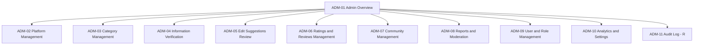

---

## 6. User Journey Catalog

Every journey required by the brief has a flow. Additional flows (F-27 to F-31) cover approved features that the required list does not name but that the PRD contains. Auth flows are in §8 (AF-01 to AF-05).

| Flow | Journey | Role | Main pages | Primary PRD features |
| --- | --- | --- | --- | --- |
| F-01 | Guest discovers ATHAR | Guest | PUB-01, PUB-08 | FR-HOME-001 |
| F-02 | Guest explores the platform directory | Guest | PUB-02 | FR-DIR-001, FR-DIR-002 |
| F-03 | User searches for a platform | Guest, member | PUB-01, PUB-02, PUB-04 | FR-SRCH-001 |
| F-04 | User filters results | Guest, member | PUB-02 | FR-FILT-001 |
| F-05 | User opens platform details | Guest, member | PUB-04 | FR-PLAT-001, FR-SRC-001, FR-VER-001, FR-STAT-001, FR-XP-001 |
| F-06 | User compares platforms | Guest, member | PUB-02, PUB-03 | FR-CMP-001 |
| F-07 | User registers | Guest | AUTH-01, AUTH-02 | FR-ACC-001 |
| F-08 | User completes the relevant onboarding steps | New member | MEM-01 | FR-MYA-001, FR-MEM-001 |
| F-09 | User tracks a platform in My ATHAR | Member | MEM-02 | FR-MYP-001 |
| F-10 | User tracks an application | Member | MEM-03, MEM-02 | FR-APP-001 |
| F-11 | User records earnings | Member | MEM-04 | FR-ERN-001 |
| F-12 | User submits a platform experience (review) | Verified member | PUB-04, MEM-10 | FR-REV-001, FR-RAT-001 |
| F-13 | User joins a community | Member | PUB-05, PUB-06 | FR-MEM-001, FR-COM-001 |
| F-14 | User reads community discussions (chat) | Joined member | COM-01 | FR-CHAT-001 |
| F-15 | User sends a chat message | Joined member | COM-01 | FR-CHAT-001 |
| F-16 | User searches previous community messages | Joined member | COM-01 | FR-CHS-001 |
| F-17 | User edits or deletes their own message | Joined member | COM-01 | FR-MSG-001 |
| F-18 | User suggests a new platform | Verified member | MEM-12 | FR-SUG-001 |
| F-19 | User submits an information correction | Verified member | PUB-04, MEM-11 | FR-COR-001 |
| F-20 | User manages privacy settings | Member | MEM-08, PUB-07 | FR-PRIV-001, FR-PROF-001 |
| F-21 | User requests a data export | Member | MEM-08 | FR-DEXP-001 |
| F-22 | User requests account deletion | Member | MEM-08 | FR-DEL-001 |
| F-23 | User reports content | Member | MEM-13 | FR-RPT-001 |
| F-24 | User appeals a moderation action | Affected user | MEM-14, MEM-15 | FR-APL-001 |
| F-25 | Moderator handles a report | Moderator | ADM-08 | FR-MOD-001, FR-RPT-001 |
| F-26 | Administrator manages platform information | Content Admin | ADM-02, ADM-04 | FR-ADM-002, FR-VER-001, FR-STAT-001 |
| F-27 | Member keeps a Favorite (provisional) | Member | PUB-02, PUB-04, MEM-09 | FR-FAV-001 |
| F-28 | Administrator reviews a suggestion | Content Admin | ADM-05 | FR-COR-001, FR-SUG-001 |
| F-29 | Administrator opens and resolves a Warning | Content Admin + second approver | ADM-02, ADM-08 | FR-STAT-001 |
| F-30 | Member leaves a community | Member | MEM-06, COM-01 | FR-MEM-001 |
| F-31 | Member opens a notification | Member | MEM-07 | FR-NOT-001 |

---

## 7. Detailed User Flows

### 7.1 Format

Each flow states: **Flow ID, journey name, role, goal, start, preconditions, main flow (numbered), alternative flows (ALT), error flows (ERR), decision points (DEC), completion state, related pages and related requirements.** Step text uses the PRD's wording; no behavior is added that the PRD does not support. "Provisional" marks steps that depend on an open decision.

Common behaviors that apply to every flow and are not repeated:

- **Protected action by a guest:** the sign-in prompt appears; after sign-in the user returns to the triggering page (§10.3).
- **Loading / empty / error / success states** are shown for every list and form (FR-98).
- **Notifications** follow PRD §6.6; no notification is created per chat message.
- Copy for states other than the approved zero-result search is drafted in design (RD-I6).

### 7.2 Discovery flows

#### F-01 — Guest discovers ATHAR

**Role:** Guest · **Goal:** Understand ATHAR and start discovering · **Start:** PUB-01 Home (direct URL, link, or logo) · **Preconditions:** none · **Completion:** the guest reaches the directory, a platform, a community page, About or sign-up · **Pages:** PUB-01, PUB-08, PUB-02, PUB-04, PUB-05, PUB-06, AUTH-01 · **Requirements:** FR-HOME-001, FR-DIR-002, FR-COM-001

**Main flow**
1. The page loads with the sticky navbar and the hero showing the slogan "من أثرٍ جئنا، وإلى أثرٍ نمضي.", the supporting message and the search with the prompt "بتدور على بداية جديدة؟".
2. The guest scrolls to Digital Work Categories (approved Fields copy) and may open a category tile → F-02 with the category filter applied.
3. Featured Platforms (approved Platforms copy) shows platform cards; opening one → F-05.
4. Active Communities shows 3–6 community cards (name, short description, member count, activity indicator, Join/Open) with the approved Community copy as introduction. **No message text, authors or timestamps appear.**
5. The static User Journey section explains the stages and invites the guest to create an account.
6. The short About (approved Philosophy copy) links to PUB-08.
7. The footer offers About, Help Center, Contact, Privacy Policy, Terms of Use, Community & Content Guidelines.

**ALT:** (a) The guest taps Join on a community card → F-13 (sign-in prompt). (b) The guest taps "create an account" → F-07. (c) A signed-in member sees the compact "Continue your journey" card (or starting-points card) instead of the User Journey section and community cards show Open for joined communities.
**ERR:** A section fails to load → that section shows an error with retry; the rest of the page stays usable. Featured pool empty → fewer cards, never unqualified ones.
**DEC:** Which entry the guest picks (search, category, featured, community, sign-up).

#### F-02 — Guest explores the platform directory

**Role:** Guest or member · **Goal:** Browse available platforms · **Start:** PUB-02 (navbar Platforms, category tile, hero search) · **Preconditions:** none · **Completion:** the user opens a platform, compares platforms, or refines with F-03/F-04 · **Pages:** PUB-02, PUB-04, PUB-03 · **Requirements:** FR-DIR-001, FR-DIR-002

**Main flow**
1. The directory loads with the default sort *Popularity* (or *Relevance* if a search term is present), the result count, and results in grid view.
2. The guest switches between grid and list views and may change the sort (rating, newest additions, last verification, popularity).
3. Each card shows name, categories, availability state, a Warning badge if present, headline rating or "Not enough reviews yet", last verification date, and a Favorite action.
4. The guest scrolls and uses pagination; filters and sort stay applied.
5. The guest opens a card → F-05, or selects up to three cards for comparison → F-06.

**ALT:** (a) Suspended-or-closed platforms are absent from the default list; they appear only if that availability state is selected in the filter (RD-A4). (b) The guest taps Favorite → F-27 (sign-in prompt for guests).
**ERR:** Results fail to load → error with retry. Zero results → the approved copy "لسه ملقيناش اللي بتدور عليه، جرّب مجال تاني." with a clear-filters action.
**DEC:** View mode; sort; whether to refine with search or filters.

#### F-03 — User searches for a platform

**Role:** Guest or member · **Goal:** Find a platform or topic by typing · **Start:** hero search (PUB-01) or directory search field (PUB-02) · **Preconditions:** none · **Completion:** a platform page opens or the directory shows results for the search term · **Pages:** PUB-01, PUB-02, PUB-04 · **Requirements:** FR-SRCH-001, FR-DIR-001

**Main flow**
1. The user focuses the search field. Before typing, popular work types and categories are suggested.
2. While typing, grouped suggestions appear: platforms, work types, payment methods, categories.
3. The user chooses a platform suggestion → PUB-04 opens (F-05); or chooses a term suggestion → PUB-02 opens with that term applied; or presses Enter with free text → PUB-02 opens with the text as the search term, sorted by Relevance.
4. Results show matches by name, category, work type or payment method.

**ALT:** The user searches from the navbar search on any page (same behavior). Communities are not searched here; community search lives only in PUB-05 (RD-A8).
**ERR:** The suggestion service fails → the typed search still submits. No match → approved zero-result copy and a clear-filters action. Network error → retry.
**DEC:** Choose a suggestion versus free text.

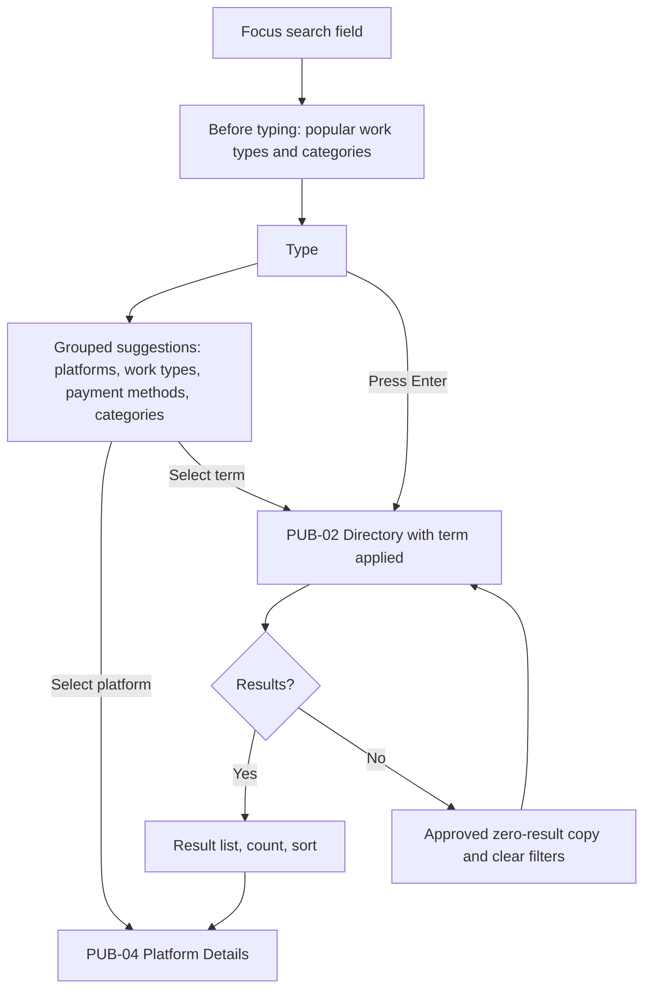

#### F-04 — User filters results

**Role:** Guest or member · **Goal:** Narrow platforms to what suits the user · **Start:** filter panel on PUB-02 · **Preconditions:** none · **Completion:** a result list that matches the active filters · **Pages:** PUB-02, PUB-04 · **Requirements:** FR-FILT-001

**Main flow**
1. On desktop the filter sidebar is visible; on mobile the user opens the drawer or bottom sheet.
2. The user selects options in one or more of: category, availability in Egypt, opportunity type, payment method, experience level (multi-select).
3. Options inside one filter combine with OR; different filters combine with AND. The result count updates.
4. Active filters appear as removable chips; the user can remove one chip or use Clear All.
5. The user opens a platform and later returns; the previous filters and sort are restored.

**ALT:** (a) The user selects Suspended or closed under availability to include those platforms. (b) A search term and filters combine.
**ERR:** No results → approved zero-result copy and a clear-filters action. Filter fetch failure → retry; the previous list stays.
**DEC:** Which filters and how many; whether to clear one chip or all.

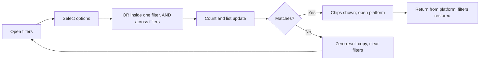

#### F-05 — User opens platform details

**Role:** Guest or member · **Goal:** Understand a platform's verified facts, status and community experience · **Start:** PUB-04 (directory, search, comparison, notification, community page, direct link) · **Preconditions:** the platform is published (Suspended-or-closed remains reachable) · **Completion:** the user has seen facts with status, source and date, and can act (Favorite, Compare, Write review, Suggest edit, Report, Open community) · **Pages:** PUB-04, HLP-06, PUB-03, PUB-06, MEM-10, MEM-11, MEM-13 · **Requirements:** FR-PLAT-001, FR-SRC-001, FR-VER-001, FR-STAT-001, FR-XP-001, FR-RAT-001

**Main flow**
1. The page loads with the platform name, availability state, and a Warning banner if the flag is set (independent of availability).
2. The user moves between the ten sections using the sidebar (desktop) or compact dropdown (mobile). Provisional: the section list is undefined (OD-07).
3. In sections 1–8 and 10 each verifiable fact shows its layer label (*From the platform* or *Verified by ATHAR*), status (Verified / Needs Review / Unconfirmed), source (title, link, access date), verification date, and the "Reviewed by the ATHAR Content Team" label.
4. Section 9 shows the Community experience layer: headline rating (or "Not enough reviews yet" plus total reviews), breakdown by experience type, and review list; each review is labeled "Experience reported by the user".
5. The user may read the public update history and the dated status history.
6. The user may follow the verification label to HLP-06 (How Verification Works).
7. The user chooses an action: Favorite (F-27), Compare (F-06), Write review (F-12), Suggest edit (F-19), Report (F-23), Open community → PUB-06.

**ALT:** (a) Suspended or closed: the state is shown clearly and the community stays Open with a banner. (b) A fact is Needs Review: it shows its last verified date, never hidden. (c) A section lacking data says it is not yet documented. (d) A guest tapping a member action sees the sign-in prompt.
**ERR:** A section fails to load → retry for that section. A merged or unpublished platform's URL behavior is undefined (SF-OD-02, PRD OD-09).
**DEC:** Which section to read; whether to act.

#### F-06 — User compares platforms

**Role:** Guest or member · **Goal:** Decide between up to three platforms · **Start:** Compare action on PUB-02 cards or PUB-04 · **Preconditions:** none · **Completion:** the user has seen aligned facts with status and date and opens a platform or leaves · **Pages:** PUB-02, PUB-04, PUB-03 · **Requirements:** FR-CMP-001

**Main flow**
1. The user selects Compare on a platform; a compare tray shows the selection (REC placement).
2. The user adds up to two more platforms.
3. The user opens PUB-03; facts (availability, work types, payment methods, requirements, experience level, advantages and challenges) are aligned by row, each with status and date.
4. The user removes a platform or opens one → F-05.

**ALT:** A Warning banner appears on a compared platform that has the flag. A fact without data shows "not yet documented".
**ERR:** Attempting a fourth platform → blocked with an explanation. Fewer than two selected → prompt to add another. The source of "advantages and challenges" is undefined (PRD OD-15).
**DEC:** Which platforms to compare.

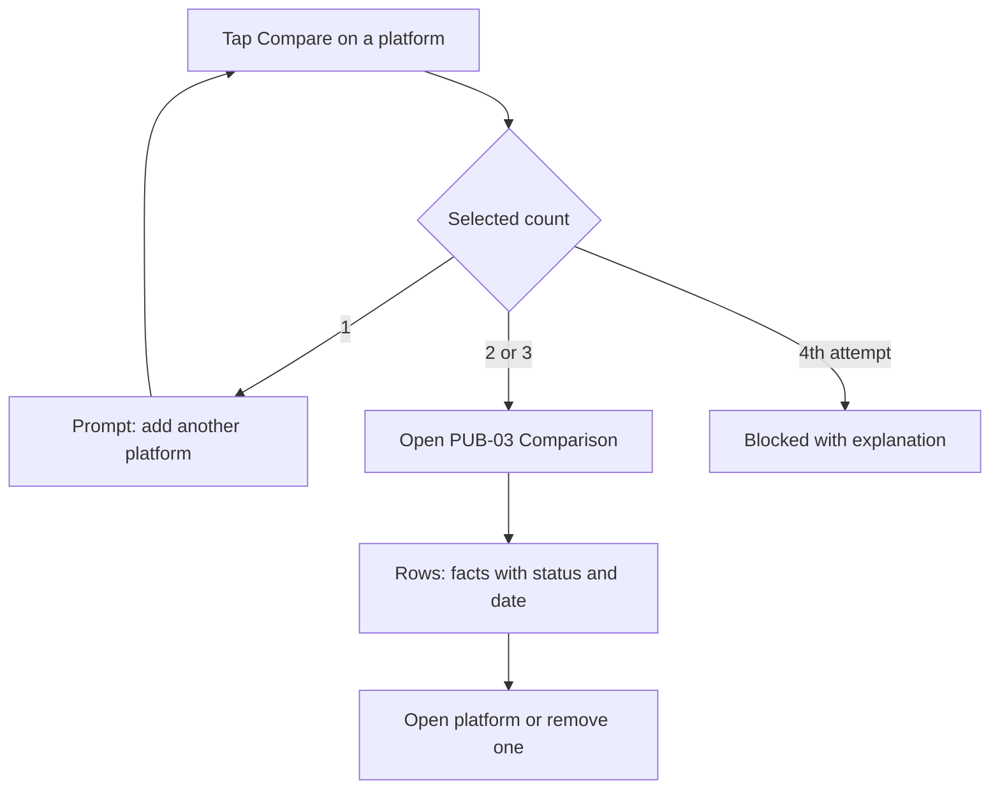

### 7.3 Registration and onboarding

#### F-07 — User registers

**Role:** Guest · **Goal:** Create an account · **Start:** AUTH-01 (navbar Sign up, or a sign-in prompt from a protected action) · **Preconditions:** none · **Completion:** a signed-in member with a display name, the Terms and Privacy acceptance recorded, a verification email sent, landing on the return page or My ATHAR · **Pages:** AUTH-01, AUTH-02, HLP-03, HLP-04, MEM-01 · **Requirements:** FR-ACC-001

**Main flow**
1. The guest opens Sign up and chooses email and password, or Google.
2. For email: enters email, a password (at least 10 characters, checked against known-breached passwords), and a display name (3–30 characters, not derived from the email, no reserved words). The form states a real name is not required. No phone number is requested.
3. The guest completes the signup challenge and accepts the Terms and Privacy Policy (links to HLP-04, HLP-03); acceptance is recorded.
4. The account is created; a verification email is sent; AUTH-02 shows the pending state.
5. The new member lands on the page that triggered signup, or My ATHAR (RD-I3). They can already save favorites, track and record applications and earnings even if unverified.
6. When the member opens the verification link, AUTH-02 shows "verified" and the member returns to where they were.

**ALT:** (a) Google: the Google account links to the same verified email. (b) The guest already has an account → sign in (AF-01). (c) The email is a disposable address → blocked with an explanation.
**ERR:** Weak or breached password; reserved or invalid display name; email already used; challenge failed → field-level errors with retained input. Verification link expired → AUTH-02 "link expired" with resend. Age confirmation is **provisional/undefined** (PRD OD-03): no age step is shown until resolved.
**DEC:** Email versus Google. Provisional: whether verification is required before community access (PRD OD-02).

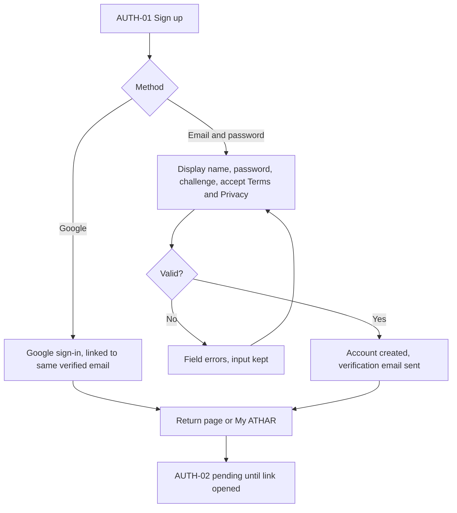

#### F-08 — User completes the relevant onboarding steps

**Role:** New member · **Goal:** Take a first step without a wizard · **Start:** MEM-01 for a member with no activity · **Preconditions:** account exists · **Completion:** the member takes at least one of the three starting points, or leaves · **Pages:** MEM-01, PUB-02, PUB-06, COM-01 · **Requirements:** FR-MYA-001, FR-MEM-001

The baseline defines **no multi-step onboarding wizard** (SF-OD-05). Onboarding is exactly:

**Main flow**
1. A first-time My ATHAR shows three starting points: explore fields, see featured platforms, join the General community.
2. "Explore fields" → PUB-01 category section or PUB-02; "see featured platforms" → PUB-01 featured section; "join the General community" → F-13 (opt-in).
3. Optional profile fields (governorate, interests, experience level) are never required and are reachable from Settings.

**ALT:** The member dismisses the starting points and browses the navbar. A member who later favorites or starts tracking a platform is offered once to join its community (RD-D13).
**ERR:** Starting-point destinations fail to load → standard retry.
**DEC:** Which starting point to take, or none.

### 7.4 Personal journey flows

#### F-09 — User tracks a platform in My ATHAR

**Role:** Member (verified email not required) · **Goal:** Record progress with a platform · **Start:** MEM-02 My Platforms (and, provisionally, a track action on PUB-04, see SF-OD-07) · **Preconditions:** signed in · **Completion:** one My Platforms entry with a status and a dated history · **Pages:** MEM-01, MEM-02, PUB-04, PUB-06, MEM-10 · **Requirements:** FR-MYP-001, FR-MYA-001, BR-060 to BR-062

**Main flow**
1. The member opens MEM-02 (from My ATHAR, profile menu, or the platforms-being-followed list).
2. The member chooses Add platform and selects a published platform.
3. The member sets one of the six statuses: Interested, Account Created, Test Passed, Started Receiving Tasks, Currently Working, Stopped Working. The change is stamped with the date.
4. The member may add a private note and later change the status; each change is dated and kept as history.
5. From the entry the member can open the platform page, its community, or write/edit their own review (F-12).
6. When the member first starts tracking a platform, ATHAR offers once to join its community (RD-D13) → F-13.

**ALT:** (a) The platform is already tracked → the existing entry opens (one entry per platform). (b) The member removes the entry to stop tracking. (c) An application reaching *Test passed* or *Started work* offers a one-tap platform-status update (F-10); nothing updates automatically. (d) A platform marked Currently Working or Stopped Working with no review → My ATHAR shows a dismissible prompt to share an experience → F-12.
**ERR:** Save fails → input is retained with a retry message. The platform became Suspended or closed → the entry stays; the platform page shows its state.
**DEC:** Which status to set; whether to join the community.
**Independence rule (CD-205):** favoriting a platform never creates or changes an entry here; removing a Favorite never changes an entry (F-27).

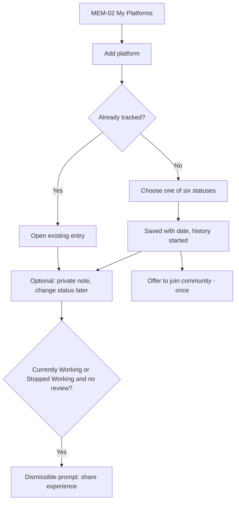

#### F-10 — User tracks an application

**Role:** Member · **Goal:** Keep records of each attempt to join or qualify for a platform · **Start:** MEM-03 My Applications · **Preconditions:** signed in · **Completion:** an application record with a current state and a timestamped history · **Pages:** MEM-03, MEM-02 · **Requirements:** FR-APP-001

**Main flow**
1. The member opens MEM-03 and adds an application for a platform. A platform may have several applications.
2. The member picks a state from Planned, Submitted, Assessment pending, Test passed, Test failed, Waitlisted, Accepted, Rejected, Started work, Withdrawn. ATHAR suggests the usual next step but allows any state.
3. Each change is timestamped.
4. When the state becomes *Test passed* or *Started work*, ATHAR offers a one-tap update of the platform's status in My Platforms to *Test Passed* or *Started Receiving Tasks*; the member confirms or declines.
5. If the application ends, the member can use *Reapply*, which creates a new application linked to the earlier one.
6. The member may export their applications (CSV or Excel) after a recent sign-in confirmation.

**ALT:** (a) Any state can become Withdrawn. (b) Waitlisted can become Accepted, Rejected or Withdrawn. (c) The member declines the one-tap update; nothing changes.
**ERR:** Save fails → retained input and retry. Export sign-in confirmation fails → export blocked with an explanation.
**DEC:** State chosen; whether to update the platform status; whether to reapply.

#### F-11 — User records earnings

**Role:** Member · **Goal:** Keep a private earnings ledger · **Start:** MEM-04 My Earnings · **Preconditions:** signed in · **Completion:** earnings entries with original amounts preserved and summaries in the display currency, if available · **Pages:** MEM-04, MEM-08 · **Requirements:** FR-ERN-001

**Main flow**
1. The member opens MEM-04 and adds an entry: amount, currency, date, payment status (Pending, Available in platform balance, Withdrawal requested, Received, Failed or disputed), optional platform, optional note.
2. Totals are grouped by original currency and payment status. A notice states that ATHAR gives no tax or financial advice.
3. The member chooses a display currency (also in Settings). Summaries convert; each converted figure shows rate, rate date and source and is marked approximate. Original amounts are unchanged.
4. A rate is locked to an entry when first used. The member can use *Recalculate*, enter their own rate, or enter the amount actually received.
5. The member may export CSV or Excel after a recent sign-in confirmation.

**ALT:** (a) No disclosed rate exists for a date → the amount is not converted and appears as a separate subtotal. (b) The member optionally links an entry to a platform.
**ERR:** Missing required fields → field errors. Rate source unavailable (PRD OD-17) → unconverted subtotal. Export confirmation fails → blocked.
**DEC:** Display currency; recalculate or keep the locked rate.
**Boundary:** earnings never appear on My ATHAR's first screen, on a public profile, or to staff (RD-E5, CD-014, RD-F10).

#### F-27 — Member keeps a Favorite (provisional)

**Role:** Member · **Goal:** Bookmark a platform to return later · **Start:** Favorite action on a PUB-02 card or PUB-04 · **Preconditions:** signed in (guests see the sign-in prompt) · **Completion:** the platform is in the member's Favorites list · **Pages:** PUB-02, PUB-04, MEM-09 · **Requirements:** FR-FAV-001, BR-062

**Main flow**
1. The member taps Favorite; the state toggles visibly on the card and page.
2. The platform appears in MEM-09 (provisional location, PRD OD-01).
3. Once per favorite, ATHAR offers to join the platform's community (RD-D13) → F-13.
4. The member removes the favorite from the card, the page or MEM-09.

**ALT:** A guest taps Favorite → sign-in prompt → returns and the favorite is applied (REC).
**ERR:** Save fails → state reverts with a retry message.
**Rules:** favoriting does not add the platform to My Platforms; unfavoriting never alters a tracking record.

### 7.5 Contribution flows

#### F-12 — User submits a platform experience (review)

**Role:** Verified member · **Goal:** Share an experience with a platform · **Start:** Write review on PUB-04, or the prompt on MEM-01/MEM-02 · **Preconditions:** signed in with a verified email (RD-C3, §6.2) · **Completion:** the review is published, labeled "Experience reported by the user", counted per the rating rules, and listed in My Contributions · **Pages:** PUB-04, MEM-10, MEM-05, AUTH-02 · **Requirements:** FR-REV-001, FR-RAT-001, FR-XP-001

**Main flow**
1. The member opens the review form (MEM-10).
2. The member selects a star rating (1–5) and an experience type: Worked on the platform; Accepted but did not start work; Registered or explored only; Applied but failed the acceptance test or was rejected.
3. The member optionally adds advantages, challenges and comments, and confirms no affiliation and no compensation.
4. The form is submitted; automated checks run (blocked contact details, referral links, phone patterns, profanity).
5. The review publishes immediately and appears in PUB-04 section 9 and MEM-05. Only "Worked on the platform" reviews feed the headline rating (shown after 3 qualifying reviews).

**ALT:** (a) The member already has a review → the form opens in edit mode; edits show "edited". (b) The member deletes the review from the form or MEM-05; it leaves the page and the aggregate immediately. (c) A guest is routed to sign-in; an unverified member is routed to AUTH-02 and returns after verifying.
**ERR:** Missing rating or type → field errors. Automated check blocks → the triggering rule is shown and the text is kept. The daily limit of 5 new reviews [F] is reached → an explanation. Submission fails → retained text with retry. A moderator later holds or removes the review → F-24 is available.
**DEC:** Experience type; whether to add optional text.

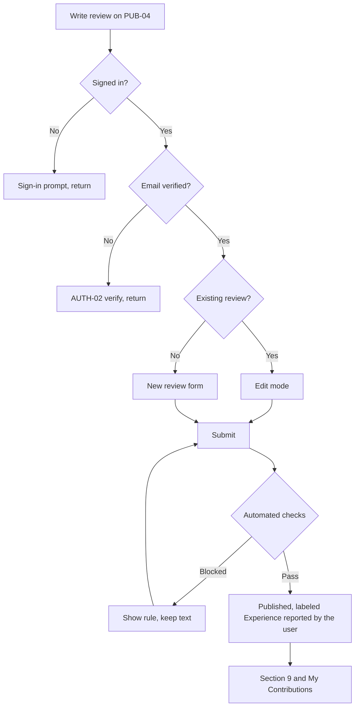

### 7.6 Community flows

#### F-13 — User joins a community

**Role:** Member · **Goal:** Join an open community immediately · **Start:** Join on PUB-06 (from PUB-05, PUB-04, a homepage card, or an offer after Favorite/track/onboarding) · **Preconditions:** signed in (guests are prompted). Whether a verified email is needed is conflicted (PRD OD-02); the flow follows CD-206 (none) and marks the branch · **Completion:** the member is joined and enters the chat room · **Pages:** PUB-05, PUB-06, COM-01, AUTH-01, MEM-06 · **Requirements:** FR-MEM-001, FR-COM-001

**Main flow**
1. The member opens a community from Browse Communities (search by community or platform name; sort by activity by default, newest, member count) or from a platform page.
2. PUB-06 shows name, platform link, description, rules summary, member count and activity indicator. No messages are shown.
3. The member taps Join. The join panel states that chat history is visible to new members and shows the safety notice.
4. The member confirms; membership is immediate with no approval and no screening.
5. The member is taken to COM-01 and the community appears in MEM-06.

**ALT:** (a) A guest taps Join → sign-in → returns to PUB-06 and can join. (b) Already a member → the button shows Open. (c) The community is Read-only → joining is allowed and posting is disabled. (d) *Provisional (OD-02):* if the baseline's verified-email rule is adopted instead, an unverified member is sent to AUTH-02 first.
**ERR:** Join fails → retry. An account that is banned or restricted from the community is told why and shown the appeal path. Empty community → the invitation to write first and the "Start here" pin.
**DEC:** Join now or later.

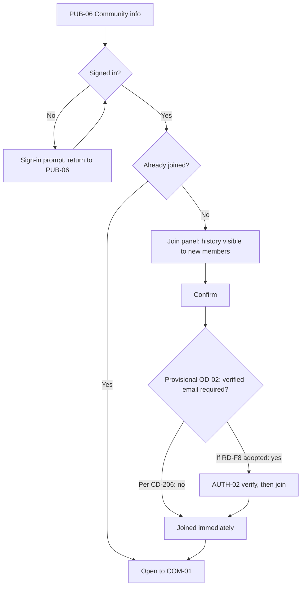

#### F-14 — User reads community discussions (chat)

**Role:** Joined member · **Goal:** Read the retained history and recent messages · **Start:** COM-01 (Open from PUB-06 or MEM-06) · **Preconditions:** the member joined · **Completion:** the member has read messages and pinned items · **Pages:** COM-01, PUB-06, MEM-06 · **Requirements:** FR-CHAT-001, FR-COM-001

**Main flow**
1. COM-01 opens with the collapsible pinned bar (up to 5 pins labeled Rules, Resource, Announcement; each platform community begins with the system "Start here" pin), the permanent safety notice, and the message list.
2. The member reads the full retained history; messages show display names and dates; edited messages are marked; deleted and moderator-removed messages show their placeholders.
3. New messages arrive in real time. The chat is flat: no reply, reaction, mention, thread, read-receipt or typing control exists.
4. External links show a visible domain and open a leaving-ATHAR notice.

**ALT:** (a) A non-member opens the chat URL → redirected to PUB-06 (guests get the sign-in prompt). (b) The community is Read-only or locked → the composer is disabled with an explanation. (c) A Suspended-or-closed platform → the community stays Open with a banner. (d) Empty community → invitation to write first.
**ERR:** Connection lost → banner and automatic retry; history shows what is loaded. Load fails → retry.
**DEC:** Where to read; whether to search (F-16).

#### F-15 — User sends a chat message

**Role:** Joined member · **Goal:** Post text or a link · **Start:** composer in COM-01 · **Preconditions:** joined; not muted/restricted; community Open · **Completion:** the message appears for all members in real time · **Pages:** COM-01 · **Requirements:** FR-CHAT-001, FR-MOD-001

**Main flow**
1. The member types text or a link (max 2,000 characters [F]).
2. The member sends. Checks run: rate limit (10 messages per minute [F]; stricter in the first 24 hours), duplicate blocking, link and contact checks.
3. The message appears with the member's display name; no notification is generated for anyone.

**ALT:** (a) A link in the first 24 hours after joining is blocked with an explanation. (b) A phone number or messaging handle is held automatically and the member is told it is under review. (c) Slow mode shows the wait before the next message. (d) Staff messages show a role badge.
**ERR:** Over 2,000 characters → rejected with a clear error. Rate limit → temporary block message. URL shortener, group-invite link or blocklisted domain → blocked. Send failure → the message shows a retry action and is not silently dropped. Muted or restricted → composer disabled with the reason and appeal path.
**DEC:** Edit before sending; whether to retry.

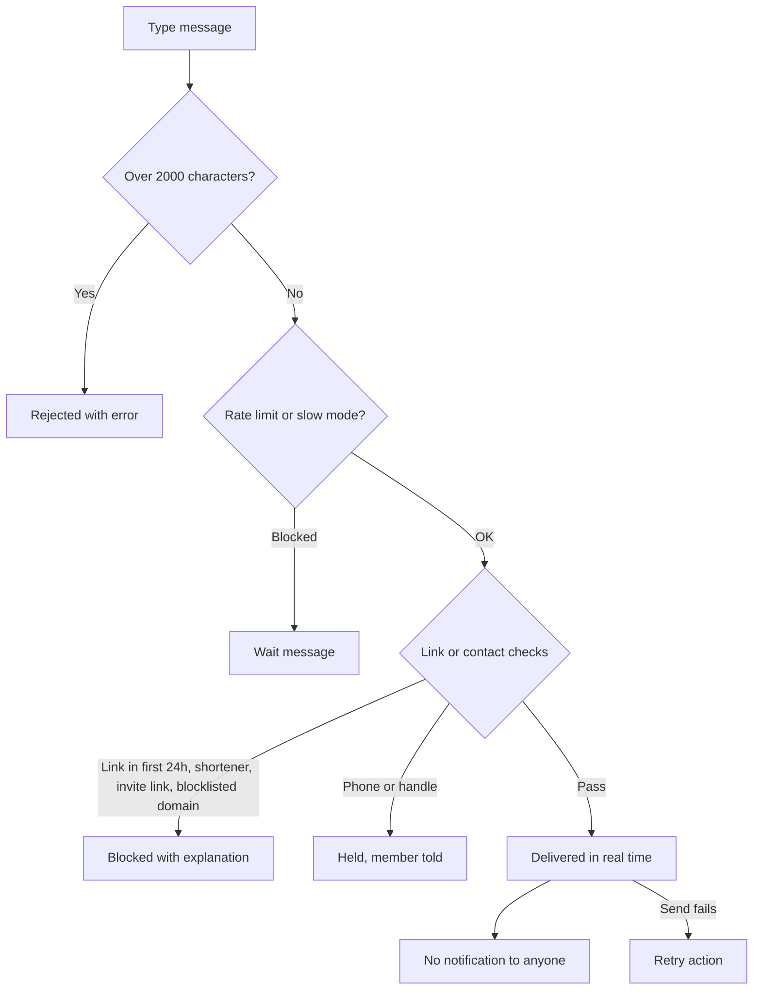

#### F-16 — User searches previous community messages

**Role:** Joined member · **Goal:** Find an earlier answer · **Start:** search control in COM-01 · **Preconditions:** joined · **Completion:** the member opens a result in context · **Pages:** COM-01 · **Requirements:** FR-CHS-001

**Main flow**
1. The member opens the search control and enters a query.
2. Results from this community only (retained, non-deleted messages) list author display name and date.
3. The member selects a result; the chat scrolls to the message in context.

**ALT:** (a) No results → empty state. (b) A guest or non-member cannot reach search. (c) After leaving the community, search is no longer available. There is no cross-community search.
**ERR:** Search fails → retry. Deleted or removed messages never appear.
**DEC:** Refine the query or return to the live chat.

#### F-17 — User edits or deletes their own message

**Role:** Joined member (author) · **Goal:** Correct or retract a message · **Start:** the message's own actions in COM-01 · **Preconditions:** the member authored the message · **Completion:** the message shows "edited" or a deletion placeholder · **Pages:** COM-01 · **Requirements:** FR-MSG-001

**Main flow (edit)**
1. The author opens Edit on their message, changes the text and saves.
2. The edited text passes the same automated checks; the message shows "edited" for all members. The previous text is kept internally for 30 days [F].

**Main flow (delete)**
1. The author opens Delete and confirms.
2. The content is removed immediately and a "message deleted" placeholder remains. It no longer appears in search.

**ALT:** (a) A reported message is deleted → the content is retained internally as evidence for moderation. (b) A pinned message is unpinned only by a moderator.
**ERR:** The edit is blocked by a check → the rule is shown. Save fails → retry. Authors cannot edit or delete a moderator-removed message (REC; baseline defines only the placeholder "removed by moderator").
**DEC:** Edit or delete.

#### F-30 — Member leaves a community

**Role:** Member · **Goal:** Stop being a member · **Start:** MEM-06 (and, provisionally, the chat room header; SF-OD-04) · **Preconditions:** joined · **Completion:** the member no longer has access to messages, history or search · **Pages:** MEM-06, COM-01, PUB-06 · **Requirements:** FR-MEM-001

**Main flow**
1. The member selects Leave on a community and confirms.
2. Access to messages, history and chat search ends; the community card on PUB-06 shows Join again.
3. The member's earlier messages remain according to the retention rules unless they delete them first.

**ERR:** Leave fails → retry. A member removed by a moderator sanction is handled by F-24, not by this flow.

#### F-18 — User suggests a new platform

**Role:** Verified member · **Goal:** Propose a platform missing from the directory · **Start:** MEM-12 (from My Contributions; REC: also from the empty-results state) · **Preconditions:** signed in with a verified email · **Completion:** a suggestion with status Pending in My Contributions · **Pages:** MEM-12, MEM-05, MEM-07 · **Requirements:** FR-SUG-001, FR-CON-001

**Main flow**
1. The member opens MEM-12 and enters the platform's name or website plus basic information. No official source is required.
2. ATHAR checks for duplicates and the member submits.
3. The suggestion appears in MEM-05 as Pending. It is never published automatically.
4. An admin verifies independently (F-28). The member is notified (N-02) when it is published or declined with a reason. Publication creates the platform community.

**ALT:** (a) Duplicate found → the member is pointed to the existing platform and may open it. (b) Identity confirmed but availability not → published with *Not yet confirmed* and Unconfirmed items. (c) Identity cannot be confirmed → stays unpublished and the member is told why.
**ERR:** Required fields missing → field errors. Per-account suggestion limits apply (RD-F9). Submission fails → input retained.
**DEC:** Name or website as the identifier.

#### F-19 — User submits an information correction

**Role:** Verified member · **Goal:** Correct or update a platform fact · **Start:** Suggest edit on PUB-04 (REC: from the specific fact item) · **Preconditions:** signed in with a verified email · **Completion:** a Pending suggestion; later Accepted or Rejected with a notification · **Pages:** PUB-04, MEM-11, MEM-05, MEM-07 · **Requirements:** FR-COR-001, FR-VER-001

**Main flow**
1. The member opens MEM-11 and selects the fact item.
2. The member enters the proposed value. If the change is substantive (availability state, or a Class 1 or Class 2 fact), evidence (link or description) is required; for a minor observation it is optional.
3. The member submits. The suggestion is Pending in MEM-05.
4. An admin decides (F-28). N-01 notifies the member. Accepted changes create an entry in the public edit history (what and when, not who).

**ALT:** (a) The admin requests more information → a note appears inside Pending. (b) The member withdraws a pending suggestion. (c) An evidenced substantive suggestion can trigger an early review of the fact.
**ERR:** No evidence for a substantive change → submission blocked. Rejected → a reason is shown. Submission fails → input retained. No file attachments in V1.
**DEC:** Evidence now or later (for minor observations).

### 7.7 Privacy, data and safety flows

#### F-20 — User manages privacy settings

**Role:** Member · **Goal:** Control visibility and notifications · **Start:** MEM-08 → Privacy · **Preconditions:** signed in · **Completion:** settings saved; profile visibility updated · **Pages:** MEM-08, PUB-07 · **Requirements:** FR-PRIV-001, FR-PROF-001

**Main flow**
1. The member opens Settings and its Privacy section. Defaults are the most private: profile private; optional fields hidden.
2. The member may set the profile public or private, per-field visibility (display name, photo, bio, governorate, interests, experience level), joined-communities visibility (hidden unless opted in), and whether reviews and contributions appear.
3. When the profile first goes public, only display name and bio show.
4. The member may change non-essential notification categories (only platform updates, N-06, can be switched off), display currency and display name (once per 30 days [F]).
5. Saving shows a success confirmation; the public profile page (PUB-07) reflects the choices.

**ALT:** (a) The member sets the profile back to private → the profile link disappears from their reviews. (b) Essential notifications (account, moderation, security) cannot be switched off.
**ERR:** Display-name rule violation (3–30 characters, reserved words) → field error. Save fails → retry. Missing profile fields (no photo, bio) → the public page simply omits them (no empty placeholders that imply data).
**DEC:** What to make public.

#### F-21 — User requests a data export

**Role:** Member · **Goal:** Obtain a copy of personal data · **Start:** MEM-08 → Data export · **Preconditions:** signed in; recent sign-in confirmation · **Completion:** the member downloads the archive within 7 days · **Pages:** MEM-08, MEM-07 · **Requirements:** FR-DEXP-001

**Main flow**
1. The member opens Data export and confirms sign-in.
2. The member requests the export (one request per 24 hours).
3. Staff-side processing is by Super Admins (ADM-09) without reading contents; target ready within 72 hours [F].
4. The member receives an in-app notification (N-08); MEM-08 shows "export ready" (SYS-07).
5. The member downloads the archive (readable files plus an Arabic readme) within 7 days.

**ALT:** A second request within 24 hours is refused with an explanation. The link has expired → request again.
**ERR:** Sign-in confirmation fails → blocked. Export fails → in-app message and retry.
**DEC:** Request now or later.

#### F-22 — User requests account deletion

**Role:** Member · **Goal:** Permanently delete the account · **Start:** MEM-08 → Account deletion · **Preconditions:** signed in · **Completion:** after the 14-day grace period, private data is permanently erased and the member is confirmed by email · **Pages:** MEM-08 (SYS-06), AUTH-01 · **Requirements:** FR-DEL-001

**Main flow**
1. The member opens Account deletion and re-enters the password.
2. The member chooses what happens to their reviews and chat messages: delete them, or keep them anonymously as "Former member". **No option is pre-selected.**
3. A confirmation email is sent; the member confirms.
4. The 14-day grace period starts; SYS-06 shows "deletion pending" (N-08 notice).
5. After the period, profile, tracking, applications, earnings, favorites and notifications are erased; reviews and messages follow the choice; a confirmation email is sent.

**ALT:** The member signs in during the grace period → deletion is cancelled (notice N-08).
**ERR:** Wrong password → blocked. The confirmation link expires → the request lapses with an explanation. The choice step cannot be skipped.
**DEC:** Delete or keep reviews and messages anonymously; proceed or cancel.

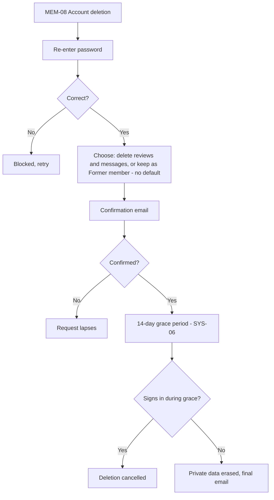

#### F-23 — User reports content

**Role:** Member (verified-email gating: PRD OD-04) · **Goal:** Flag a message, review, platform page or account · **Start:** Report action on the item · **Preconditions:** signed in · **Completion:** the report is in the correct queue; the reporter is later notified (N-04) · **Pages:** COM-01, PUB-04, MEM-13, MEM-07, ADM-08 · **Requirements:** FR-RPT-001

**Main flow**
1. The member opens Report on the item; MEM-13 opens with the target pre-filled.
2. The member selects a reason: spam or promotion, suspected scam, harassment or abuse, confidential content, personal information, inaccurate information, or other (with an optional note).
3. The report is submitted. Messages and accounts go to the Moderator queue; reviews and platform information go to the Content Admin queue.
4. When reviewed, the member receives an in-app notice without detail (N-04).

**ALT:** A guest taps Report → sign-in prompt → returns. The report form is also reachable from a review and from a platform page.
**ERR:** Per-account report limits reached → an explanation. Repeated false reports lead to a warning (RD-D9). Submission fails → retry.
**DEC:** Reason selection.

#### F-24 — User appeals a moderation action

**Role:** Affected user · **Goal:** Contest a moderation decision · **Start:** a moderation notice, N-05 notification, MEM-15 (suspended users), or Settings → Reports and appeals · **Preconditions:** a moderation action exists; within 14 days [F] · **Completion:** an outcome notice (upheld, reduced or reversed) · **Pages:** MEM-14, MEM-15, MEM-07, MEM-08 · **Requirements:** FR-APL-001

**Main flow**
1. The user opens the appeal form from the notice.
2. The user explains the situation and submits (one appeal per action).
3. A different person than the original decider reviews it; the Super Admin decides finally (7-day target [F]).
4. The outcome arrives as an in-app notice; an appeal outcome email is also sent.

**ALT:** A suspended user signs in, lands on MEM-15 (restricted view) and uses the appeal form only. A reversed action restores access or content.
**ERR:** The 14-day window has passed → the form is unavailable with an explanation. A second appeal on the same action is blocked.
**DEC:** Appeal or accept.

### 7.8 Administration and moderation flows

#### F-25 — Moderator handles a report

**Role:** Community Moderator (Content Admin for review and platform-information reports; Super Admin for all) · **Goal:** Resolve a report fairly · **Start:** ADM-08 queue (from ADM-01) · **Preconditions:** staff account with two-factor authentication · **Completion:** a logged action with a reason code, the affected user informed, and the reporter notified · **Pages:** ADM-08, ADM-06, ADM-07, ADM-09, ADM-11 · **Requirements:** FR-MOD-001, FR-RPT-001, FR-APL-001

**Main flow**
1. The moderator opens ADM-08; the queue is sorted by severity, then age. Targets: first response within 24 hours for scam, personal-information and harassment reports; 72 hours for others [F].
2. The moderator opens a report and reviews the reported message with its context, the reason, and the reported account's history.
3. The moderator chooses an action: dismiss; warn; hold or remove content; temporary mute in one community (1 hour to 7 days); temporary chat or review restriction up to 30 days. A reason code and an internal note are mandatory.
4. The affected user receives the reason and the appeal path (N-03 or N-05); the reporter receives N-04.
5. The action is written to the audit log (ADM-11). Users see only "ATHAR Moderation".

**ALT:** (a) Serious conduct: the moderator **recommends** suspension or a ban; a Super Admin decides (ADM-08/ADM-09). (b) Reviews: a moderator may only hold a review; the Content Admin decides removal (ADM-06; authority conflict SC-06). (c) The moderator enables slow mode, locks the chat, pins or unpins a message, or updates the domain blocklist from ADM-07. (d) A staff member with a declared affiliation does not handle reports about that platform.
**ERR:** Missing reason code → cannot save. The reported content was already deleted by the author → retained evidence is used. A Moderator tries a Super Admin action → blocked (SYS-02/inline).
**DEC:** Severity; which sanction; recommend escalation.

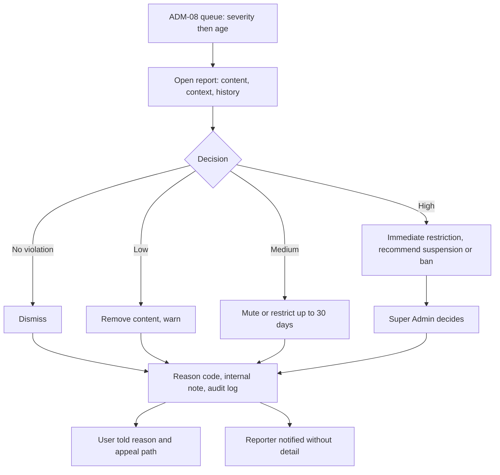

#### F-26 — Administrator manages platform information

**Role:** Content Admin (Super Admin) · **Goal:** Publish and maintain accurate platform facts · **Start:** ADM-02 / ADM-04 (from ADM-01) · **Preconditions:** staff account with two-factor authentication; conflict-of-interest declaration on file · **Completion:** a published platform with verified or labeled facts, an auto-created community and dated history · **Pages:** ADM-02, ADM-03, ADM-04, ADM-01, PUB-04 · **Requirements:** FR-ADM-002, FR-ADM-003, FR-VER-001, FR-STAT-001, FR-SRC-001, FR-COM-001

**Main flow**
1. The Content Admin creates a platform in ADM-02 and assigns categories, work types, opportunity type, experience level and payment methods from the controlled vocabularies (ADM-03).
2. The admin enters fact items with sources (title, link, access date).
3. A **different** reviewer verifies each fact in ADM-04 and sets status, verification date and next-review due date. Facts that cannot be verified publish as Unconfirmed or stay unpublished.
4. The admin sets the availability state (for *Available with restrictions*, a restriction note is mandatory; *Not yet confirmed* only when unknown).
5. The admin publishes. The platform appears in the directory; its community is created automatically with the "Start here" pin.
6. Ongoing: due and overdue items appear in ADM-01/ADM-04. At the due date an item becomes Needs Review; 14 days later it moves to the top of the queue; 30 days after a missed Class 1 date the platform loses Featured eligibility (see PRD SC-07).
7. The admin may pick Featured platforms (re-confirmed within 30 days; logged).

**ALT:** (a) Changing the Egypt availability of a Featured platform or setting a Warning or Suspended-or-closed state requires a second approver (F-29). (b) A duplicate platform is merged only by a Super Admin, preserving history and community. (c) An evidenced suggestion triggers early review (F-28).
**ERR:** The author tries to verify their own fact → blocked. Missing restriction note → save blocked. A staff member tries to verify a platform they are affiliated with → blocked. Unpublish rights are undefined (PRD OD-09).
**DEC:** Publish as Unconfirmed or hold back; which sources are acceptable.

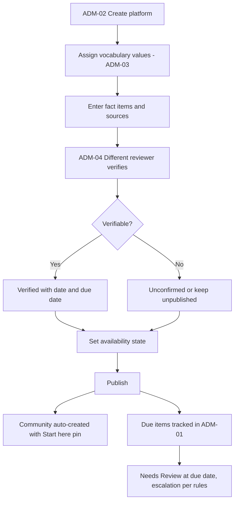

#### F-28 — Administrator reviews a suggestion

**Role:** Content Admin (Super Admin) · **Goal:** Decide edit suggestions and new-platform submissions · **Start:** ADM-05 · **Preconditions:** staff 2FA · **Completion:** Accepted, Rejected (with reason) or kept Pending with a note; the author is notified · **Pages:** ADM-05, ADM-04, ADM-02 · **Requirements:** FR-COR-001, FR-SUG-001

**Main flow (edit suggestion)**
1. The admin opens a suggestion with the fact item, proposed value and evidence.
2. The admin checks it against acceptable sources.
3. Accept: the fact updates, an edit-history entry is created, and status becomes Verified only if the evidence meets the source standards, otherwise Unconfirmed. Reject: a reason is mandatory. The author is notified (N-01). Target median decision time 7 days [F].

**Main flow (new platform)**
1. The admin independently checks identity (working website, accessible terms), payment and withdrawal information, Egypt availability and warnings.
2. Publish (possibly with *Not yet confirmed* availability and Unconfirmed items) or leave unpublished with a reason. The author is notified (N-02).

**ALT:** Request more information → a note inside Pending. The author withdraws → closed.
**ERR:** Rejection without a reason cannot be saved. Evidence insufficient for Verified → Unconfirmed, not Verified.
**DEC:** Accept, reject or ask for information.

#### F-29 — Administrator opens and resolves a Warning

**Role:** Content Admin with a second approver (Super Admin or another Content Admin) · **Goal:** Flag credible concerns about a platform without defamation · **Start:** ADM-02 / ADM-08 after a trigger · **Preconditions:** staff 2FA · **Completion:** the Warning is lifted, replaced by a sourced factual note, or the platform moves to Suspended or closed · **Pages:** ADM-02, ADM-08, ADM-11, PUB-04 · **Requirements:** FR-STAT-001

**Main flow**
1. A trigger arrives: at least three independent reports about the same issue within 30 days [F], or one report with documentary evidence, or an official notice.
2. A Content Admin triages within 3 days [F] and checks evidence, confirming with the platform where possible.
3. The admin proposes a Warning with neutral wording and a dated note; a second approver confirms.
4. The banner appears on PUB-04 and in comparison; members tracking the platform are notified (N-06). The Warning appears in the public status history.
5. The platform is re-reviewed every 14 days.
6. Within 60 days [F] the Warning is lifted, replaced by a sourced factual note, or the platform is moved to Suspended or closed (second approver).

**ALT:** The evidence is insufficient → no Warning; the reports may still trigger an early fact review. Negative reviews alone never trigger a Warning.
**ERR:** No second approver → the Warning cannot be set. Any wording containing "fraud" or "scam" needs second-person approval and legal review [L].
**DEC:** Open, keep, lift or escalate.

### 7.9 Notification flow

#### F-31 — Member opens a notification

**Role:** Member · **Goal:** See what changed and go to it · **Start:** bell or MEM-07 · **Preconditions:** signed in · **Completion:** the related content opens, or an explanation shows if it was removed · **Pages:** MEM-07 and the target page · **Requirements:** FR-NOT-001

**Main flow**
1. The bell shows the unread count (9+ above nine).
2. The member opens the list (newest first; similar items grouped).
3. The member selects a notification; it is marked read and opens the related content (platform page, My Contributions, appeal form, Settings export area).
4. The member may mark one or all as read.

**ALT:** Platform-update notifications (N-06) can be switched off in Settings; account, moderation and security notices cannot.
**ERR:** The content was removed → a clear explanation page state instead of a dead link. The list fails to load → retry. Empty → "nothing new".
