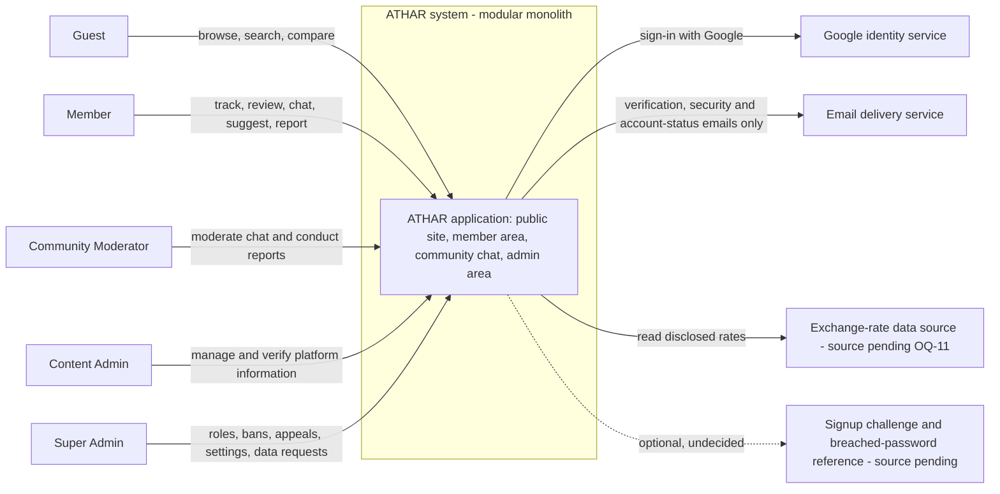
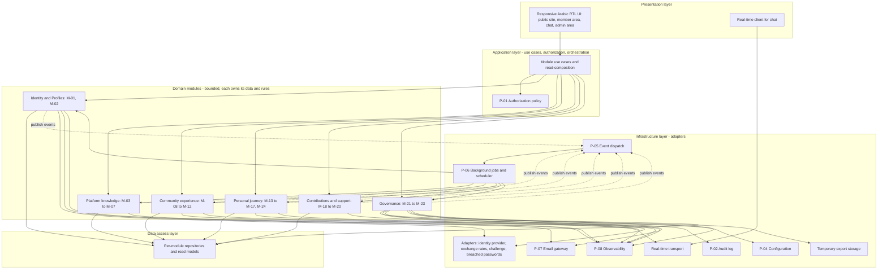

# ATHAR — System Architecture Blueprint

> Suggested location: `docs/03-architecture/SYSTEM-ARCHITECTURE.md`

**Purpose.** Define ATHAR's *logical* architecture: structure, boundaries, responsibilities and interactions. **This document does not choose a technology stack, vendor, database, framework, search engine or hosting model, and it contains no database schemas or API endpoint contracts.** Those belong to the Tech Stack and detailed technical-design documents. Where a technology-flavored word appears (for example "relational" or "queue"), it states a *capability requirement*, not a product decision.

**Sources.** Baseline *Product & UX Decisions v1.2* ("the baseline"); `PRD.md` v1.0; `SITEMAP-USER-FLOWS.md`; `UI-UX-SPECIFICATION.md`.

**Labels.**

| Label | Meaning |
| --- | --- |
| **[Req]** | Derived from an approved requirement (baseline or PRD). |
| **[Rec]** | Architectural recommendation by this document, not yet approved. |
| **[Open]** | Unresolved decision; see §16. |
| **[F]** / **[L]** | Pilot setting / legal matter, inherited from the baseline. |
| `PRD OD-xx`, `SC-xx` | Open decisions and source conflicts recorded in the PRD. |

**Conflict handling.** Where the baseline contradicts itself, this architecture follows the PRD's handling (CD-205 Favorites independent of tracking; CD-206 open membership without email verification; CD-207 no age rule) and makes the affected behavior a **configurable policy input**, not a hard-wired structure, so a decision can change without restructuring (§8.2, AD-07).

---

## 1. Architecture Overview

### 1.1 Architectural goals

| # | Goal | Basis |
| --- | --- | --- |
| AG-1 | **Protect trust integrity.** Keep the three information layers (*From the platform*, *Verified by ATHAR*, *Community experience*) structurally separate, so reviews can never alter verification status. | RD-B3, CD-012, CD-210 [Req] |
| AG-2 | **Make privacy a structural property**, not a UI convention: staff cannot read individual earnings, applications, notes or tracking; guests cannot read chat. | CD-014, CD-105, RD-F10 [Req] |
| AG-3 | **Keep operations simple** for a small early-stage team; no distributed infrastructure without demonstrated need. | CD-208 [Req], PRD §13 |
| AG-4 | **Enforce business rules in one place each**, with unambiguous module ownership. | Design goal [Rec] |
| AG-5 | **Support incremental delivery**, module by module, behind stable internal interfaces. | Design goal [Rec] |
| AG-6 | **Make time-based and workflow-based rules reliable**: verification due dates, Warning cycles, grace periods, retention purges. | RD-B4, RD-B5, RD-F4, §8.7 [Req] |
| AG-7 | **Keep configurable what the baseline calls pilot-tunable** ([F] values). | CD-209 [Req] |
| AG-8 | **Be auditable**: every privileged action is attributable and immutable. | RD-H2 [Req] |

### 1.2 Design principles

1. **Modularity by business capability.** Modules mirror the PRD's capabilities and own their data and rules.
2. **Dependency direction.** Outer layers depend inward; business rules do not depend on frameworks, transport, storage or external services (ports and adapters).
3. **Single owner per rule and per piece of data.** Other modules interact through published interfaces or events, never by reaching into another module's data.
4. **Server-side authority.** Every authorization, validation and rule check is enforced on the server side of the application boundary; client checks are conveniences only.
5. **Strong consistency where the baseline demands it; eventual consistency elsewhere** (§12.3).
6. **Privacy by construction and data minimization.** Collect only what is approved; no phone number, no real-name requirement, no tracking of anonymous visitors by default.
7. **No speculative infrastructure.** Each runtime component must trace to an approved requirement (§14).
8. **Explicit seams for the future.** Deferred features get extension points in the design, never implementation.
9. **Observable by default**, without logging private content.

### 1.3 Architecturally significant requirements

| ID | Requirement | Source | Architectural consequence |
| --- | --- | --- | --- |
| ASR-01 | Real-time group chat with edit/delete, pins, history search, link and contact controls, rate limits, slow mode, locks | CD-011, CD-109, RD-D5 to RD-D12 | A chat module with a real-time delivery boundary, per-community ordering, and moderation hooks |
| ASR-02 | Per-fact verification with interval-based status transitions and escalation | RD-B1, RD-B4, RD-B5, §7.1 | Scheduled processing and a verification-state model separate from fact values |
| ASR-03 | Personal journey data private even from staff | RD-F10, CD-014 | No staff-facing read path to tracking, applications, earnings; aggregate-only analytics |
| ASR-04 | Three information layers and rating rules with immediate effect on deletion | RD-B3, RD-C2, RD-C4 | Rating as a separate module updated synchronously with review changes |
| ASR-05 | In-app notifications only; transactional, security and account-status emails | CD-119, CD-204 | Notification module separate from an outbound-email gateway |
| ASR-06 | Export, deletion with grace period and anonymization choice, retention purges | RD-F4, RD-F5, §8.7 | A data-lifecycle orchestration module and a contract every data-owning module implements |
| ASR-07 | Arabic and Latin platform search with suggestions | RD-A8 | Search responsibilities with Arabic normalization (§10) |
| ASR-08 | Reports, sanctions, appeals, two-person rule, mandatory staff 2FA, audit log | RD-D8 to RD-D10, RD-B9, RD-H2 | Moderation and Administration modules; approval workflow; audit service |
| ASR-09 | Small team, pilot of roughly 100–300 members and about 30–40 launch platforms | CD-208, §13 | Single deployable application initially; capacity targets undefined (PRD OD-13) |
| ASR-10 | No third-party advertising trackers, no data sale | §8.1, CD-021 | First-party, aggregate-only analytics; minimal external dependencies |

### 1.4 Functional scope

The system implements every V1 module in PRD §6: homepage composition, directory, search, filters, comparison, platform details, sources, verification, status, community experiences, reviews, ratings, communities, membership, chat, chat search, message edit/delete, My ATHAR, My Platforms, Favorites, Applications, Earnings, Contributions, Notifications, suggestions, corrections, Help Center, profiles, accounts, privacy settings, export, deletion, administration, moderation, reporting and appeals.

**Excluded from V1** (and from this architecture): AI agent, direct messages, followers, stories/reels, feeds, platform or earnings integrations, live opportunity feed, courses, country expansion, English localization, chat images/attachments, push notifications, ordinary activity emails, replies/reactions/mentions in chat, user-created communities, community-scoped moderators, member 2FA, file evidence in suggestions (PRD §11).

### 1.5 Quality attributes (priority order [Rec])

| Priority | Attribute | Meaning for ATHAR | Notes |
| --- | --- | --- | --- |
| 1 | **Security and privacy** | Server-enforced authorization; private-by-default data; staff isolation | Targets are rules, not numbers |
| 2 | **Data integrity and trust** | One-per-user rules; no silent changes; immutable audit; rating correctness | Strong consistency for key invariants |
| 3 | **Reliability of time-based and real-time behavior** | Scheduled transitions run; chat degrades gracefully | Availability numbers are **[Open]** (PRD OD-13) |
| 4 | **Maintainability and testability** | Clear boundaries; rules testable without infrastructure | |
| 5 | **Performance** | Responsive discovery on mid-range mobile devices | Numeric targets **[Open]** |
| 6 | **Evolvability** | Extract components only on evidence | §13 |
| 7 | **Operability and observability** | Small team can diagnose without private data | §12 |
| 8 | **Accessibility and localization** | Delivered by the presentation layer; the architecture must not block RTL, Arabic search or Arabic exports | |

### 1.6 Constraints

| ID | Constraint | Source |
| --- | --- | --- |
| C-01 | Technology stack is **not** decided here | Task |
| C-02 | Excluded features in §1.4 must not enter the architecture | CD-022, CD-121 |
| C-03 | Legal items are unresolved: PDPL obligations, retention, UGC liability, wording about platforms | OQ-01 to OQ-12 [L] |
| C-04 | Numerical thresholds are pilot settings and must be configurable | CD-209 [F] |
| C-05 | Staff accounts require two-factor authentication | RD-F8 |
| C-06 | The product is Arabic-first and RTL; Arabic text must survive search, storage, export | CD-020, RD-E8 |
| C-07 | No partnership or integration with any platform or initiative may be implied or implemented | RD-J5, CD-022 |
| C-08 | Small team and early-stage operations | CD-208 |
| C-09 | Retention periods are recommended defaults [L][F] and must be adjustable without redesign | §8.7 |

### 1.7 Architectural assumptions

| ID | Assumption | Status |
| --- | --- | --- |
| AS-01 | V1 is a **responsive web application**; native mobile apps are not part of V1 (the baseline mentions none) | [Rec] — confirm |
| AS-02 | One operating entity and one primary deployment region initially (entity is **[Open]**, OQ-09) | [Rec] |
| AS-03 | All timestamps are stored and compared in a single canonical time basis; local time is applied only in presentation | [Rec] |
| AS-04 | A transactional data store with strong consistency for single-module transactions is available (capability, not product) | [Rec] |
| AS-05 | Thresholds, intervals, limits and retention periods are held in a configuration capability, changeable by Super Admins and audited | [Rec] from CD-209 |
| AS-06 | PRD conflict handling is followed: Favorites independent (CD-205), open membership with no email verification gate (CD-206), no age rule (CD-207) | PRD §15.1 |
| AS-07 | External services are limited to those the baseline requires (§3.3) | [Req] |

---

## 2. Architecture Style Evaluation

Layered and clean architecture are **internal structuring patterns**, not alternatives to a deployment style. They are evaluated separately and then combined.

### 2.1 Candidates

| Approach | What it is | Fit for ATHAR | Verdict |
| --- | --- | --- | --- |
| **Microservices** | Independently deployable services per capability, communicating over a network | No requirement demands independent scaling, independent release cadence per team, or technology heterogeneity. Cost: distributed transactions (one-review-per-platform, deletion workflows), network failure modes, operational overhead for a small team, privacy surface growth | **Rejected for V1** |
| **Plain layered architecture** (presentation → business → data) | Horizontal layers across the whole system | Simple and familiar, but without module boundaries, trust rules (rating, verification, moderation) become entangled; pressure to share tables across features | **Insufficient alone** |
| **Clean architecture / ports and adapters** | Business rules at the center; infrastructure depends inward | Excellent for protecting rules from frameworks and external services (Google sign-in, email, exchange rates) and for testability | **Adopted as the internal structure of each module** |
| **Domain-oriented modular architecture** | Business-capability modules with owned data and published interfaces | Matches the PRD's module map; supports incremental delivery and later extraction | **Adopted as the primary structuring principle** |
| **Modular monolith** | One deployable unit composed of strictly bounded modules | Single transaction scope per module; simple operations; one deployment | **Adopted as the deployment style** |

### 2.2 Recommendation [Rec — AD-01, AD-02]

**A domain-oriented modular monolith, with a clean/layered internal structure per module.** Modules are strictly bounded (own data, own rules, published interfaces, event publication), deployed together as one application. Two additional *logical* runtime components exist because the baseline demands behavior they supply: a **real-time delivery boundary** for chat and a **background processing capability** for scheduled and long-running work (§14). Both may live inside the same deployable unit initially.

### 2.3 Why it fits the current product

- The pilot is small (roughly 100–300 members, 30–40 platforms [F]); the team is small (CD-208).
- Several rules need atomic consistency inside one capability (one review per platform, one tracking entry per platform, one membership per community, aggregate update on review deletion).
- The privacy model is easier to enforce when data ownership is explicit and there are few network boundaries.
- Most workflows are request/response plus a few time-based jobs; real-time is confined to chat.

### 2.4 Benefits and limitations

| Benefits | Limitations |
| --- | --- |
| One deployment and one operational surface | A fault in one module can affect the whole runtime (mitigated by error boundaries, §12) |
| Strong consistency inside a module; simple local transactions | Scaling is by the whole unit until a component is extracted |
| Clear ownership of rules and data; easy to test | Needs discipline to prevent boundary erosion (enforced by structural checks, §13.4) |
| Easy to evolve by extracting a module along an existing seam | Real-time chat and background jobs may compete for resources in a single runtime until separated |
| Lowest cost for a pilot | Release coupling: all modules ship together |

### 2.5 What would justify evolving later

| Trigger (needs evidence) | Evolution |
| --- | --- |
| Chat concurrency degrades other modules or needs independent scaling | Extract the real-time delivery boundary and chat module |
| Search latency or index size outgrows the primary store | Introduce a dedicated search component behind the existing search port |
| Background workloads interfere with interactive traffic | Run background processing as a separate worker pool of the same codebase |
| Independent teams or release cadences emerge | Extract the module with the most independent lifecycle along its published interface |
| Moderation volume outgrows global moderators | Add community-scoped moderator assignment (Later candidate RD-D3) |

**No distributed infrastructure** (service mesh, event streaming platform, separate read databases, distributed caches) is introduced without a measured requirement.

---

## 3. System Context

### 3.1 Users and actors

| Actor | Type | Interaction |
| --- | --- | --- |
| Guest | Human, anonymous | Browses, searches, compares, reads public information; no chat messages |
| Member (unverified / verified email) | Human | Tracks journey, favorites, applications, earnings; reviews, suggestions, reports, community participation |
| Community Moderator | Staff | Chat conduct, reports on messages and accounts, pins, locks, blocklist, temporary sanctions |
| Content Admin | Staff | Platform content, verification, suggestions, review moderation, Help Center, support inbox |
| Super Admin | Staff | Roles, bans, appeals (final), settings, data requests, platform-wide notices, audit read |

### 3.2 External systems required by approved decisions

| System | Why required | Status |
| --- | --- | --- |
| **Google identity service** | Sign-in with Google (CD-013) | Required [Req] |
| **Outbound email delivery service** | Verification, password reset, security and account-status emails (CD-119, CD-204) | Required [Req] |
| **Exchange-rate data source** | Disclosed rates for earnings conversion (RD-E7) | Required, **source undecided** (OQ-11, PRD OD-17) |

### 3.3 External capabilities with an undecided source

| Capability | Source of the requirement | Decision pending |
| --- | --- | --- |
| Signup challenge | RD-F9 | Whether it uses an external provider; privacy implications |
| Known-breached password check | RD-F8 | Local reference data or an external service |

These are modelled as **ports** (§4.4). No provider is assumed.

### 3.4 Not integrated (by decision)

Digital work platforms and their sites (referenced by links only), payment providers, DEPI / Digital Egypt Pioneers or any initiative, push-notification services, advertising or tracking services, courses or marketplace systems (CD-022, RD-J5).

### 3.5 Context diagram

---

## 4. High-Level Architecture

### 4.1 Layers

The same five layers apply to the application as a whole and, in miniature, inside every module.

| Layer | Responsibilities | May depend on | Must not |
| --- | --- | --- | --- |
| **Presentation** | Responsive Arabic/RTL user interface for the public site, member area, community chat and admin area (sitemap pages); client-side usability validation; page composition (e.g., homepage sections); real-time client for chat; accessibility and localization | Application layer interfaces | Contain business rules, make authorization decisions, or access data stores |
| **Application** | Use cases (commands and queries) per module; transaction boundaries; authorization checks through the central policy; orchestration across domain objects; publishing domain events; read-composition (e.g., platform details assembly) via other modules' published interfaces | Domain layer; ports | Reach into another module's data or domain internals |
| **Domain (business logic)** | Entities, value objects, domain services and rules (qualifying review, availability and Warning model, verification state transitions, tracking statuses, application states, sanction ladder); domain events | Nothing outward | Know about transport, storage, frameworks, external services |
| **Data access** | Persistence behind repository ports; per-module private storage; read-model projections owned by their module | Domain layer (types), infrastructure facilities | Join or read another module's private data |
| **Infrastructure** | Adapters: identity provider, email, exchange-rate source, challenge, breached-password reference, scheduler, event dispatch, real-time transport, temporary file storage (export archives), configuration, logging, metrics, clock | Domain/application ports (implements them) | Contain business rules |

**Dependency rule.** Dependencies point inward: Presentation → Application → Domain; infrastructure implements ports declared by the inner layers.

### 4.2 Cross-cutting platform services

Shared by modules through explicit ports. They contain no product business rules beyond their own purpose.

| ID | Service | Purpose | Owner |
| --- | --- | --- | --- |
| P-01 | **Authorization policy** | Central decisions: role checks, ownership checks, account-state checks, community-membership checks, staff-isolation rules | Architecture-owned, rules fed by M-01, M-11, M-22 |
| P-02 | **Audit log** | Append-only record of privileged actions (who, what, when, before/after, reason) | M-21 |
| P-03 | **Abuse prevention and rate limiting** | Per-account and sign-in limits, duplicate detection, lockouts; values from configuration | M-22 (policy), used by M-01, M-08, M-12, M-19, M-22 |
| P-04 | **Configuration** | Thresholds, intervals, limits, retention periods marked [F]/[L]; audited changes | M-21 |
| P-05 | **Domain event dispatch** | Delivers published domain events to subscribers after the originating transaction commits | Infrastructure, contract owned by architecture |
| P-06 | **Background processing and scheduling** | Runs scheduled and long-running work (verification due transitions, Featured refresh, grace-period expiry, retention purges, export generation) | Infrastructure, jobs owned by the module that defines them |
| P-07 | **Outbound email gateway** | Sends transactional, security and account-status emails only | Infrastructure; callers are M-01, M-23, M-22 |
| P-08 | **Observability** | Structured logs, metrics, traces, alerts without private content | Infrastructure |
| P-09 | **Content safety checks** | Automated checks for contact details, referral links, phone patterns, profanity, link rules, blocklist | M-22 (rules and blocklist), invoked by M-08, M-12 |

### 4.3 Architecture diagram

---

## 5. Module Breakdown

### 5.1 Module map

| ID | Module | Group | PRD feature IDs |
| --- | --- | --- | --- |
| M-01 | Authentication and Identity | Identity | FR-ACC-001, FR-ACC-002 |
| M-02 | User Profiles | Identity | FR-PROF-001, FR-PRIV-001 (visibility part) |
| M-03 | Platform Directory | Platform knowledge | FR-HOME-001 (featured), FR-DIR-001, FR-DIR-002 |
| M-04 | Platform Information | Platform knowledge | FR-PLAT-001, FR-STAT-001, FR-ADM-002 |
| M-05 | Platform Verification | Platform knowledge | FR-VER-001, FR-SRC-001, FR-ADM-003 (verification part) |
| M-06 | Search and Discovery | Platform knowledge | FR-SRCH-001, FR-FILT-001 |
| M-07 | Platform Comparison | Platform knowledge | FR-CMP-001 |
| M-08 | Reviews and Experiences | Community experience | FR-REV-001, FR-XP-001 |
| M-09 | Rating System | Community experience | FR-RAT-001 |
| M-10 | Communities | Community experience | FR-COM-001 |
| M-11 | Community Membership | Community experience | FR-MEM-001 |
| M-12 | Chat and Messages | Community experience | FR-CHAT-001, FR-CHS-001, FR-MSG-001 |
| M-13 | My ATHAR | Personal journey | FR-MYA-001 |
| M-14 | Platform Tracking | Personal journey | FR-MYP-001 |
| M-15 | Application Tracking | Personal journey | FR-APP-001 |
| M-16 | Earnings Tracking | Personal journey | FR-ERN-001 |
| M-17 | Contributions | Personal journey | FR-CON-001 |
| M-18 | Notifications | Contributions and support | FR-NOT-001 |
| M-19 | Suggestions and Corrections | Contributions and support | FR-SUG-001, FR-COR-001 |
| M-20 | Help Center | Contributions and support | FR-HELP-001 |
| M-21 | Administration | Governance | FR-ADM-001, FR-ADM-004 |
| M-22 | Moderation | Governance | FR-RPT-001, FR-MOD-001, FR-APL-001 |
| M-23 | Privacy and Data Management | Governance | FR-DEXP-001, FR-DEL-001, FR-PRIV-001 (lifecycle part) |
| M-24 | Favorites | Personal journey | FR-FAV-001 |

M-24 is added because the PRD defines Favorites as an independent feature (CD-205) that the architecture brief's module list does not name; leaving it unowned would break the ownership rule. Homepage composition (FR-HOME-001) is a read-composition in the application layer that calls M-03, M-10 and M-13; it owns no data.

### 5.2 Module specifications

Entities are logical names only (no schemas). "Inputs/Outputs" describe conceptual commands, queries and events, not endpoints.

#### M-01 — Authentication and Identity

| Aspect | Specification |
| --- | --- |
| Purpose | Establish who a user is and keep the account lifecycle and sessions secure |
| Responsibilities | Sign-up (email and password, Google); email verification; sign-in/sign-out; password recovery; password policy (at least 10 characters, known-breached check, no composition rules); sign-in rate limiting and temporary lockout; session list, end-session, password change ends other sessions; email change confirmed at old and new addresses; re-authentication for sensitive operations; recording acceptance of Terms and Privacy Policy; staff two-factor enforcement; account state (active, deletion-pending); holding role assignments (changed only on command from M-21) |
| Main entities | Account, Credential, ExternalIdentityLink, Session, VerificationToken, RecoveryToken, TermsAcceptanceRecord, StaffSecondFactor, RoleAssignment |
| Main use cases | Sign up; verify email; sign in; recover password; change password/email; list and end sessions; re-authenticate; enrol staff second factor |
| Inputs | Credentials; tokens; external identity assertions; role-change commands from M-21; restriction state from M-22; deletion state from M-23 |
| Outputs | Authenticated **principal context** (account id, roles, email-verified flag, account state) to every module; security emails via P-07 |
| Dependencies | Ports: identity provider, breached-password reference, signup challenge; P-03; P-07 |
| Events / interactions | Publishes `UserSignedUp`, `EmailVerified`, `PasswordChanged`, `AccountStateChanged`. Consumes `AccountSuspended/Reinstated` (M-22), `DeletionStarted/Cancelled/Completed` (M-23) |
| Ownership boundaries | Credentials, sessions, tokens, account state, role holdings |
| Explicit exclusions | Profile data (M-02); business authorization decisions (P-01); phone numbers; age verification (PRD OD-03 open); member two-factor (Later) |

#### M-02 — User Profiles

| Aspect | Specification |
| --- | --- |
| Purpose | Own the member's display identity and the visibility of any public profile |
| Responsibilities | Display name rules (3–30 characters, no impersonation or reserved words, change at most once per 30 days [F]); optional fields (photo, bio, governorate, interests, experience level); per-field visibility; profile private by default; link-only, unlisted, unindexed public profile; joined-communities visibility; public statistics (reviews written, accepted contributions, member-since) obtained via module interfaces; "Former member" anonymization of displayed identity; propagation of display name changes to displays |
| Main entities | Profile, VisibilitySettings, DisplayNameHistory (internal) |
| Main use cases | Edit profile; set visibility; view public profile; resolve display identity for another module |
| Inputs | Profile commands from the member; `AccountStateChanged`; anonymization instruction from M-23 |
| Outputs | Display identity (display name or "Former member", profile-link flag) to M-08, M-12; public profile view |
| Dependencies | M-01 (account), M-08 and M-19 (aggregate counts via interfaces), P-01 |
| Events / interactions | Publishes `DisplayNameChanged`, `ProfileVisibilityChanged`; consumes `UserSignedUp` (creates profile), `Anonymize` instructions |
| Ownership boundaries | Display name, optional fields, visibility settings |
| Explicit exclusions | Followers, user search or directory, indexing of profiles, private journey data, earnings |

#### M-03 — Platform Directory

| Aspect | Specification |
| --- | --- |
| Purpose | Present the catalog of published platforms for browsing and the homepage |
| Responsibilities | Catalog read model for cards (name, categories, availability, Warning badge, rating summary, last verification); default listing rules (Suspended or closed hidden unless selected); Featured Platforms selection (about 6 slots: admin picks, highly rated, recently added; eligibility rules; daily refresh; 30-day pick re-confirmation); popularity calculation (distinct users who started tracking or joined the community within 90 days [F], using aggregate counts only); category tiles for the homepage |
| Main entities | DirectoryEntry (read model), FeaturedPool, FeaturedPick, PopularitySnapshot |
| Main use cases | List platforms for discovery; produce homepage featured set; record Featured picks; compute popularity |
| Inputs | Events from M-04, M-05, M-09; aggregate counts from M-14 and M-11 (no individual records); Featured picks from Content Admin |
| Outputs | Directory entries to M-06 and the homepage; Featured set |
| Dependencies | M-04, M-05, M-09, M-14 (aggregate), M-11 (aggregate), P-04, P-06 |
| Events / interactions | Consumes `PlatformPublished`, `PlatformStateChanged`, `WarningFlagChanged`, `FactVerificationChanged`, `RatingAggregateChanged`; publishes `FeaturedSetChanged` |
| Ownership boundaries | Featured selection and logging, popularity, directory read model |
| Explicit exclusions | Sponsorship, paid placement, editing platform facts, search execution (M-06) |

#### M-04 — Platform Information

| Aspect | Specification |
| --- | --- |
| Purpose | Own the platform record: identity, fact values, taxonomy, availability, Warning flag and history |
| Responsibilities | Platform lifecycle (draft, published, merged); fact-item values; the five controlled vocabularies (category, work type, opportunity type, experience level, payment method) managed by Content Admins; availability states (Available, Available with restrictions with mandatory note, Unavailable, Suspended or closed, Not yet confirmed); independent Warning/under-review flag and its procedure (intake, triage, decision with second approver, 14-day review, 60-day resolution [F]); dated public status history and update history; platform-details assembly (composing M-05, M-09, M-08 summaries); merging duplicates (Super Admin) with history and community preserved; rule that platforms are never deleted |
| Main entities | Platform, FactItem (value), Vocabulary values, AvailabilityState, WarningFlag, WarningCase, StatusHistoryEntry, UpdateHistoryEntry |
| Main use cases | Create/edit/publish; set availability; open/lift Warning; apply accepted correction; merge duplicates; assemble platform details |
| Inputs | Admin commands; accepted corrections from M-19; approvals from the approval workflow (M-21) |
| Outputs | Platform views; events for projections, communities, notifications |
| Dependencies | M-05, M-09, M-08 (summaries), M-21 (approval workflow), P-01, P-02 |
| Events / interactions | Publishes `PlatformPublished`, `PlatformStateChanged`, `WarningFlagChanged`, `FactValueChanged`, `PlatformMerged`. Consumes `ReportFiled` for platform information (queue signal) |
| Ownership boundaries | Platform record, availability, Warning, histories, taxonomy |
| Explicit exclusions | Verification status and sources (M-05); reviews and ratings (M-08, M-09); communities (M-10); any wording of "fraud" or "scam" generated by the system |

#### M-05 — Platform Verification

| Aspect | Specification |
| --- | --- |
| Purpose | Make every important fact's trustworthiness explicit and time-bound |
| Responsibilities | Per-fact verification record (sources with title, link, access date; status; verification date; reviewer; next due date); statuses Verified, Needs Review, Unconfirmed; source standards (platform documents, ATHAR direct test, reputable third-party reports, user reports as support only); interval classes (Class 1 every 60 days, Class 2 every 120, Class 3 every 180, Warning items every 14 [F]); scheduled transition of overdue items to Needs Review; escalation (queue priority after 14 days; Featured-eligibility signal for overdue Class 1); platform-level last verification (oldest core-fact date); early review triggers; separation of duties (author never verifies); "Reviewed by the ATHAR Content Team" label |
| Main entities | VerificationRecord, Source, VerificationStatus, DueSchedule, FreshnessSummary |
| Main use cases | Verify a fact; record sources; list due/overdue items; compute freshness |
| Inputs | Verification commands from Content Admins; `FactValueChanged`; early-review triggers from M-19 and M-22 |
| Outputs | Status, dates, sources per fact; freshness summary; events |
| Dependencies | M-04 (fact identity), P-04, P-06, P-01, P-02 |
| Events / interactions | Publishes `FactVerificationChanged`, `FactNeededReview`, `FreshnessLost`; consumes `FactValueChanged`, `EarlyReviewRequested` |
| Ownership boundaries | Verification state and sources; due schedules; freshness |
| Explicit exclusions | Reviews and ratings can never change verification (BR-015); user reports alone can never produce Verified; screenshots are never published |

#### M-06 — Search and Discovery

| Aspect | Specification |
| --- | --- |
| Purpose | Execute platform search, suggestions, filtering and sorting |
| Responsibilities | Query by platform name, category, work type, payment method; suggestions before and while typing (grouped: platforms, work types, payment methods, categories); filter logic (OR within a filter, AND across); sorts (relevance, popularity, rating via evidence-weighted score, newest additions, last verification) with the defined tie-breaks; result counts; pagination; visibility rules; maintain the platform search projection from events; Arabic and Latin normalization (§10) |
| Main entities | SearchProjection (logical), SuggestionSet, PopularTerms |
| Main use cases | Search; suggest; filter; sort; count |
| Inputs | Query parameters; events from M-03, M-04, M-05, M-09 |
| Outputs | Result pages, suggestions, counts |
| Dependencies | M-03 (directory entries, popularity), M-04, M-05, M-09 |
| Events / interactions | Consumes projection-feeding events; publishes none required |
| Ownership boundaries | The platform search projection and query behavior |
| Explicit exclusions | Searching communities (M-10), chat (M-12), members, help (M-20); personalization |

#### M-07 — Platform Comparison

| Aspect | Specification |
| --- | --- |
| Purpose | Compose a side-by-side view of up to three platforms |
| Responsibilities | Enforce the maximum of three platforms; assemble availability, work types, payment methods, requirements, experience level and advantages/challenges with each fact's status and date; carry layer labels and Warning banners; stateless |
| Main entities | ComparisonView (transient) |
| Main use cases | Build comparison from platform identifiers |
| Inputs | Platform identifiers from the client |
| Outputs | Comparison view |
| Dependencies | M-04, M-05, M-09 / M-08 summaries |
| Events / interactions | None; synchronous reads only |
| Ownership boundaries | The composition rule (max three) |
| Explicit exclusions | Persisting comparisons, recommendations; the provenance of "advantages and challenges" is **[Open]** (PRD OD-15) |

#### M-08 — Reviews and Experiences

| Aspect | Specification |
| --- | --- |
| Purpose | Capture and present members' self-declared experiences |
| Responsibilities | One review per user per platform; required rating and experience type; optional advantages, challenges, comments; affiliation/compensation confirmation; four experience types; label "Experience reported by the user"; immediate publication after automated checks; edit/delete with internal version history; moderation states (held, removed, restored) applied on command from M-22/M-21; per-account daily limit [F]; breakdown by experience type; display identity from M-02; handling of "Former member" |
| Main entities | Review, ReviewVersion, ReviewModerationState |
| Main use cases | Submit; edit; delete; hold/remove/restore; list with filter by experience type |
| Inputs | Member commands; moderation commands; display identity |
| Outputs | Review lists and summaries; events |
| Dependencies | M-01 (principal), M-02, M-04 (platform exists), M-22 via P-09 (safety checks), P-03 |
| Events / interactions | Publishes `ReviewPublished`, `ReviewEdited`, `ReviewDeleted`, `ReviewHeld`, `ReviewRemoved`, `ReviewRestored`, `ReviewAnonymized` |
| Ownership boundaries | Review content, versions and moderation state |
| Explicit exclusions | Rating computation (M-09); changing verification status; helpfulness votes; replies |

#### M-09 — Rating System

| Aspect | Specification |
| --- | --- |
| Purpose | Compute fair, rule-conformant ratings |
| Responsibilities | Qualifying reviews (*Worked on the platform* only); real average and counts; headline shown only with at least 3 qualifying reviews [F]; directory-wide average; evidence-weighted score for rating sort (weight equivalent to 10 reviews [F]; formula **[Open]**, PRD OD-10); ordering rules for platforms with fewer than 3 qualifying reviews; recompute on review events; immediate removal of deleted reviews from aggregates |
| Main entities | RatingAggregate (per platform), DirectoryAverage, ScoringConfiguration |
| Main use cases | Update aggregate; read aggregate; read ranking score |
| Inputs | Review events/queries from M-08; configuration from P-04 |
| Outputs | Aggregates and scores to M-03, M-04, M-06, M-07 |
| Dependencies | M-08, P-04 |
| Events / interactions | Consumes `Review*`; publishes `RatingAggregateChanged` |
| Ownership boundaries | Aggregates and scoring rules |
| Explicit exclusions | Review storage; moderation; verification |

#### M-10 — Communities

| Aspect | Specification |
| --- | --- |
| Purpose | Own the community entities and their public information |
| Responsibilities | General community at launch; one platform community created automatically on platform publication (with the system "Start here" pin created through M-12); states Open, Read-only, Archived; description and rules summary; public information view for guests; Browse Communities (search by name or platform; sort by activity, newest, member count); activity indicator (derived, privacy-safe) and the honest "New community" label; selection of Active Communities for the homepage (General first, then most active, then featured platforms' communities; one pinned slot) |
| Main entities | Community, CommunityState, RulesSummary, ActivityIndicator |
| Main use cases | Create platform community; edit information; set state; browse; select homepage communities |
| Inputs | `PlatformPublished`, `PlatformMerged`; moderator/Super Admin commands; member counts from M-11; activity signals from M-12 |
| Outputs | Public community views; events |
| Dependencies | M-04 (events), M-11 (counts), M-12 (activity), P-01 |
| Events / interactions | Publishes `CommunityCreated`, `CommunityStateChanged` |
| Ownership boundaries | Community identity, state, public information |
| Explicit exclusions | Message content (M-12); user-created communities; auto-deletion or auto-archiving for low activity; the definition of "active member" for the activity threshold is **[Open]** (AO-13) |

#### M-11 — Community Membership

| Aspect | Specification |
| --- | --- |
| Purpose | Own who belongs to which community |
| Responsibilities | One-click join for any registered member into any Open community; leave at any time; membership checks for M-12; member counts; removal only through a moderation sanction (read from M-22); no member list; "offer once to join" tracking for onboarding, Favorites and tracking prompts |
| Main entities | Membership, JoinOfferRecord |
| Main use cases | Join; leave; check membership; count members |
| Inputs | Member commands; sanctions from M-22; account state from M-01 |
| Outputs | Membership decisions; counts; events |
| Dependencies | M-10, M-01, M-22, P-01 |
| Events / interactions | Publishes `MemberJoined`, `MemberLeft`; consumes `SanctionApplied`, `DeletionCompleted` |
| Ownership boundaries | Memberships |
| Explicit exclusions | Approval flows; identity screening; email-verification gate (policy-configurable, PRD OD-02); member lists; in-community roles |

#### M-12 — Chat and Messages

| Aspect | Specification |
| --- | --- |
| Purpose | Provide flat, real-time group chat for joined members |
| Responsibilities | Post text and links (2,000 characters [F]); real-time delivery; per-community message ordering; edit (with "edited" marker; prior text kept 30 days [F]) and delete (placeholder); moderator removal placeholder and evidence retention; pins (≤ 5; Rules/Resource/Announcement; system "Start here" pin); history and **history search** (members only, one community at a time, excluding deleted content); link rules (plain-text display, first-24-hour link block, shorteners, group-invite links, blocklist); held messages (phone numbers, handles); rate limit 10/min [F], duplicate blocking, slow mode, locks; retention 24 months rolling; connection-state support for clients |
| Main entities | Message, MessageRevision, Pin, HeldMessage, ChatControls (slow mode, lock) |
| Main use cases | Send; edit; delete; pin/unpin; read history; search history; hold/release |
| Inputs | Member commands; moderator commands; safety rules from M-22; membership from M-11; community state from M-10 |
| Outputs | Real-time message stream; history pages; search results; events |
| Dependencies | M-11, M-10, M-22 (P-09), M-02 (display identity), P-03, P-01, real-time transport |
| Events / interactions | Publishes `MessagePosted` (internal, minimal), `MessageEdited`, `MessageDeleted`, `MessageRemoved`, `MessagePinned`; **never creates per-message notifications** |
| Ownership boundaries | Message content, revisions, pins, chat controls, chat search |
| Explicit exclusions | Replies, reactions, mentions, threads, read receipts, typing indicators, attachments, images, link previews, direct messages, bots or simulated activity |
