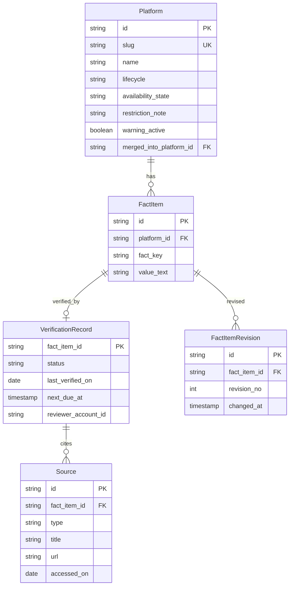
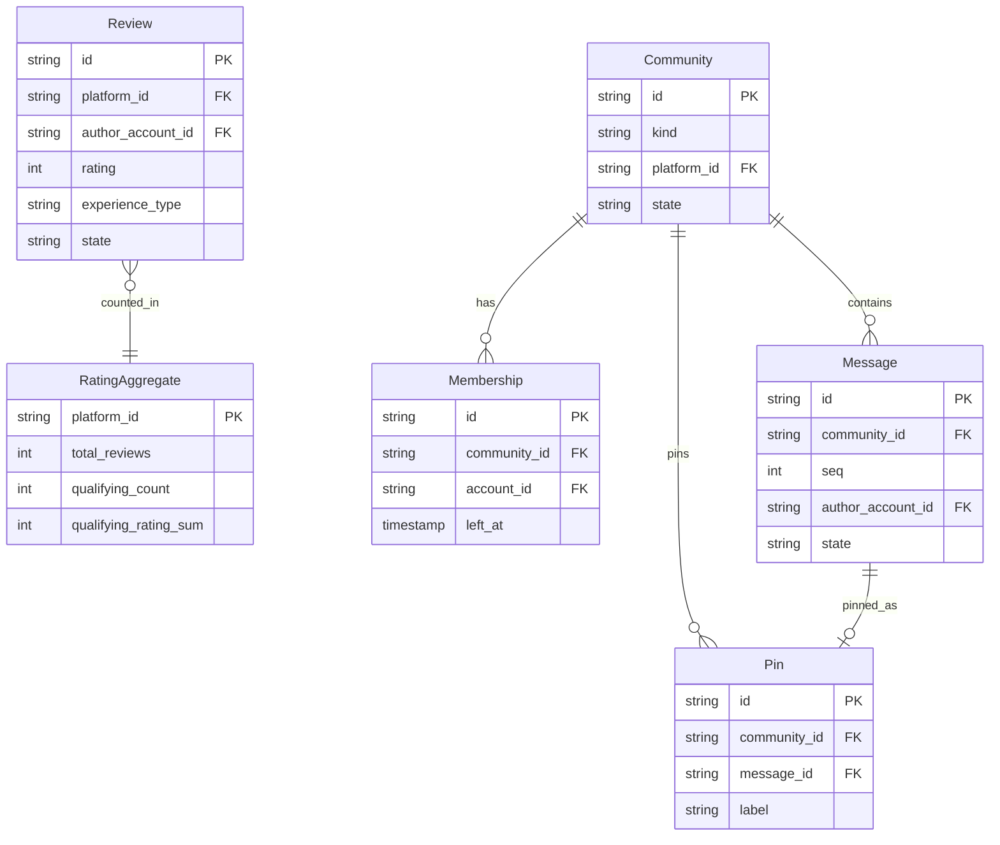

# ATHAR — Database and API Design

> Suggested location: `docs/04-technical/DATABASE-API-DESIGN.md`

**Purpose.** A *conceptual* (logical) data model and an HTTP API contract detailed enough to guide backend implementation. **No database engine, query language, framework or transport library is chosen.** Types are logical; identifiers, constraints and indexes are described by intent so they can be mapped to any suitable store.

**Sources.** Baseline *Product & UX Decisions v1.2*; `PRD.md`; `SITEMAP-USER-FLOWS.md`; `SYSTEM-ARCHITECTURE.md` (modules `M-01`…`M-24`, services `P-01`…`P-09`); `UI-UX-SPECIFICATION.md`.

**Labels.** **(P)** proposed field/rule (not in the baseline; needs approval). Unmarked fields trace to the baseline/PRD. **[F]** pilot setting (configurable, not hard-coded). **[L]** legal confirmation pending. **[Open]** unresolved (see §19). Source conflicts follow the PRD's handling (Favorites independent of tracking, CD-205; open community membership without email verification, CD-206; no age field, CD-207). Conditions that depend on those open decisions are modelled as **policy parameters**, not schema.

**Out of scope here.** Excluded features (direct messages, replies, reactions, mentions, threads, attachments, push notifications, followers, feeds, stories, integrations, AI agent, courses, English localization) have **no entities and no endpoints**.

---

# PART A — DATA MODEL

## 1. Data Architecture Principles

| Principle | Application |
| --- | --- |
| **Data ownership** | Every entity is owned by exactly one module (architecture §5). Other modules read it only through that module's interface or an event-fed projection; **no cross-module joins** against another module's private data. The ERD in §4 shows logical references between entities; a reference across modules is an *identifier reference*, not permission to read. |
| **Data integrity** | Business invariants are enforced inside the owning module's transaction and backed by uniqueness constraints (e.g., one active review per author per platform). The API never trusts client-supplied ownership. |
| **Normalization** | Third normal form by default. Denormalization is allowed only for a justified reason and is marked **derived** with its source and refresh rule (e.g., `warning_active`, rating aggregates, search/directory projections). |
| **Referential integrity** | Foreign keys are declared logically between entities of the **same module**. Cross-module references are by opaque identifier plus existence checks at write time; deletion behavior is stated per entity (restrict, anonymize, cascade by lifecycle job). |
| **Privacy** | Each entity carries a **privacy class**: *Public*, *Members-only*, *Private to user*, *Staff-restricted*, *Internal*. Private-journey entities (tracking, applications, earnings, favorites, notes) have **no staff read path** (RD-F10). Data minimization: no phone, no real name, no age. |
| **Auditability** | Privileged actions write immutable `AuditEntry` rows (who, what, when, before/after, reason). User-facing histories (status, update, tracking, application) are separate append-only tables where the baseline requires dated history. |
| **Soft vs permanent deletion** | *Never deleted for status reasons:* platforms (CD-111). *Soft-deleted with timed purge* (internal retention): reviews, messages, versions, moderation evidence. *Hard-deleted after grace:* personal data on account deletion. *Anonymized:* reviews/messages the member chose to keep. Each entity states its behavior. |
| **Retention** | Retention periods are **configuration** (baseline §8.7, [F][L]); each purge-eligible row stores a `purge_after` (or is purged by rule) so jobs are simple and auditable. |
| **Transaction boundaries** | One command = one transaction in one module. Rating aggregate updates occur in the **same transaction** as review changes (architecture AD-08). Cross-module effects use events/process managers; no distributed transactions. |
| **Time** | All timestamps UTC; dates without time (`date`) only where the baseline defines a calendar date (earnings date, verification date shown to users, rate date). |
| **Identifiers** | Opaque, non-sequential identifiers (type `id`), not guessable, not encoding personal data. Public slugs for platforms and communities (unique, URL-safe, immutable once published (P)). |
| **Reference data** | Fixed lists (experience types, statuses, reason codes, fact keys) are modelled as **enumerations** owned by the module; admin-managed lists (five vocabularies) are rows. |

### 1.1 Standard columns

Unless stated otherwise every entity has: `id` (id, PK), `created_at` (timestamp, required). Mutable entities also have `updated_at` (timestamp). These are not repeated in the entity tables.

### 1.2 Logical types

`id`, `text(n)` bounded text, `text` unbounded, `int`, `decimal` (exact, no floating point; precision decided in the stack document), `bool`, `timestamp`, `date`, `enum(...)`, `url`, `code` (ISO 4217 currency code), `email`.

---

## 2. Entity Inventory

Entities are included only if a requirement needs them. Items from the brief that are **not separate entities** are explained.

| # | Entity | Module | Needed for |
| --- | --- | --- | --- |
| **Identity (M-01)** | | | |
| 1 | Account | M-01 | Users |
| 2 | Credential | M-01 | Email/password sign-in |
| 3 | ExternalIdentityLink | M-01 | Google sign-in |
| 4 | Session | M-01 | Session list/end |
| 5 | EmailVerificationToken | M-01 | Email verification |
| 6 | PasswordRecoveryToken | M-01 | Password recovery |
| 7 | EmailChangeRequest | M-01 | Email change confirmed at both addresses |
| 8 | StaffSecondFactor | M-01 | Staff 2FA (method open) |
| 9 | TermsAcceptance | M-01 | Recorded acceptance of Terms/Privacy |
| 10 | SecurityEvent | M-01 | Security emails; 12-month security logs |
| 11 | Role | M-01/M-21 | Roles and Permissions (seeded reference data) |
| 12 | RoleAssignment | M-01/M-21 | Staff roles |
| 13 | Permission, RolePermission | M-21 | Permission matrix as seeded policy data (P; may be static configuration) |
| **Profiles (M-02)** | | | |
| 14 | Profile | M-02 | User Profiles |
| 15 | DisplayNameHistory | M-02 | Internal history of display-name changes |
| **Platform knowledge (M-03…M-05)** | | | |
| 16 | Platform | M-04 | Platforms |
| 17 | VocabularyValue | M-04 | Platform Categories and the other four vocabularies |
| 18 | PlatformVocabularyLink | M-04 | Platform ↔ vocabulary values |
| 19 | FactItem | M-04 | Platform Information |
| 20 | FactItemRevision | M-04 | Public update history |
| 21 | PlatformStatusHistory | M-04 | Platform Status History |
| 22 | WarningCase | M-04 | Warning procedure |
| 23 | VerificationRecord | M-05 | Verification Records |
| 24 | Source | M-05 | Information Sources |
| 25 | FeaturedPick | M-03 | Featured admin picks |
| 26 | FeaturedRotation | M-03 | Daily featured set (P) |
| 27 | PopularitySnapshot | M-03 | Popularity (derived) |
| **Community experience (M-08…M-12)** | | | |
| 28 | Review | M-08 | Reviews; *User Experiences = `experience_type` attribute* (no separate entity) |
| 29 | ReviewVersion | M-08 | Internal review history |
| 30 | RatingAggregate | M-09 | Rating Aggregates |
| 31 | DirectoryRatingStats | M-09 | Directory-wide average for the weighted score |
| 32 | Community | M-10 | Communities |
| 33 | HomeCommunityPin | M-10 | One pinned homepage slot |
| 34 | Membership | M-11 | Community Memberships |
| 35 | JoinOfferRecord | M-11 | "Offer once" prompts |
| 36 | Message | M-12 | Messages |
| 37 | MessageRevision | M-12 | Message Edit History (required by RD-D5: prior text kept 30 days) |
| 38 | Pin | M-12 | Pinned messages and system "Start here" |
| 39 | ChatControl | M-12 | Slow mode (lock is community state) |
| **Personal journey (M-13…M-17, M-24)** | | | |
| 40 | TrackingEntry | M-14 | Platform Tracking |
| 41 | TrackingStatusChange | M-14 | Dated status history |
| 42 | TrackingNote | M-14 | Private notes |
| 43 | Favorite | M-24 | Favorites |
| 44 | Application | M-15 | Applications |
| 45 | ApplicationStateChange | M-15 | Timestamped changes |
| 46 | EarningsEntry | M-16 | Earnings Records |
| 47 | ConversionLock | M-16 | Locked conversion rate per entry |
| 48 | RateSnapshot | M-16 | Disclosed exchange rates |
| 49 | EarningsPreference | M-16 | Display currency |
| 50 | PromptDismissal | M-13 | Dismissed review prompt |
| — | *Contributions* | M-17 | **Not an entity**: a read-composition of Review, EditSuggestion and NewPlatformSuggestion |
| **Contributions and support (M-18…M-20)** | | | |
| 51 | EditSuggestion | M-19 | Suggestions and Corrections (*a "correction" is an edit suggestion plus its accepted FactItemRevision*) |
| 52 | NewPlatformSuggestion | M-19 | Suggestions |
| 53 | Notification | M-18 | Notifications |
| 54 | NotificationPreference | M-18 | Platform-update switch |
| 55 | HelpTopic, HelpEntry | M-20 | Help Center Content |
| 56 | ManagedPage | M-20 | Legal pages, How Verification Works, About |
| 57 | ContactMessage | M-20 | Contact intake |
| **Governance (M-21…M-23)** | | | |
| 58 | Report | M-22 | Message Reports and other reports |
| 59 | ModerationAction | M-22 | Action ladder |
| 60 | Sanction | M-22 | Mute/restriction/suspension/ban |
| 61 | Appeal | M-22 | Appeals |
| 62 | DomainBlocklistEntry | M-22 | Link safety |
| 63 | AuditEntry | M-21 | Administrative Audit Logs |
| 64 | ConfigSetting | M-21 | [F] settings |
| 65 | ApprovalRequest | M-21 | Two-person rule |
| 66 | AffiliationDeclaration | M-21 | Conflict-of-interest rule |
| 67 | PlatformWideNotice | M-21 | N-07 notices |
| 68 | DataExportRequest | M-23 | Export |
| 69 | DeletionRequest | M-23 | Deletion |
| 70 | DeletionLedgerEntry | M-23 | Restore safety |
| **Infrastructure** | | | |
| 71 | IdempotencyRecord | all | Safe retries |
| 72 | OutboxEvent | all | Reliable post-commit event dispatch (P) |

Not persisted as entities: rate-limit counters (ephemeral), search indexes (projections), activity indicators (derived; see §5.12, [Open] AO-13), contribution lists (composition).

---

## 3. Entity Specifications

**How to read.** Each entity lists attributes (`Req` = required), then **Keys/Constraints**, **Relationships**, **Privacy**, **Deletion**, **Audit**. `FK→` references the same module unless marked *(ref)* = cross-module identifier reference. Validation limits not given in the baseline are **(P)**.

### 3.1 Identity module (M-01)

#### Account — core user identity

| Attribute | Type | Req | Notes |
| --- | --- | --- | --- |
| id | id | Y | PK |
| email | email | Y | Unique (case-insensitive, normalized); visible only to Super Admin and the owner |
| email_verified_at | timestamp | N | Null = unverified |
| state | enum(active, deletion_pending, deleted) | Y | `deleted` only transiently; account row removed at completion |
| created_at | timestamp | Y | |
| last_sign_in_at | timestamp | N | Security use |

Keys/Constraints: unique(email); no phone, no age, no real name fields. Relationships: 1—1 Credential (optional), 1—N ExternalIdentityLink, Session, RoleAssignment; 1—1 Profile *(ref M-02)*. Privacy: Staff-restricted (email) / Private. Deletion: hard-delete at deletion completion (after grace); suspended/banned status is **not** stored here (owned by Sanction). Audit: role changes and state changes audited.

#### Credential

| Attribute | Type | Req | Notes |
| --- | --- | --- | --- |
| account_id | id | Y | FK→Account, PK |
| password_hash | text | Y | Slow salted hash; algorithm decided in Tech Stack |
| password_changed_at | timestamp | Y | |
| failed_attempts | int | Y | For lockout; reset on success |
| locked_until | timestamp | N | Temporary lockout (duration [Open]) |

Privacy: Internal (never exposed, never exported). Deletion: removed with Account. Audit: password changes logged as SecurityEvent.

#### ExternalIdentityLink

| Attribute | Type | Req | Notes |
| --- | --- | --- | --- |
| account_id | id | Y | FK→Account |
| provider | enum(google) | Y | |
| provider_subject | text | Y | Provider's stable user id |
Constraint: unique(provider, provider_subject). Google links to the same verified email. Privacy: Internal. Deletion: with Account.

#### Session

| Attribute | Type | Req | Notes |
| --- | --- | --- | --- |
| id | id | Y | |
| account_id | id | Y | FK→Account |
| secret_hash | text | Y | Hash of the session credential |
| created_at / last_seen_at / expires_at | timestamp | Y | Lifetimes **[Open]** |
| device_label | text(100) | N | Coarse, e.g. browser/OS (P) |
| reauthenticated_at | timestamp | N | For "recent sign-in confirmation" |
| second_factor_verified_at | timestamp | N | Staff only |
| ended_at | timestamp | N | |
Constraints: index on account_id. Privacy: Private (own list) / Internal. Deletion: purged after expiry/ended (security log retention 12 months applies to SecurityEvent, not Session).

#### EmailVerificationToken / PasswordRecoveryToken / EmailChangeRequest

| Entity | Attributes | Notes |
| --- | --- | --- |
| EmailVerificationToken | id, account_id (FK), token_hash, expires_at, used_at | Single use; expiry [Open] |
| PasswordRecoveryToken | id, account_id (FK), token_hash, expires_at, used_at | Single use; confirmation must not reveal account existence |
| EmailChangeRequest | id, account_id (FK), new_email, old_email_confirmed_at, new_email_confirmed_at, expires_at, completed_at | Both confirmations required (RD-F8) |
Privacy: Internal. Deletion: purged after use/expiry.

#### StaffSecondFactor

| Attribute | Type | Req | Notes |
| --- | --- | --- | --- |
| account_id | id | Y | FK→Account |
| method | enum | Y | **Method [Open]** (PRD OD-14) |
| secret_ref | text | Y | Protected secret reference |
| enrolled_at | timestamp | Y | |
Privacy: Internal. Required for every account holding a staff role. Audit: enrolment and reset audited.

#### TermsAcceptance

| Attribute | Type | Req | Notes |
| --- | --- | --- | --- |
| account_id | id | Y | FK→Account |
| document_key | enum(terms, privacy) | Y | |
| document_version | text(50) | Y | Version of ManagedPage accepted |
| accepted_at | timestamp | Y | |
Constraint: unique(account_id, document_key, document_version). Privacy: Private/Staff-restricted. Retention: with account; minimal evidence may be retained for legal reasons **[L]**.

#### SecurityEvent

| Attribute | Type | Req | Notes |
| --- | --- | --- | --- |
| id | id | Y | |
| account_id | id | N | Null for failed sign-ins on unknown email |
| type | enum(sign_in_success, sign_in_failure, lockout, new_device, password_changed, email_changed, deletion_requested, suspicious, role_changed) | Y | |
| occurred_at | timestamp | Y | |
| context | text(200) | N | Coarse only (P); no content |
Retention 12 months [F][L]. Privacy: Staff-restricted. Used for security emails.

#### Role, RoleAssignment, Permission, RolePermission

| Entity | Attributes | Notes |
| --- | --- | --- |
| Role | key enum(guest, member, community_moderator, content_admin, super_admin), name | Seeded; fixed in V1 (no custom roles) |
| RoleAssignment | id, account_id (FK), role_key (FK→Role), granted_by (ref Account), granted_at, revoked_at | Only Super Admin grants; granter ≠ grantee; audit required; unique active (account, role) |
| Permission | key (e.g., `platform.publish`), description | Seeded (P) |
| RolePermission | role_key, permission_key | Seeded from PRD §5.3 (P). May be static configuration instead of rows |

Guest and plain member are implicit (no assignment row). Privacy: Staff-restricted. Deletion: assignments revoked (soft) and retained for audit 24 months; removed with Account only after audit retention ends **[Open]**.

### 3.2 Profile module (M-02)

#### Profile

| Attribute | Type | Req | Notes |
| --- | --- | --- | --- |
| account_id | id | Y | PK; FK *(ref)* Account |
| display_name | text(30) | Y | 3–30 characters; not derived from email; reserved words (ATHAR, Admin, Moderator) and staff impersonation rejected; unique-ness **[Open]** (P) |
| display_name_changed_at | timestamp | N | Change allowed once per 30 days [F] |
| bio | text(500) | N | Length (P) |
| photo_ref | text | N | Reference to a stored image; image storage is out of V1 chat scope but profile photo is approved (CD-014); storage **[Open]** |
| governorate | enum/text | N | Optional (CD-116) |
| interests | text(300) | N | Optional |
| experience_level | enum(beginner_friendly, some_experience, advanced) | N | Describes the user (optional field); reuses vocabulary labels |
| is_public | bool | Y | Default false (private by default) |
| show_photo / show_bio / show_governorate / show_interests / show_experience_level | bool | Y | Default false; when first public only display name and bio show |
| show_joined_communities | bool | Y | Default false |
| show_reviews_contributions | bool | Y | Default (P) false |
| public_id | text | Y | Opaque public profile identifier (SF-OD-03) |

Constraints: unique(public_id). Relationships: 1—1 Account (ref). Privacy: Private unless `is_public` and per-field flags. Deletion: erased at account deletion; display identity replaced by "Former member" for kept content. Audit: none (user setting); visibility changes not audited (P).

#### DisplayNameHistory

| Attribute | Type | Req | Notes |
| --- | --- | --- | --- |
| id, account_id (ref), old_name, new_name, changed_at | | Y | |
Privacy: Internal. Retention: internal (period **[Open]**, support/abuse investigation). Deletion: with account (P).

### 3.3 Platform knowledge (M-03, M-04, M-05)

*Inventory addition:* `FactLink` (child of FactItem) holds titled links for the "links from the platform" fact, because one fact can have several links.

#### Platform

| Attribute | Type | Req | Notes |
| --- | --- | --- | --- |
| id | id | Y | PK |
| slug | text(80) | Y | Unique, URL-safe; Latin allowed; immutable after publish (P) |
| name | text(150) | Y | Arabic or Latin brand name |
| lifecycle | enum(draft, published, unpublished(P), merged) | Y | `unpublished` pending PRD OD-09 |
| published_at | timestamp | N | Set at first publication; drives "newest additions" |
| availability_state | enum(available, available_with_restrictions, unavailable, suspended_or_closed, not_yet_confirmed) | Y | Default `not_yet_confirmed`; this **is** the value of the `egypt_availability` fact (no separate value stored on the FactItem) |
| restriction_note | text(500) | N | **Required when** state is `available_with_restrictions` |
| warning_active | bool | Y | **Derived** from an open WarningCase; kept on the row for list/filter performance; maintained in the same transaction as the case |
| merged_into_platform_id | id | N | FK→Platform (self); only for duplicates, set by Super Admin |
| created_by | id | Y | *(ref)* Account (staff) |

Constraints: unique(slug); published platforms must have a `name`; `merged_into` forbids self-reference and chains (P). Privacy: Public (when published). Deletion: **never deleted** (CD-111); merged platforms keep history, reviews and community. Audit: state, lifecycle and merge changes → AuditEntry + PlatformStatusHistory (public).

#### VocabularyValue and PlatformVocabularyLink

| Entity | Attributes | Constraints |
| --- | --- | --- |
| VocabularyValue | id; type enum(category, work_type, opportunity_type, experience_level, payment_method); slug; label_ar text(100) (required); label_latin text(100) (optional, for Latin terms); display_order int; is_active bool | unique(type, slug); retire by `is_active=false` (never delete a referenced value); opportunity_type and experience_level kept to about six values each (RD-A1) |
| PlatformVocabularyLink | platform_id FK→Platform; vocabulary_value_id FK→VocabularyValue | PK(platform_id, vocabulary_value_id); a platform may have many values per type (e.g., several categories); `experience_level` links describe the **platform**, not the user |

Facts `work_types`, `payment_methods`, `experience_level` take their structured values from these links; the FactItem carries verification anchor and optional descriptive text. Privacy: Public. Deletion: links cascade only when a platform is merged; values retire, not delete. Audit: vocabulary edits audited.

#### FactItem, FactLink, FactItemRevision

| Entity | Attributes | Constraints |
| --- | --- | --- |
| FactItem | id; platform_id FK; fact_key enum(identity_overview, egypt_availability, registration_requirements, registration_steps, tests_acceptance, payment_methods, withdrawal_conditions, work_types, experience_level, eligibility, official_links); value_text text(4000, P) nullable; is_visible bool (P, "stays unpublished" when unverifiable); last_edited_by (ref staff) | unique(platform_id, fact_key); `egypt_availability` has no value_text (value lives on Platform); interval **class** is derived from `fact_key` via configuration (Class 1: egypt_availability, tests_acceptance, payment_methods, withdrawal_conditions; Class 2: registration_requirements, registration_steps, eligibility, experience_level; Class 3: identity_overview, work_types, official_links) |
| FactLink | id; fact_item_id FK; title text(150); url url; position int | Only for `official_links`; displayed as links *from the platform* (the bare word "official" is never shown) |
| FactItemRevision | id; fact_item_id FK; revision_no int; previous_value_text; new_value_text; change_summary text(300) (public, neutral); changed_at; changed_by (ref staff, **internal**); source_suggestion_id (ref, **internal**) | Append-only; powers the **public update history** (what changed and when, never who) |

Privacy: Public values; `changed_by` and suggestion link are Staff-restricted and never returned publicly. Deletion: with platform only if ever removed (platforms are not); revisions are permanent. Audit: edits audited.

#### PlatformStatusHistory

| Attribute | Type | Req | Notes |
| --- | --- | --- | --- |
| platform_id | id | Y | FK→Platform |
| kind | enum(availability, warning, lifecycle) | Y | |
| from_value / to_value | text(50) | Y | State names |
| note | text(500) | N | Neutral wording; never system-generated "fraud"/"scam" |
| source_summary | text(300) | N | Summary of the source, per baseline §7.3 |
| occurred_at | timestamp | Y | |
| approval_request_id | id | N | *(ref)* internal; present for two-person changes |

Append-only; Public. Never deleted. Audit: each row is paired with an AuditEntry.

#### WarningCase

| Attribute | Type | Req | Notes |
| --- | --- | --- | --- |
| id | id | Y | |
| platform_id | id | Y | FK→Platform |
| intake_basis | enum(multiple_independent_reports, documented_report, official_notice) | Y | Thresholds in configuration [F] |
| status | enum(triage, open, lifted, replaced_by_note, closed_as_suspended) | Y | |
| opened_at / triage_due_at / next_review_due_at / resolve_by | timestamp | Y/N | 3-day triage, 14-day review, 60-day limit [F] |
| public_note | text(500) | N | Neutral wording |
| approval_request_id | id | N | *(ref)* required for open/lift/close-as-suspended |

Constraint: at most one non-final case per platform. Privacy: Staff-restricted (internal details); the **public** part is the status-history row and banner. Deletion: permanent. Audit: every transition audited.

#### VerificationRecord and Source

| Entity | Attributes | Constraints |
| --- | --- | --- |
| VerificationRecord | fact_item_id *(ref M-04)* PK; status enum(verified, needs_review, unconfirmed); needs_review_reason enum(overdue, disputed, contradicted) nullable; last_verified_on date nullable (kept even when Needs Review); next_due_at timestamp nullable; reviewer_account_id *(ref staff, internal)* | One per fact item; `verified` requires at least one acceptable Source and `reviewer ≠ last_edited_by`; user-report-only evidence can never yield `verified`; Warning items use the 14-day interval [F] |
| Source | id; fact_item_id FK→VerificationRecord; type enum(platform_document, athar_test, third_party_report, user_reports_support); title text(200); url url (nullable for athar_test); accessed_on date; test_scope text(300) (required for `athar_test`: date and scope); added_by (ref staff) | **No file/screenshot attribute** (private screenshots are never published); `user_reports_support` is support-only |

Privacy: Public status, date, source title/link/access date; reviewer identity Staff-restricted (public label is "Reviewed by the ATHAR Content Team"). Deletion: permanent. Audit: every verification change audited.

#### FeaturedPick, FeaturedRotation, PopularitySnapshot

| Entity | Attributes | Constraints |
| --- | --- | --- |
| FeaturedPick | id; platform_id (ref); picked_by (ref staff); picked_at; reconfirm_due_at (≤ 30 days [F]); is_active bool | Logged; expires unless re-confirmed |
| FeaturedRotation (P) | rotation_date date; slot int; platform_id (ref); pool enum(admin, highly_rated, recently_added) | unique(rotation_date, slot); only eligible platforms; derived daily |
| PopularitySnapshot | platform_id (ref); distinct_users int; window_days int; computed_at | Counts only, derived from M-14/M-11 aggregate interfaces; no user identifiers |

Privacy: Public/Internal. Deletion: rotations purged after a short period (P).

### 3.4 Community experience (M-08 to M-12)

#### Review

| Attribute | Type | Req | Notes |
| --- | --- | --- | --- |
| id | id | Y | |
| platform_id | id | Y | *(ref)* Platform |
| author_account_id | id | N | *(ref)* Account; set to null on anonymization (account deleted + "keep") |
| author_mode | enum(named, former_member) | Y | Display identity resolved from Profile unless `former_member` |
| rating | int | Y | 1–5 |
| experience_type | enum(worked, accepted_not_started, registered_only, failed_or_rejected) | Y | `worked` = qualifying |
| advantages / challenges | text(1000, P) | N | |
| comment | text(2000, P) | N | |
| affiliation_confirmed | bool | Y | Must be true (no affiliation, no compensation) |
| state | enum(published, held, removed, author_deleted) | Y | |
| state_reason_code | enum | N | Required for `held`/`removed` |
| edited_at / deleted_at | timestamp | N | "edited" marker |
| purge_after | timestamp | N | Internal retention (180 days [L][F]) |

Constraints: unique(platform_id, author_account_id) among `published`, `held`, `removed` (a moderator-removed review keeps the author's single slot until restored or deleted by the author; **(P)**); never editable by anyone except the author (moderators change state, never text). Privacy: Public when `published`; body of other states Staff-restricted. Deletion: author deletion → `author_deleted` (immediate removal from public view and aggregates), internal copy until `purge_after`; account deletion → delete rows or anonymize per member's choice. Audit: moderator state changes audited and linked to a ModerationAction.

#### ReviewVersion

| Attribute | Type | Req |
| --- | --- | --- |
| id, review_id (FK), version_no, rating, experience_type, advantages, challenges, comment, created_at, purge_after | | Y |

Append-only; Staff-restricted (moderation roles only); purge per retention.

#### RatingAggregate and DirectoryRatingStats

| Entity | Attributes | Constraints |
| --- | --- | --- |
| RatingAggregate | platform_id PK (ref); total_reviews int; qualifying_count int; qualifying_rating_sum int; count_worked, count_accepted_not_started, count_registered_only, count_failed_or_rejected int; weighted_score decimal (nullable); updated_at | **Derived**; updated in the same transaction as any Review state/content change; counts only `published` reviews; headline average = sum/qualifying_count shown only if qualifying_count ≥ configured minimum (3 [F]) |
| DirectoryRatingStats | singleton: directory_average decimal; qualifying_total int; computed_at | Refreshed asynchronously; used by the weighted score together with the weight setting (10 [F]); exact formula **[Open]** (PRD OD-10) |

Privacy: Public. Deletion: recomputable from reviews.

#### Community, HomeCommunityPin

| Attribute | Type | Req | Notes |
| --- | --- | --- | --- |
| id | id | Y | |
| kind | enum(general, platform) | Y | |
| platform_id | id | N | *(ref)* required iff `kind=platform`; unique |
| slug | text(80) | Y | Unique |
| name | text(150) | Y | |
| description | text(500) | N | Public |
| rules_summary | text(1000) | N | Public; separate from pinned messages |
| state | enum(open, read_only, archived) | Y | Lock = `read_only`; archive by Super Admin only |

HomeCommunityPin: community_id FK, pinned_by (ref staff), pinned_at; at most one active (P). Constraints: exactly one `general`; one community per platform. Privacy: Public information only; messages are members-only. Deletion: never auto-deleted or archived for low activity. Audit: state changes and pins audited.

#### Membership and JoinOfferRecord

| Entity | Attributes | Constraints |
| --- | --- | --- |
| Membership | id; community_id FK; account_id (ref); joined_at; left_at nullable; ended_reason enum(left, sanction, account_deleted) | unique(community_id, account_id) where `left_at` is null; no member-list endpoint; counts derived |
| JoinOfferRecord | account_id (ref); community_id FK; trigger enum(onboarding, favorite, tracking); offered_at | unique(account_id, community_id): offered once |

Privacy: Private/Internal (the list of members is never exposed; "joined communities" shown on a profile only if the owner opts in). Deletion: membership rows hard-deleted at account deletion.

#### Message, MessageRevision, Pin, ChatControl

| Entity | Attributes | Constraints |
| --- | --- | --- |
| Message | id; community_id FK; seq bigint (monotonic per community, ordering); author_account_id (ref, null if anonymized); author_mode enum(named, former_member); body text(2000) [F]; state enum(visible, held, deleted_by_author, removed_by_moderator); hold_reason enum(contact_detail, rule_check) nullable; client_message_id text(64); created_at; edited_at; deleted_at; removed_at; purge_after | unique(community_id, seq); unique(community_id, author_account_id, client_message_id) (idempotent send); text and links only (no attachment fields exist); no reply/parent/reaction/mention/thread columns |
| MessageRevision | id; message_id FK; previous_body text; revised_at; purge_after (30 days [F]) | Append-only; Staff-restricted |
| Pin | id; community_id FK; kind enum(message, system_start_here); message_id FK nullable; label enum(rules, resource, announcement); position int; pinned_by (ref staff or system); pinned_at; unpinned_at | At most 5 active per community [F] (rule); `system_start_here` is not a member message and links to the platform page and its reviews; pinned messages are exempt from retention until unpinned |
| ChatControl | community_id PK FK; slow_mode_seconds int nullable; updated_by (ref staff); updated_at | Lock is `Community.state=read_only` |

Privacy: Members-only (message content never public); display name only. Deletion: author deletion → placeholder + `purge_after` (30 days unless a report exists); moderator removal → placeholder + evidence until 180 days after case closure; retention purge of messages older than 24 months (not pinned). Audit: moderator actions audited; author edits/deletes not audited (user content), revisions retained.

### 3.5 Personal journey (M-13 to M-17, M-24) — all **Private to user**; no staff read path

| Entity | Attributes | Keys/Constraints | Deletion |
| --- | --- | --- | --- |
| TrackingEntry | id; account_id (ref); platform_id (ref); status enum(interested, account_created, test_passed, started_receiving_tasks, currently_working, stopped_working); updated_at | unique(account_id, platform_id); exactly the six statuses (no "failed" status) | Hard-delete at removal and at account deletion |
| TrackingStatusChange | id; entry_id FK; from_status nullable; to_status; changed_at | Append-only | With entry |
| TrackingNote | id; entry_id FK; body text(2000, P); created_at; updated_at | Private | With entry |
| Favorite | account_id (ref); platform_id (ref); created_at | PK(account_id, platform_id); **independent** of TrackingEntry (CD-205): no foreign key or trigger between them | Hard-delete |
| Application | id; account_id (ref); platform_id (ref); state enum(planned, submitted, assessment_pending, test_passed, test_failed, waitlisted, accepted, rejected, started_work, withdrawn); previous_application_id FK→Application nullable; note text(1000, P); updated_at | Many per platform; any state transition allowed (guided in UI only); Reapply sets `previous_application_id` | Hard-delete at account deletion; per-record deletion by the member **[Open]** |
| ApplicationStateChange | id; application_id FK; from_state nullable; to_state; changed_at | Append-only | With application |
| EarningsEntry | id; account_id (ref); platform_id (ref, nullable); amount decimal (≥ 0, P); currency code; earned_on date; payment_status enum(pending, available_in_balance, withdrawal_requested, received, failed_or_disputed); note text(500, P); updated_at | **Original amount and currency are immutable once saved** unless the member edits the entry itself (edit = new values, history not required (P)); never converted in place | Hard-delete at account deletion; per-record deletion **[Open]** |
| ConversionLock | entry_id FK; display_currency code; rate decimal; rate_date date; rate_source text(100); basis enum(disclosed, user_entered, actual_received); received_amount decimal nullable; locked_at | unique(entry_id, display_currency); created on first use; replaced only by *Recalculate* | With entry |
| EarningsPreference | account_id PK (ref); display_currency code | One row per member | Hard-delete |
| PromptDismissal | account_id (ref); prompt_key enum(share_experience); platform_id (ref); dismissed_at | unique(account, prompt_key, platform) | Hard-delete |

`RateSnapshot` (M-16 reference data, not private): id; base_currency code; quote_currency code; rate decimal; rate_date date; source_name text(100); fetched_at; unique(base, quote, rate_date, source_name). Source **[Open]** (OQ-11). Privacy: Public reference data.

### 3.6 Contributions, notifications, help (M-18 to M-20)

| Entity | Attributes | Keys/Constraints | Privacy / Deletion |
| --- | --- | --- | --- |
| EditSuggestion | id; platform_id (ref); fact_item_id (ref); proposed_value text(2000, P); evidence_text text(2000, P) nullable; evidence_url url nullable; is_substantive bool; status enum(pending, accepted, rejected, withdrawn); info_requested_note text(500) nullable; decision_reason_code enum nullable; decision_reason_text text(500) nullable; submitted_by (ref); decided_by (ref staff); decided_at; resulting_revision_id (ref FactItemRevision) | **Evidence required when `is_substantive`** (availability change, Class 1/2 fact); reason required when `rejected`; only the author may withdraw while `pending`; never auto-published | Private to author + Content Admin/Super Admin; public shows only the revision, not the author. Deletion at account deletion **[Open]** (PD-01) |
| NewPlatformSuggestion | id; name text(150) nullable; website url nullable; basic_info text(2000, P); status enum(pending, published, declined, withdrawn); duplicate_of_platform_id (ref) nullable; decision_reason_text text(500); resulting_platform_id (ref); submitted_by (ref); decided_by (ref); decided_at | **name or website required**; not published until admin verification | As above |
| Notification | id; account_id (ref); type enum(suggestion_decided, new_platform_decided, moderation_on_content, report_reviewed, sanction_or_appeal, platform_update, admin_notice, data_lifecycle); target_type text(30); target_id id nullable; platform_id (ref) nullable; group_key text(80); message_key text(80); params text(500) (non-sensitive); read_at nullable; expires_at | N-06 cap: at most one per (account, platform) per 24 hours (rule); copies no private content (references only) | Private; purged at `expires_at` (90 days [F]) and at account deletion |
| NotificationPreference | account_id PK (ref); platform_updates_enabled bool (default true) | Only this category is switchable | Hard-delete |
| HelpTopic / HelpEntry | topic: id, slug (unique), title_ar, display_order; entry: id, topic_id FK, slug (unique), question text(300), answer text(8000, P), display_order, is_published bool, updated_by (ref staff), updated_at | Content Admin/Super Admin managed | Public; permanent |
| ManagedPage | id; key enum(terms, privacy, guidelines, how_verification_works, about); version text(50); title; body text; is_current bool; published_at; updated_by (ref) | unique(key, version); one current per key; versions retained for TermsAcceptance | Public; permanent |
| ContactMessage | id; topic enum(support, legal_notice, takedown, report_issue); email email; body text(5000, P); account_id (ref) nullable; status enum(new, in_progress, closed); assigned_to (ref staff) nullable; received_at; response_due_at; handled_at | Takedown/legal notices routed for Content Admin handling [L]; response target 2 business days [F] | Staff-restricted; retained 24 months [F][L] |

### 3.7 Governance (M-21 to M-23)

| Entity | Attributes | Keys/Constraints | Privacy / Deletion / Audit |
| --- | --- | --- | --- |
| Report | id; reporter_account_id (ref); target_type enum(message, review, platform, account); target_id id; community_id (ref) nullable; reason_code enum(spam_promotion, suspected_scam, harassment_abuse, confidential_content, personal_information, inaccurate_information, other); note text(1000, P); evidence_snapshot text nullable (copy of the reported text at report time (P)); queue enum(moderator, content_admin) (derived from target_type); severity enum(low, medium, high) (P); status enum(open, in_review, resolved, dismissed); first_response_at; resolved_at | unique(reporter, target) while not closed (P); routing rule: message/account → moderator, review/platform → content_admin | Staff-restricted; retained 24 months after closure [F][L]; evidence follows 180-day rule |
| ModerationAction | id; report_id (FK) nullable; target_account_id (ref) nullable; target_type; target_id; action_type enum(dismiss, warn, hold, remove, restore, request_edit, mute, restrict, suspend, ban, lift); reason_code enum (P list: spam, referral_link, harassment, scam_attempt, personal_data, confidential_content, other); internal_note text(1000); acted_by (ref staff); acted_at; community_id (ref) nullable; ends_at nullable | Reason code mandatory; mute 1 h–7 days; restriction ≤ 30 days; `suspend`/`ban` only by Super Admin; Moderators may only recommend | Staff-restricted (user sees reason code and appeal path only); 24 months; each row has an AuditEntry |
| Sanction | id; account_id (ref); kind enum(mute, restriction, suspension, ban); scope enum(community, chat, review, account); community_id (ref) nullable; starts_at; ends_at nullable; status enum(active, expired, lifted); action_id FK; evasion_identifier text nullable (minimal, e.g., a hash; **[L] PD-03**) | Active sanction queried by Identity/Membership/Chat on every guarded command | Staff-restricted; `evasion_identifier` may outlive account deletion; rest per 24-month rule |
| Appeal | id; action_id FK→ModerationAction; appellant_account_id (ref); text text(3000, P); status enum(submitted, in_review, upheld, reduced, reversed); deadline_at (action + 14 days [F]); reviewer_account_id (ref staff); decided_by (ref super admin); decided_at | **unique(action_id)** (one per action); reviewer ≠ original decider; Super Admin decides finally; target 7 days [F] | Private/Staff-restricted; 24 months |
| DomainBlocklistEntry | id; domain text(255); reason text(200); added_by (ref staff); added_at | unique(domain) | Internal; permanent until removed (audited) |
| AuditEntry | id; actor_account_id (ref); actor_role enum; action_key text(100); target_type text(30); target_id id; before_state text; after_state text; reason text(500); occurred_at | **Append-only; no update or delete path**; index on (actor, time) and (target) | Staff-restricted; 24 months [F][L]; Super Admin reads all, others read their own |
| ConfigSetting | key text(100) PK; value text; value_type enum(int, decimal, text, duration); description; version int; updated_by (ref); updated_at | Holds every [F] value (e.g., review minimum 3, weight 10, intervals, limits, retention) | Staff-restricted; changes audited |
| ApprovalRequest | id; kind enum(warning_open, warning_lift, close_as_suspended, featured_availability_change); subject_type; subject_id; proposed_change text; requested_by (ref); status enum(pending, approved, rejected, withdrawn); decided_by (ref); decided_at; reason text | **decided_by ≠ requested_by**; approver must be Content Admin or Super Admin; Super Admin counts as approver when only one Content Admin exists (RD-B9) | Staff-restricted; permanent with audit |
| AffiliationDeclaration | id; account_id (ref staff); platform_id (ref); declared_at; ended_at | Policy blocks that staff member from verifying, featuring or moderating reviews for that platform | Staff-restricted; permanent while active |
| PlatformWideNotice | id; title text(150); body text(1000); audience enum(all_members, targeted); created_by (ref super admin); published_at | Targeting criteria **[Open]**; rare | Staff-restricted until published; then Members |
| DataExportRequest | id; account_id (ref); status enum(requested, preparing, ready, expired, failed); requested_at; ready_at; expires_at (7 days [F]); archive_ref text | One per 24 hours per account (rule) | Private; archive purged at expiry; row purged (P) |
| DeletionRequest | id; account_id (ref); status enum(awaiting_confirmation, grace, cancelled, executing, completed, lapsed); requested_at; confirmed_at; grace_ends_at (confirmed + 14 days); review_choice enum(delete, keep_anonymous); message_choice enum(delete, keep_anonymous); completed_at | **Choices required, no default**; sign-in during grace cancels | Private; minimal record retained for legal/security [L] |
| DeletionLedgerEntry | id; account_ref id; deleted_at | Non-identifying opaque reference only; re-applied after any backup restore (AD-17) | Internal; retention aligned to backup horizon [Open] |

### 3.8 Infrastructure entities

| Entity | Attributes | Notes |
| --- | --- | --- |
| IdempotencyRecord | id; account_id (ref) nullable; operation text(60); key text(80); request_fingerprint text; result_ref text; created_at; expires_at | unique(account_id, operation, key); short-lived |
| OutboxEvent (P) | id; event_type text(60); payload text(1000, minimal identifiers only); created_at; dispatched_at nullable; attempts int | Written in the same transaction as the state change; supports reliable post-commit dispatch; purged after dispatch + short window |

---

## 4. Relationships and ERD

### 4.1 Cardinality and ownership

| Relationship | Cardinality | Ownership / notes |
| --- | --- | --- |
| Account — Profile | 1 : 1 | Profile owned by M-02; created at sign-up |
| Account — Credential | 1 : 0..1 | Absent for Google-only accounts |
| Account — ExternalIdentityLink / Session / tokens / SecurityEvent | 1 : N | Owned by M-01 |
| Account — RoleAssignment — Role | N : M via assignment | Staff only; Super Admin grants |
| Role — Permission | N : M via RolePermission | Seeded policy data (P) |
| Platform — FactItem | 1 : N (one per `fact_key`) | Unique(platform, fact_key) |
| FactItem — VerificationRecord | 1 : 0..1 | Verification state per fact |
| VerificationRecord — Source | 1 : N | Evidence list |
| FactItem — FactItemRevision / FactLink | 1 : N | Public update history / links |
| Platform — VocabularyValue | N : M via PlatformVocabularyLink | Several categories per platform |
| Platform — PlatformStatusHistory / WarningCase | 1 : N | At most one open WarningCase |
| Platform — Platform (merged_into) | N : 0..1 | Duplicates only |
| Platform — Review | 1 : N | Reviews are not deleted with status changes |
| Account — Review | 1 : N | At most one active review per platform (unique rule) |
| Review — ReviewVersion | 1 : N | Internal history |
| Platform — RatingAggregate | 1 : 0..1 | Derived |
| Platform — Community | 1 : 0..1 | Created on publication |
| Community — Membership — Account | N : M via Membership | Active uniqueness |
| Community — Message | 1 : N | Ordered by `seq` |
| Message — MessageRevision / Pin | 1 : N / 1 : 0..1 | Revisions 30 days; a Pin may reference a message |
| Account — TrackingEntry — Platform | N : M via entry | One entry per pair |
| Account — Favorite — Platform | N : M via Favorite | **No link** to TrackingEntry |
| Account — Application — Platform | 1 : N per pair | Self-reference for Reapply |
| Account — EarningsEntry | 1 : N | Optional Platform |
| EarningsEntry — ConversionLock | 1 : N (per display currency) | Rate lock |
| FactItem — EditSuggestion | 1 : N | Accepted suggestion yields a FactItemRevision |
| Account — Report; Report — ModerationAction | 1 : N; 1 : N | Reports may exist without action (dismissed) |
| ModerationAction — Sanction / Appeal | 1 : 0..1 each | One appeal per action |
| ApprovalRequest — Platform / WarningCase | N : 1 (by subject) | Two-person rule |
| Account — DeletionRequest / DataExportRequest | 1 : N | One active deletion at a time (P) |

### 4.2 Overview ER diagram (all entities and relationships)

```mermaid
erDiagram
    Account ||--o| Credential : has
    Account ||--o{ ExternalIdentityLink : links
    Account ||--o{ Session : opens
    Account ||--o{ EmailVerificationToken : receives
    Account ||--o{ PasswordRecoveryToken : receives
    Account ||--o{ EmailChangeRequest : requests
    Account ||--o| StaffSecondFactor : enrols
    Account ||--o{ TermsAcceptance : accepts
    ManagedPage ||--o{ TermsAcceptance : "version accepted"
    Account ||--o{ SecurityEvent : logs
    Account ||--o{ RoleAssignment : holds
    Role ||--o{ RoleAssignment : assigned
    Role ||--o{ RolePermission : grants
    Permission ||--o{ RolePermission : in
    Account ||--|| Profile : has
    Account ||--o{ DisplayNameHistory : changes

    Platform ||--o{ FactItem : has
    FactItem ||--o{ FactLink : lists
    FactItem ||--o{ FactItemRevision : revised
    FactItem ||--o| VerificationRecord : verified_by
    VerificationRecord ||--o{ Source : cites
    Platform ||--o{ PlatformVocabularyLink : classified
    VocabularyValue ||--o{ PlatformVocabularyLink : used
    Platform ||--o{ PlatformStatusHistory : records
    Platform ||--o{ WarningCase : flags
    Platform }o--o| Platform : merged_into
    Platform ||--o{ FeaturedPick : picked
    Platform ||--o{ FeaturedRotation : rotated
    Platform ||--o| PopularitySnapshot : scored

    Platform ||--o{ Review : receives
    Account ||--o{ Review : writes
    Review ||--o{ ReviewVersion : versions
    Platform ||--o| RatingAggregate : summarised_by

    Platform ||--o| Community : has
    Community ||--o{ Membership : has
    Account ||--o{ Membership : joins
    Account ||--o{ JoinOfferRecord : offered
    Community ||--o{ JoinOfferRecord : offered_for
    Community ||--o{ Message : contains
    Account ||--o{ Message : authors
    Message ||--o{ MessageRevision : revised
    Community ||--o{ Pin : pins
    Message ||--o| Pin : pinned_as
    Community ||--o| ChatControl : controlled_by
    Community ||--o| HomeCommunityPin : featured_on_home

    Account ||--o{ TrackingEntry : tracks
    Platform ||--o{ TrackingEntry : tracked
    TrackingEntry ||--o{ TrackingStatusChange : history
    TrackingEntry ||--o{ TrackingNote : notes
    Account ||--o{ Favorite : saves
    Platform ||--o{ Favorite : saved
    Account ||--o{ Application : files
    Platform ||--o{ Application : for
    Application ||--o{ ApplicationStateChange : history
    Application }o--o| Application : reapply_of
    Account ||--o{ EarningsEntry : records
    Platform |o--o{ EarningsEntry : optional
    EarningsEntry ||--o{ ConversionLock : locks
    Account ||--o| EarningsPreference : sets
    Account ||--o{ PromptDismissal : dismisses

    Account ||--o{ EditSuggestion : submits
    FactItem ||--o{ EditSuggestion : targets
    EditSuggestion }o--o| FactItemRevision : accepted_as
    Account ||--o{ NewPlatformSuggestion : submits
    NewPlatformSuggestion }o--o| Platform : resulted_in
    Account ||--o{ Notification : receives
    Account ||--o| NotificationPreference : sets
    PlatformWideNotice ||--o{ Notification : generates
    HelpTopic ||--o{ HelpEntry : contains
    Account |o--o{ ContactMessage : sends

    Account ||--o{ Report : files
    Report ||--o{ ModerationAction : leads_to
    Account ||--o{ Sanction : subject_of
    ModerationAction ||--o| Sanction : creates
    ModerationAction ||--o| Appeal : appealed_by
    Account ||--o{ Appeal : files
    Account ||--o{ AuditEntry : acts
    Account ||--o{ ApprovalRequest : requests
    ApprovalRequest }o--o| WarningCase : concerns
    Account ||--o{ AffiliationDeclaration : declares
    Platform ||--o{ AffiliationDeclaration : affiliated
    Account ||--o{ DataExportRequest : requests
    Account ||--o{ DeletionRequest : requests
```

Not drawn because they have no relationships: `ConfigSetting`, `DomainBlocklistEntry`, `RateSnapshot`, `DirectoryRatingStats`, `IdempotencyRecord`, `OutboxEvent`, `DeletionLedgerEntry` (opaque account reference only).

### 4.3 Keyed diagram — platform knowledge

### 4.4 Keyed diagram — reviews, ratings, communities, chat

---

## 5. Important Data Rules

| ID | Topic | Rule (all trace to approved decisions unless marked P) |
| --- | --- | --- |
| DR-01 | **Platform status history** | Every change of availability state, Warning flag or lifecycle writes a `PlatformStatusHistory` row (dated, neutral note, source summary) in the **same transaction** as the change; rows are append-only and public. A platform is never deleted for a status change. `warning_active` equals "an open WarningCase exists". Opening/lifting a Warning, moving to `suspended_or_closed`, and changing availability on a Featured platform require an **approved ApprovalRequest** whose approver differs from the requester. |
| DR-02 | **Verification evidence and timestamps** | Each FactItem has at most one VerificationRecord with `status`, `last_verified_on`, `next_due_at`, reviewer. `verified` requires ≥ 1 acceptable Source and a reviewer different from `last_edited_by`. When `next_due_at` passes, a scheduled job sets `needs_review` (reason `overdue`), **keeping `last_verified_on`**. A changed `value_text` invalidates verification (status becomes `unconfirmed` or `needs_review` per workflow) until re-verified. |
| DR-03 | **Platform last verification** | Derived = oldest `last_verified_on` among the platform's core facts (egypt_availability, registration_requirements, tests_acceptance, payment_methods, withdrawal_conditions); stored only in the directory projection. |
| DR-04 | **Source attribution** | Every public fact shows its Sources (title, link, access date) and the label "Reviewed by the ATHAR Content Team" with the date. `user_reports_support` sources are supportive only and can never make a fact `verified`. `athar_test` sources record date and scope. No file or screenshot is stored in Source. |
| DR-05 | **Review eligibility** | Only a signed-in member with a verified email (policy parameter) may create a review; one active review per (platform, author); `rating` 1–5 and `experience_type` required; `affiliation_confirmed` true; at most 5 new reviews per account per day [F]. Edits and deletes are author-only; moderators change **state** only, with a reason code. |
| DR-06 | **Rating calculation eligibility** | Only `published` reviews of type `worked` are **qualifying**. Other types remain visible and are counted separately in the breakdown. |
| DR-07 | **Rating aggregation** | `RatingAggregate` is recomputed in the same transaction as every review create/edit/delete/hold/remove/restore/anonymize. Headline average is returned only when `qualifying_count` ≥ minimum (3 [F]); otherwise the API returns `headline: null` plus `total_reviews`. Platforms with fewer than 3 qualifying reviews rank after those with 3 or more in the rating sort; zero-review platforms rank last; ties by review count then fresher verification. Deleting a review removes it from aggregates immediately; kept anonymous reviews still count. Exact weighted-score formula **[Open]**. |
| DR-08 | **Community membership** | Joining an Open community is immediate and requires no approval or screening; email verification is a **policy parameter** (default off per CD-206). Leaving sets `left_at`; removal only via a Sanction. No endpoint lists members. Member counts are derived from active memberships. A `read_only` community accepts joins but no messages; `archived` accepts neither. |
| DR-09 | **Message ownership** | A message belongs to exactly one author; only the author edits or deletes it. Display identity is resolved at read time (display name, or "Former member" when anonymized). Messages are text and links only; the model has no attachment, reply, reaction, mention or thread fields. |
| DR-10 | **Message editing** | Edit replaces `body`, sets `edited_at`, stores the previous text in `MessageRevision` (30 days [F]), re-runs content checks. |
| DR-11 | **Message deletion** | Author deletion sets `state=deleted_by_author`, shows a placeholder, hides content immediately and sets `purge_after` (30 days unless a report exists). Moderator removal sets `removed_by_moderator` with evidence retained until 180 days after the case closes. Messages older than 24 months are purged unless pinned. Deleted/removed content never appears in lists or search. |
| DR-12 | **Chat limits** | Body ≤ 2,000 characters [F]; 10 messages/minute per account, stricter during the first 24 hours [F]; duplicates blocked; links blocked in the first 24 hours after joining a given community [F]; shorteners, group-invite links, blocklisted domains rejected; phone numbers and messaging handles → `held`. Pins ≤ 5 per community. |
| DR-13 | **Tracking relationships** | One TrackingEntry per (account, platform); the six statuses only; every change adds a TrackingStatusChange. Application events never change a platform status automatically: the client calls the tracking endpoint after the member confirms. **Favorites and TrackingEntry are independent** — no foreign key, trigger or cascade. |
| DR-14 | **Application records** | Many applications per platform; ten states; any transition allowed; each change adds an ApplicationStateChange; Reapply creates a new Application with `previous_application_id`. |
| DR-15 | **Earnings records** | Original `amount` and `currency` are never overwritten by conversion. Converted figures come from ConversionLock (rate, rate date, source, basis); a lock is created on first use and changed only by an explicit *Recalculate*; if no disclosed rate exists for the date the amount stays unconverted in its own subtotal. |
| DR-16 | **User privacy** | Private-journey entities (TrackingEntry/StatusChange/Note, Favorite, Application/StateChange, EarningsEntry/ConversionLock/Preference, PromptDismissal, Notification) are readable only by their owner; **no staff role, report, export-for-support or analytics path reads individual rows**. Staff analytics use aggregates with small-group suppression. Public profile fields follow per-field flags; earnings/applications/tracking are never public. |
| DR-17 | **Popularity** | Derived from distinct accounts that started tracking or joined the community in the last 90 days [F], counted once; no page views; only counts leave M-14/M-11. Whether Favorites count is **[Open]** (PRD OD-16). |
| DR-18 | **Activity indicator** | Derived (not stored): coarse indicator from message activity per community. The definition of an "active member" (at least 5 per week for homepage selection [F]) is **[Open]** (AO-13); default proposal: authors of messages in the last 7 days. |
| DR-19 | **Administrative auditability** | Every privileged write (role change, platform publish/state/Warning, verification, featured pick, moderation action, sanction, appeal decision, settings, data-request processing, blocklist change, pin/lock/archive) inserts an `AuditEntry` in the same transaction. Audit rows cannot be updated or deleted by any API. Staff read scope: Super Admin all; Content Admin and Moderator their own. |
| DR-20 | **Separation of duties** | Fact author ≠ verifier; requester ≠ approver; appeal reviewer ≠ original decider; no one grants their own role; staff with an AffiliationDeclaration for a platform cannot verify, feature or moderate reviews for it. |
| DR-21 | **Display name** | 3–30 chars; reserved words rejected; one change per 30 days [F]; changes are reflected in existing reviews/messages (resolved at read time); history kept internally. |
| DR-22 | **Suggestions** | Never auto-published. Substantive edit suggestions require evidence; accepted suggestions create a FactItemRevision and set verification to `verified` only if evidence meets source standards, otherwise `unconfirmed`. Public edit history never shows the suggester. |

---

## 6. Indexing and Query Requirements

Indexes are described by **intent** (logical keys and access patterns). Mapping them to physical structures is a Tech Stack concern.

### 6.1 Projections (derived, rebuildable)

| Projection | Owner | Contents | Fed by |
| --- | --- | --- | --- |
| DirectoryEntry | M-03 | Platform id, slug, name, categories, availability_state, warning_active, rating summary, `core_last_verified_at`, `published_at`, popularity, searchable text (Arabic-normalized), facet value ids | Platform, Verification, Rating, Popularity events |
| ChatSearchIndex (logical) | M-12 | message id, community id, author id, normalized body, created_at; only `visible` messages | Message events |

### 6.2 Query patterns

| ID | Query | Filter / sort | Suggested access path (logical) | Notes |
| --- | --- | --- | --- | --- |
| Q-01 | Directory listing | Exclude `suspended_or_closed` by default; sort popularity / rating score / published_at / last verification; paginate | DirectoryEntry keyed by (visibility, sort key, tie-break); tie-break: fresher verification then Arabic alphabetical | Count must reflect filters |
| Q-02 | Platform search | Text over name, category, work type, payment method; Arabic + Latin normalization | Normalized-text lookup on DirectoryEntry; prefix lookup for suggestions | Engine **[Open]** (AO-10) |
| Q-03 | Filters | category, availability, opportunity type, payment method, experience level; OR within, AND across | (vocabulary_value_id → platform) lookup; availability_state | Facet counts for result count |
| Q-04 | Platform details | By slug; all FactItems + VerificationRecords + Sources + histories + aggregate | unique(slug); (platform_id, fact_key) | Single assembled response |
| Q-05 | Reviews of a platform | platform_id, state=published, optional experience_type, newest first, paginated | (platform_id, state, experience_type, created_at) | |
| Q-06 | One-per-author check | (platform_id, author_account_id) among active states | Unique constraint | |
| Q-07 | My tracking | account_id, optional status, updated_at desc | (account_id, status, updated_at); unique(account_id, platform_id) | |
| Q-08 | Applications | account_id, platform_id, state, created_at | (account_id, created_at), (account_id, platform_id) | |
| Q-09 | Earnings ledger and summaries | account_id, earned_on range, currency, payment_status | (account_id, earned_on), grouping by (currency, payment_status) | Summaries computed per request or cached per member |
| Q-10 | Community messages | community_id ordered by `seq`; page backward from a cursor | (community_id, seq) | Only `visible` and placeholders |
| Q-11 | Chat history search | community_id + text query; members only | ChatSearchIndex keyed by community_id | Membership checked at query time |
| Q-12 | Active membership check | (community_id, account_id) with `left_at` null | Unique partial constraint | Hot path for chat |
| Q-13 | Notifications | account_id, read_at null count; newest first | (account_id, created_at), (account_id, read_at) | Unread count capped for display |
| Q-14 | Moderation queues | queue, status, severity, created_at | (queue, status, severity, created_at) | Sorted severity then age |
| Q-15 | Verification queue | next_due_at, status, platform featured flag | (status, next_due_at) | Overdue escalation |
| Q-16 | Due scheduler scans | next_due_at ≤ now; grace_ends_at ≤ now; purge_after ≤ now; reconfirm_due_at ≤ now | Index on each time column | Jobs idempotent |
| Q-17 | Audit log | actor, target, time range | (actor_account_id, occurred_at), (target_type, target_id) | Append-only |
| Q-18 | Active sanctions | account_id, status=active, ends_at | (account_id, status) | Checked on guarded commands |
| Q-19 | Featured eligibility | Published, availability, no warning, Class 1 facts in interval | Derived from DirectoryEntry fields | Daily |
| Q-20 | Community browse | search name/platform; sort activity, newest, member count | Community (slug, name), derived counts | Counts derived |

---

## 7. Data Lifecycle

| Phase | Behavior | Entities |
| --- | --- | --- |
| **Creation** | Platforms start as `draft` with `not_yet_confirmed` availability; communities are created automatically on publication with a system "Start here" pin; accounts start `active`; reviews publish immediately after checks | Platform, Community, Pin, Account, Review |
| **Updates** | Fact edits append FactItemRevisions; state changes append PlatformStatusHistory; member updates change current rows and append histories (tracking, applications) | FactItem, Platform, TrackingEntry, Application |
| **Verification** | Verification is time-bound: `next_due_at` drives scheduled transition to `needs_review`; escalation after 14 days; Featured eligibility loss per SC-07 (timing **[Open]**) | VerificationRecord, FeaturedRotation |
| **Archiving** | Communities may be `archived` (Super Admin, e.g., duplicate merge) with history preserved; merged platforms keep history and community; nothing is archived for low activity | Community, Platform |
| **Soft deletion** | Reviews → `author_deleted`/`removed`; messages → deleted/removed placeholders; versions/revisions retained for their periods | Review, Message, ReviewVersion, MessageRevision |
| **Permanent deletion** | After the 14-day grace: erase Account, Credential, Sessions, tokens, Profile, tracking, applications, earnings, favorites, notifications, preferences, memberships; reviews and messages deleted or anonymized per the member's explicit choice; minimal security/legal records may remain **[L]** | M-23 orchestrated across modules |
| **Export** | Archive of readable files (profile, settings, reviews, messages written, suggestions, tracking, applications, earnings, notifications) with an Arabic readme; one request per 24 h; ready ≤ 72 h [F]; available 7 days; staff cannot read contents | DataExportRequest + each module's export |
| **Retention** | Periods are configuration: moderation records 24 months after closure; review versions/deleted reviews 180 days; chat 24 months rolling (pinned exempt); author-deleted messages 30 days (unless reported); edited-message prior text 30 days; removed-message evidence 180 days after closure; notifications 90 days; exports 7 days; security logs 12 months; audit 24 months; support messages 24 months; backups of deleted data cleared within 90 days | all, via `purge_after` and jobs |
| **Audit history** | Immutable AuditEntry; read-only through the API | AuditEntry |
| **Restore safety** | After any backup restore, DeletionLedgerEntry is re-applied so erased accounts do not reappear | DeletionLedgerEntry |

**Unresolved legal/policy decisions (not invented here):** retention lengths and legality (OQ-05 [L]); whether "Former member" anonymization is sufficient (OQ-01, RD-C5 [L]); what happens to suggestions, reports and appeals of a deleted account (PD-01); the ban-evasion identifier (PD-03); timing of audit-entry retention for deleted staff accounts; per-record deletion of applications and earnings (not stated in the baseline).
